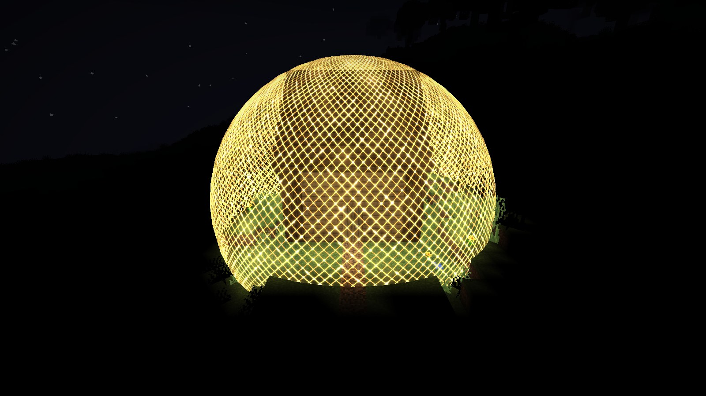
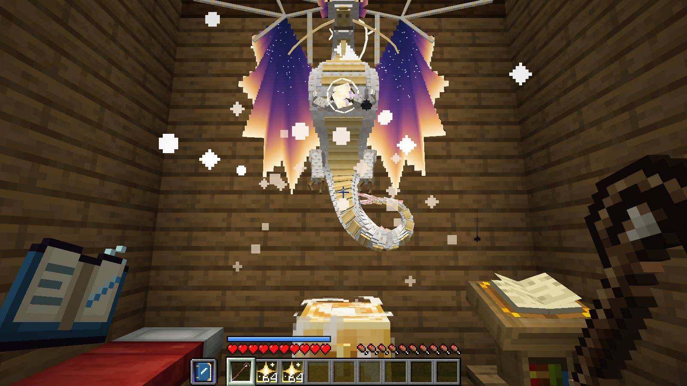
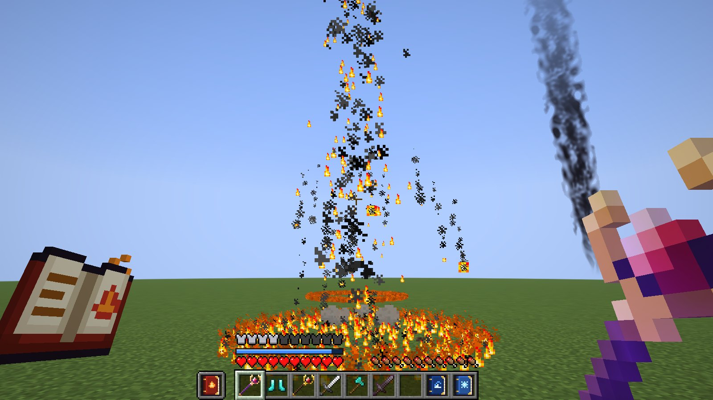
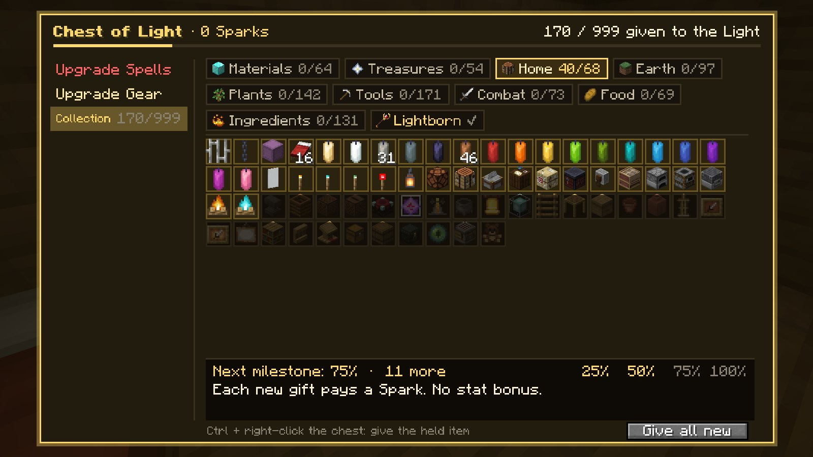

# Lightborn

A Minecraft Java mod for **Minecraft 26.3 on Fabric** that turns survival into *Path of Exile 2, in Minecraft*:
nearly 90 spells in twelve schools, each with three tiers of upgrades; bosses and new monster kinds; loot worth
chasing; a Chest of Light that is both your home's ward and a collection book; and a chained Light Dragon with a story
of his own.

| | |
|---|---|
|  |  |
|  |  |

## What it plays like

- **Spells, not levels.** You cast from tomes held in the off hand or slotted into a Spellstone. Tomes drop from
  monsters, chests and bosses, awaken after a hundred kills, and take upgrades you buy with Sparks, the mod's one
  currency. There are no player levels: your power is your gear and your spells.
- **Home is a ward.** The Chest of Light raises a golden dome around your home. Inside it is safe; outside, at night,
  the dark hunts you. Feed the chest the Dark Shards you find and it calls a Cleanse, the big fight of the game, on
  your terms.
- **Nights run on the moon.** An eight-night moon cycle brings quiet nights, then scouts, hordes and Dark Phantoms
  that hunt by ear. Monsters come in distinct natural kinds with their own skins, sounds and tricks, and the bosses
  come looking for you.
- **Collect everything.** The Chest of Light keeps a collection of every item, monster spirit and trophy you find,
  with set bonuses, a daily shop and a travel map.
- **The Dragon.** A Light Dragon lies chained under the world. He visits at night, talks, sends you on errands and
  quests, and his tale ends in a choice.

## Install and play

1. Install **Minecraft Java 26.3** with **Fabric Loader 0.20.1** or newer and **Fabric API**, on **Java 25**.
2. Download the newest `lightborn-*.jar` from this repository's [Releases](../../releases) and put it in your `mods` folder.
3. Optional, the way it is meant to be played: the companion mods in [Companion mods](#17-companion-mods) (pinned in
   `tools/companion-mods.lock.json`). Lightborn runs without them.
4. Start a **new world**. Every world is locked to Normal difficulty.

Lightborn is server-authoritative, so a multiplayer server needs it too, and so does every player.

## Build from source

- **Plain build:** with JDK 25, `./gradlew build` (or `gradlew.bat build` on Windows) leaves the jar in `build/libs`.
- **Build and test (Windows, PowerShell):** `tools\build.ps1` formats the code (Spotless, Palantir style), builds,
  and runs the headless self-test, which must print `LIGHTBORN SELFTEST PASS`. `-Visual` also runs the client tests
  in a real game window and saves screenshots; `-Only <scene>` runs only the named client scenes.
- **Companion mods:** `py -3.14 -I tools/companion_mods.py fetch` downloads the pinned companion jars, checking each
  file's hash.
- **Art:** the textures are generated by the Python scripts in `tools/` (`make_*.py`); `design-references/` keeps
  earlier versions worth returning to.

| Folder | What is in it |
|---|---|
| `src/main/java/lightborn` | The game: spells (one class per school: `FireSpells`, `FrostSpells` and so on), monsters, bosses, the Chest of Light, the Dragon, loot, and the self-tests |
| `src/client/java/lightborn/client` | Everything drawn on screen: renderers, the HUD, the chest's tabs, screen effects |
| `src/gametest` | The client game tests and their screenshot scenes |
| `src/main/resources` | Textures, models, sounds, language file, recipes and the mod's data packs |
| `tools` | Build, test and deploy scripts, the companion-mod lock, and the texture generators |

## The design document

Everything below is the full design of the game, in the order a playthrough meets it: every rule is a standing decision, and changing the game means
changing it here first. Dates in brackets, such as "(owner, 2026-11-18)", mark when the author made or changed a
decision; they explain why a rule is the way it is.

**Game:** Minecraft Java 26.3 + Fabric Loader 0.20.1 + Fabric API. Sodium (beta) rides along for frame rate.
Server-authoritative throughout, so co-op later only needs both players to have the mod. Core tuning lives in
`Balance.java`; spell values are in `Spell.java`, set bonuses in `Collection.java`, daily wares and prices in
`LightShop.java`.

**Contents:** [1. Vision](#1-vision-three-equal-thirds) ·
[2. First night](#2-spawn-hut-and-first-night) ·
[3. The Chest of Light](#3-the-chest-of-light) ·
[4. Sparks and gear](#4-sparks-and-gear-no-levels) ·
[5. Spells](#5-spells-and-tomes) ·
[6. Spell upgrades](#6-spell-upgrades) ·
[7. Loot](#7-loot) ·
[8. Monsters](#8-monsters) ·
[9. Moon nights and the Cleanse](#9-moon-nights-and-the-cleanse) ·
[10. Bosses](#10-bosses) ·
[11. The Light Dragon](#11-the-light-dragon) ·
[12. The Dragon's Tale](#12-the-dragons-tale) ·
[13. Food, sleep and home](#13-food-sleep-and-home) ·
[14. Atmosphere](#14-atmosphere-and-music) ·
[15. The Dark](#15-the-dark) ·
[16. The Hollow](#16-the-hollow) ·
[17. Companion mods](#17-companion-mods) ·
[18. Build and test](#18-build-and-test) ·
[19. To do](#19-to-do)

## 1. Vision: three equal thirds

1. **Path of Exile 2, in Minecraft.** Tons of fun spells and their upgrades, bosses, new monsters and variants, loot worth
   chasing. Breadth of content, never rolled monster modifiers or floating name banners: monster variety comes from
   distinct natural kinds, their traits, skins and sounds. Boss names and boss bars stay meaningful.
2. **Collection and exploration.** "Gotta catch 'em all", Pokemon style, for everything: the Chest of Light is the
   heart of it, and every other system should hand it something new to collect.
3. **A cozy yet dangerous world.** The Minecraft everyone loves (farming, home building, preparation) with something
   that is out to get you. The gripe with vanilla: nothing hunts you, zombies stop mattering at an iron sword, and no
   boss ever comes looking. Never hardcore survival.

**How the third is balanced (the rule every danger feature is judged by): danger has a place and a time, and both
are visible.** Place: home, inside the Chest of Light's ward, is safe. Time: night is the danger and the moon its clock:
quiet nights, then scouts as it wanes. The biggest fight is called on purpose: dark shards fed to the chest bring the
Cleanse. The player always knows what is coming, prepares in the calm (walls, food, sleep, gear), and chooses when to
call the dark. Enemies and bosses
must sometimes seek the player. Cozy work must feed the fight (a furnished home and a varied farm make you stronger)
and the fight must feed the cozy (Cleanses pay for enchants, collection and a bigger ward). Dying costs progress, never
the player's things or builds.

**World rules.** Every world is locked to Normal: at creation, in settings and through difficulty commands; Hardcore
cannot override it. Ordinary Minecraft ambient spawning stays, with about 50% more monsters at night
([Monsters](#8-monsters)). The every-night zombie rush is replaced by the eight-night moon cycle of scouts
([Moon nights](#9-moon-nights-and-the-cleanse)).

**No runes.** Runes do not exist in Lightborn, in words or in art (owner, 2026-11-18: the mod was renamed from Runeborn, and the
story, item marks and particles lost their runes). The old support runes (Haste, Thrift, Endurance, Ruin, Echo, Blood)
were removed (owner, 2026-11-15) with their items, recipes and drops: a tome improves only through its
[spell upgrades](#6-spell-upgrades) and awakening. No effect uses the enchanting table's glyph particles.

## 2. Spawn hut and first night

Every fresh world gets a plain spruce room at spawn: 7 by 7 outside, 5 by 5 inside and five blocks high, so the
full-size Dragon fits over his chest, with solid walls and log corners, a dark-oak gable roof overhanging the front
and back by a block (its gable ends stop flush with the side walls, so it stays inside the starting ward; owner,
2026-11-17) and a south door. It contains the bed, the lectern with the Dragon's guide, and the Chest of Light against
the back wall at its centre, with the bed to its left and lectern to its right, facing into the room. New players
arrive in the middle of the room, facing the chest. There is no wooden chest, crafting table, furnace or bookshelf.
The coarse-dirt front path stays; there is no campfire or log seats.

First-time players receive, once, an unrolled, attribute-free **Simple Staff** equipped in the main hand (no
spell-power implicit, affixes or leech: it only enables casting; drawn as a real wooden walking staff with a crook head
and a wrapped grip, owner 2026-11-15), a **Spellstone** in the off hand holding the **Bolt tome** (right-click) and
**one random Basic tome** beside it (owner, 2026-11-23; never one only given), then **Homeward** and **Ender
Pocket** (owner, 2026-11-23); the Book of Souls is found, and **5 apples**, no torches (owner, 2026-11-23). No wooden tools, loose guide book or pumpkins.

**The Dragon's guide** (the lectern book, The Dragon's Notes) is **never longer than 3 pages and holds only the
story** (owner, 2026-11-18: no page of hints; `SelfTestWorld` and the `guide` visual scene check the length). It is a
letter in the Dragon's own voice (owner, 2026-11-18: rewritten from scratch):

1. Who he is: the Dragon under this world, chained long ago beneath the stone; where his light can't reach, the dark
   gathers, a little more every night.
2. What the dark does: it stirs the dead and swells some of them, and they hunt whatever carries light. A little of
   his light runs in the player.
3. The chest is his hearth and its ward keeps the night off the home, so build inside it. He can't leave the stone;
   the player can. Stay near the chest tonight and he will visit. Signed by the Dragon.

The letter never tells what his chapters reveal later (why he was chained, his blood, the Keepers, Orvane). Every page
fits the book's 14 lines at GUI width.

## 3. The Chest of Light

The hub of the game: collection, storage, spell upgrades, the Cleanse, shop and travel. **A chest made of flowing
light** (owner, 2026-11-16; motes of light; its own block light is 10, so it dies at the smallest ward's wall and the client glow lights the inside): every face is an animated, interpolated strip from
`tools/make_textures.py` (`light_chest()`, which also writes the block model). Currents of white light stream up an
amber body, two bright pulses run round the gilt rim and along the lid seam, the small suns on the sides and the lid's sun breathe,
and the lid washes rings of light outward. Over the body sits a translucent shell: wisps of light rising up the sides
and three spiral arms turning on the lid (26.x puts a sprite with translucent pixels in the translucent layer by
itself, so no render-layer code exists). A broad outer light ring is supplemented with high room fill and symmetrical doorway
fill. Only chest-owned sources are removed when it moves; temporary spell lights and player-placed blocks are
preserved. Fixed source positions are reconciled with the ward, without scanning the world.

**It is unique for now.** One chest stands at the back centre of the spawn hut. It has no crafting recipe and no
shop, quest or loot source. **It cannot be broken, pushed or blown up** (owner, 2026-11-15; strength -1 like
bedrock, immovable): a home moves whole, from the Travel tab ([Move Your Home](#move-your-home)). It cannot be donated to itself, so
completion never asks the player to give away the only hub.

**Opening and giving.** A plain right-click opens its book. **Ctrl + right-click** with an item gives one of it (the
client reads Ctrl and asks the server); an ordinary click never donates by accident. Both live in the Collection
tab's footer (owner, 2026-11-17: moved out of the tab column, smaller): a small Give all new button at its right and,
beside it, one dim line scaled to fit: Ctrl + right-click the chest: give the held item.

**One Sparks count** (owner, 2026-11-16): the chest's title bar shows the player's Sparks (carried plus stored) once,
beside "Chest of Light", for every tab. No tab shows its own count.

**Tabs.** Up to seven tabs in a column 90 px wide (owner, 2026-11-17: 40% slimmer), in this order: **Upgrade Spells (red), Upgrade Gear (pale gold, [Light gear](#light-gear-the-dragons-gifts)),
Cleanse (violet), Shop (blue), Travel (green), Spirits (purple), Collection (gold)**. **Four appear only as the game
reaches them** (owner, 2026-11-18; `ChestTabs`, counts saved on the player and synced to them): the **Shop** after
surviving one night (in the Overworld at nightfall and alive at dawn; joining mid-night or dying starts the watch
over), the **Cleanse** after beating one Dark Fountain, **Travel** after beating eight, **Spirits** once the Book of
Souls has been carried (loose or in a Spellstone). The server refuses a hidden tab's actions too. Creative players see
all seven. A chest opens on the Shop once it is there, else on the Collection. Each tab is its own class
(`CollectionScreen` keeps the frame, column and scrollbar; `UpgradeTab`, `CleanseTab`, `ShopTab`, `TravelTab`,
`SpiritsTab`, `CollectionTab`, `UnlockedWindow`).
**Upgrade Spells sees the tomes inside a carried Spellstone** (owner, 2026-11-18), each in its stone's place in the
strip on a violet rim, and upgrades them where they sit (`Spellstone.tomeAt`). **Upgrade Gear groups its strip by
kind** (owner, 2026-11-18: the staffs lay scattered): helms, chests, leggings, boots and so on together, each kind in
carried order. **Double-clicking an item in the Collection takes what the chest keeps of it** into the bag (owner,
2026-11-18). **An item no hand can make says where it is found** in the recipe's place (owner, 2026-11-18): a Lightborn
item where the mod hands it out (dropped by monsters, by a named boss, a gift from the Dragon), anything else read from
the loot tables, the mods' included: which monsters drop it, which blocks it is mined from, which chests hold it,
fishing, bartering, brushing (`Sources`). **A button's label always fits it**: buttons widen to their text (owner,
2026-11-18: "Upgrade ward · 20 Sparks" was cut), and the visual test fails on any cut label. **Collection is a mega tab**
(owner, 2026-11-17): the ten sets are chips along the top of its page (icon, name, count or ✔; the open one lit
gold), drawn at 92% size (owner, 2026-11-17: 40% bigger, then 10% more) and wrapping onto a second row when narrow, with the set's item grid below; it opens on the
set seen last and shows the given-of-all count in the tab list. The grid's rows take all the height down to the
panel under it: that panel sits on the footer, half height for a set's milestones (the next milestone with the four
quarter marks on its line, then what it gives) and the same height for an opened item (owner, 2026-11-17: they must
match): its icon, name, given or not with the count kept, the Take 1 / Take all / Put in buttons under them, and the
recipe in small 13 px slots at the right with its kind and pager beside it. The grid's scrollbar can be dragged with
the mouse as well as wheeled, and so can the Spirits list's, which scrolls when its kinds do not fit above the picked
spirit's lines and buttons (owner, 2026-11-17: the Claim button hung over the frame). The visual test opens every tab
at 1920 x 1080, GUI scale 4, and fails if any button crosses the chest's frame or any label runs past its button. The Dragon Quest tab is gone (owner, 2026-11-15): the Dragon
tells his story in his talks. There is no Overview. Selected and hovered tab backgrounds use their
tab's colour. The seven tabs fit in one column at any window size (16 px, down to 12 on a short window). Spirits shows how many earned spirits wait to be claimed. Its page lists the book's slots (a placed spirit's chip
spans the slots it takes; slots filled out of slots owned), every kind in two columns (placed ◆, rank, or "claim"),
and the picked kind's rank, slots taken, bonus and buttons: Claim, Rank up (with its price), Place in book / Take out,
and Buy a slot. **A kind not yet slain shows as "???"** (owner, 2026-11-16: no spoilers) until the first kill.

### The ward

Each Chest of Light wards **9 blocks** in its dimension (owner, 2026-11-16: half the old 18). It grows only when its
owner pays: the Shop tab's ward card's **Upgrade ward** button buys the next of five sizes, 9 → 13 → 18 → 26 → 36 → 48, for 20, 40,
80, 150 and 250 Sparks. Gifts no longer grow it. The step bought is the player's and survives death. Overlapping wards cooperate, so the largest covering a position
protects it. Owner and radius save with the world, including when the owner is offline. The spawn hut's chest counts.
Moving a home carries its ward and owner with it.

**No night drag** (owner, 2026-11-23): the old deep-water night (slower walking, lower jumps, slow falls, and the
camera zoom the slowdown caused) is gone for good; never bring it back. The Ward spell's dome counts as a ward for
the threshold's dark rain: inside it at night no drops run down the screen (`WardThreshold`).

**The monsters hear you at night** (owner, 2026-11-19: dramatically, even inside the ward). Every two seconds, from
dusk to dawn in the Overworld, each monster within 48 blocks of a survival player with nothing to chase turns on that
player through walls, and its follow range grows by 48 so it keeps coming; a player inside a ward is heard too, so the
dark gathers at its edge. Neutral kinds (endermen, piglins), frozen monsters and creative or spectator players are left
out (`NightHearing`).

**The Dragon-friend ending lifts the night's weight** (owner, 2026-11-19): the moon's chains break with his, nights are
lit as in an ordinary game (no darker skylight), and the monsters' far hearing ends. Night monsters,
hordes and the Cleanse go on. The world's ending is synced to clients (`DragonStory.ENDING`, `nightLifted`).

**The lighthouse** (owner, 2026-11-16; 2026-11-23: day and night). At any hour, more than 128 blocks (horizontally) from home, a faint gold pillar
stands on the horizon where the player's nearest own ward is: a slim beam over the chest's column, brightest at its
foot and gone 320 blocks up, with light drifting slowly up it, fading in over the first 64 blocks past the threshold.
Home is usually beyond the render distance, so the pillar stands on the true bearing at seven tenths of it, the same
apparent width at any range, and by day it burns 1.6 times brighter so it reads against the sky. Only its owner sees it (`Lighthouse`, synced per player; `LighthouseView`).

- **A wall.** A self-lit golden dome of light marks the exact ward radius (owner, 2026-11-15: tight enough to feel
  safe inside, and alive). A dense criss-cross lattice, gaps under a block wide at any radius, of fine deep-gold core
  lines (alpha cutout, writing depth, so a cloud behind the ward cannot wash out its colour; terrain and genuinely
  nearer clouds still occlude it) inside a soft glowing halo that brightens where the eye grazes the wall. Comets of
  light stream up both line families toward the crown, two slow veils of warm shimmer drift against each other between
  the lines, every crossing twinkles on its own rhythm, and every eight seconds a heartbeat ring of light rises from
  the sphere's lowest point to the crown, lifting every layer it passes; the whole dome breathes gently. Light flows
  through the lower half below ground as well as the upper (owner, 2026-11-16). **Drawn on the GPU, with no flicker**
  (owner, 2026-11-18: it still flickered and cost frames): one fixed 48 x 24 sphere mesh and two passes of
  `shaders/core/ward.vsh/.fsh`, the core lines (opaque, writing depth) and the soft light (premultiplied, no depth
  write), every effect worked out per pixel from the game clock. Every line, comet and star is filtered to the pixel it
  lands in: widened by the pixel's footprint and dimmed to match, never thinner than a pixel, settling into its even
  glow far off. The flicker was the old lattice textures, which had no smaller copies for distance, crawling as the
  camera moved. Both passes land on identical depth (an invariant position), so their tie resolves the same way
  every frame. The CPU only copies the mesh (no per-point maths, no sorting). No cross, plus-sign or rune ornaments.
  Only the veil is still a texture (`tools/make_ward_texture.py`); the previous, sparser lattice is kept in
  `design-references/ward-classic/`. Hostile mobs cannot walk, fly, leap or
  teleport across it, bosses included, except during that chest's [Cleanse](#the-cleanse). **They slide along it,
  never stick to it** (owner, 2026-11-23: monsters froze where they touched it and hung on its upper half): only the
  part of a move that pushes in is taken away, so they walk round it and fall down it. **A monster that has pressed
  at the wall for 3 s after someone inside gives them up and prowls** a quarter turn or so round it, 3 to 7 blocks
  out, for 8 to 12 s, unable to take anyone inside as a target; then the night's hearing turns it back and it comes
  again (`LightWards.prowl`). Animals that are angry, aggressive or pursuing a target
  (Naturalist bears included) are blocked the same way; calm animals can enter again. Hostile natural spawns are
  prevented inside; a hostile creature already inside when a chest is placed is moved to clear ground outside.
  Players, friendly tamed pets, calm farm animals, friendly Dragon echoes, summons and thralls pass
  freely. One cached mesh/render anchor per loaded chest avoids particle swarms.
- **Torchlit inside, black outside** (owner, 2026-11-16: "bright inside, glow by shader"). Every block and creature
  inside the dome's sphere reads as light 14 on each client (`WardGlow`), with an exact edge at the wall, so the night
  beyond stays black and a small ward is as bright as a big one. A mixin on the client world's block `LightEngine`
  answers both read paths: `getLightValue` (vanilla terrain and every entity) and `getDataLayerData` (Sodium copies
  whole section layers). The sections around a ward rebuild when it appears, moves or grows. The server still keeps
  its dim fill lights (level = blocks left to the wall), which also stop natural spawns; only their look is replaced.
- **The threshold** (owner, 2026-11-15; 2026-11-16: five times longer, both ways, day and night): crossing the dome
  is never seamless. Walking out, its light holds you like warm syrup for **5 seconds** (sprinting tears it twice as
  fast, owner 2026-11-16) (you barely advance while gold
  creeps in from the screen's edges), then it tears and you break free. Walking in meets the same membrane for the
  same time. **Walking in, the ward pulls you in** (owner, 2026-11-23: from a mine shaft below, its wall held you
  off the stairs): touching the membrane from outside flashes gold and draws you toward its centre. At night,
  outside, a slow heartbeat sounds (no darkened screen and no red pulse: owner, 2026-11-23), and
  dark rain runs down the screen (owner, 2026-11-17: dark raindrops, not small dots): near-black beads that streak
  downward, a new one about every two thirds of a second, at most seven (owner, 2026-11-23: half). Coming home at
  night plays a
  soft chime. Client-side (`WardThreshold`); other dimensions, spectators, creative flight and riding are left alone.
- **A sanctuary, not a firing position** (outside a Cleanse). Players inside cannot harm hostile creatures with melee, arrows, spells,
  reflected hits or attacks by their pets and summons. Projectiles keep their inside-ward launch origin, so stepping
  out after firing does not bypass it. Damaging spells refuse without spending mana. Step outside to
  fight. Damage prevention is server-authoritative.
- **Protection.** Hostile damage to creatures inside is rejected (the same hostility rule as the wall), and hostile
  projectiles are intercepted at the boundary. Monster explosions skip protected positions when destroying blocks or
  starting fires, including blasts from outside. Player-placed TNT keeps its ordinary block interaction.

### Collection

"Collect them all", for the Light. The chest is also storage: it keeps up to one stack of every catalogue item (a
later copy only adds to that stack, same variant only), per player like an ender chest. The book has a tab per set
with its reward, given items lit and the rest dimmed, the count kept shown on each, in a scrolling grid. Clicking an
item opens it below the grid: Take 1, Take all (back into the inventory, dropped at your feet when full), Put in
(every carried copy up to the stack), and how it is made, sent by the server from the recipe manager: crafting
(shaped or any order), furnace / smoker / blast furnace / campfire, stonecutter, smithing, up to 8 ways with page
arrows, tag ingredients cycling each second. Taking an item out, or breaking the chest, never un-gives it.

**The catalogue must feel like collecting Minecraft, not collecting other mods.** It is curated from the original
creative-tab ownership, so rejected block variants cannot slip back in through a second tab. **Never more than 999
collectible items and exactly 10 collection sets, each named in one word**: check every addition, and get a new
owner decision before exceeding either. Operator/technical items, spawn eggs and the Chest of Light itself are
excluded. It has **937 items in ten sets** (measured by the self-test after the restore): Materials 43, Treasures 54, Home 61, Earth 99, Plants 142, Tools 166, Combat 73, Food 69, Ingredients 131 and Lightborn 99. Counts
vary with the installed pack.

**The ten sets**, in tab order: **Materials, Treasures, Home, Earth, Plants, Tools, Combat, Food, Ingredients,
Lightborn.** Earth and Plants split the Natural Blocks creative tab: logs, leaves, saplings, flowers, crops, seeds,
mushrooms, vines, coral, moss, cacti, bamboo, pumpkins, melons and other growing things are Plants; stone, ores,
dirt, sand, gravel, ice, terrain and the rest are Earth (grass block and nylium count as Earth).

**Retired groups.** Building Blocks, Colored Blocks, Redstone Blocks and Functional Blocks are not collection
sets: their items are boring to collect, too niche, or merely variants of one item. Do not refill the catalogue with
those decorative or technical families. Stairs, slabs, walls, waxed/oxidized copper variants, colour variants and
damaged/chipped anvils stay out. The excluded items still exist in Minecraft; they are only not collectible. A few
named survivors come back from them (owner's picks): **bricks, glass, quartz pillar, end stone / nether / red nether /
mud / resin bricks and the 16 glazed terracottas** (Materials), **TNT** (Combat), **rail, lever, piston, sticky piston,
slime block and honey block** (Tools), and **one red bed, one white banner, one plain shulker box, lantern, barrel,
iron chain, iron bars, one oak shelf, armour stand and end crystal** (Home). Three hand-picked sets:

- **Materials**: mineral storage blocks (coal, iron/raw iron, copper/raw copper, gold/raw gold, redstone, lapis,
  emerald, diamond, netherite, amethyst and quartz), redstone dust, end stone, every plain plank type, full
  sandstone/red-sandstone variants, prismarine, dark prismarine and prismarine bricks, bricks, glass, quartz
  pillar, end stone / nether / red nether / mud / resin bricks and the 16 glazed terracottas.
- **Treasures**: mob skulls and heads (Lightborn's boss heads stay in Lightborn), Mutant Monsters' non-wearable drops,
  dedicated enemy loot (bone, rotten flesh, spider eye, string, gunpowder, arrow, ender pearl, blaze rod, breeze
  rod, magma cream, slime ball, ghast tear, prismarine shard and crystals, sponge, wet sponge, shulker shell, phantom
  membrane, nautilus shell, nether star, totem of undying, dragon's breath), and rare finds: echo shard, heart of the
  sea, trial key, ominous trial key, ominous bottle, heavy core, disc fragment, goat horn, dragon egg, rabbit's foot,
  armadillo and turtle scutes, ink sac and glow ink sac.
- **Home**: every candle and torch; crafting table, stonecutter, furnace, blast furnace, smoker,
  smithing/cartography/fletching tables, loom, grindstone, enchanting table, brewing stand and crafter; redstone lamp,
  bell, bear plush, eye of ender, ender chest, chest, red bed, white banner, shulker box, lantern, barrel, iron chain,
  iron bars, oak shelf, armour stand, end crystal, lectern, bookshelf,
  painting, item/glow item frame, flower/decorated pot, beehive, scaffolding, ladder, beacon, cauldron, jukebox, note
  block, composter, the healthy anvil (one collectible), campfire and soul campfire.

Ordinary food and equipment keep their useful subject groups.

**Gifts.** A new gift's tooltip says "New for the Light" in gold, in inventories and other item views. Give all new
deposits one of each new carried item that fits, through the same rules as single gifts, then opens an **Unlocked**
window over the book listing everything just given (scrolling when long) until it is closed. Donation feedback shows the
affected subgroup's x/x rather than the global total; bulk gifts report each group they changed. Every first gift pays one Spark. Repeated deposits and withdrawals never pay again.

**Set bonuses.** Stat-bearing sets pay at each 25%. Bonuses are whole numbers, except life regeneration at 0.2/s per
quarter, shown with one decimal.

| Set | Each 25% | Full-set reward |
|---|---|---|
| Materials | Collection progress only | No stat bonus |
| Treasures | +5% Cooldown Speed | +20% Cooldown Speed |
| Home | Collection progress only | No stat bonus |
| Earth | +1 Max Health | +4 Max Health |
| Plants | +5% Item Rarity | +20% Item Rarity |
| Tools | +10% Mining Speed | +40% Mining Speed |
| Combat | +10% Attack Damage | +40% Attack Damage |
| Food | +0.2/s Life Regeneration | +0.8/s Life Regeneration |
| Ingredients | +20% Spell Damage | +80% Spell Damage |
| Lightborn | +20 Max Mana | +80 Max Mana |

The reward panel shows the next unearned quarter, its actual added bonus and the cumulative total after it, rather
than merely the full-set prize. There is no generic footer help text.

### The Light

Completing all ten sets makes the player the Light, with no extra stat prize. A level-15 vanilla Light block
follows their head, with the chest's motes around them. It preserves the original air or water, shares a source when
completed players overlap, and removes the source when the player dies, logs out or changes dimension. Cleanup data
save in the same chunk as the temporary block, and stale sources clear when their chunk loads. Other blocks the player
places over a source are preserved.

The completion grants the Dragon's closing words, The Light, with wording for the world's ending, and a title once.
The earned light remains yours when later catalogue changes add more items. There is no Bestiary: no Lightborn
advancement tab, family entries or automatic kill unlocks.

### Sparks

**Sparks** (`lightborn:spark`, a four-rayed gold glint) are the Light's own currency, the small change of his light.
The shop takes nothing else. **Villagers and wandering traders deal in Sparks too** (owner, 2026-11-17): every
emerald a trade asks or pays is the same number of Sparks, so selling to a villager earns Sparks and buying from one
spends them (`VillagerSparksMixin`, rewriting offers as they are read, so old villagers change over as well). A Spark is itself a collectible Lightborn item. Sources (amounts in `Balance.java`):

| Source | Sparks |
|---|---|
| The Dragon's Big Quest, once | 8 (Neutral and Guarded quests add 12 more) |
| A nightly errand | 3 |
| A gift's return gift (sometimes) | 2 |
| First gift of each kind to the collection | 1 |
| Any boss / a named boss | 3 / 8 |
| Clearing a Cleanse | 2 per cache item (8 to 26) |
| Surviving a Cleanse to dawn | 3 |
| A dawn refugee with no place left to show | 8 |
| Breaking a Dark Fountain | 7 to 25, rising with its stage |
| Catching a Light Butterfly | 1; 2 one time in four; 3 one time in eight |
| Monster kills not from a spawner | By the monster's tier: 1; 2-3; 5; 10; 25 (owner, 2026-11-20) |

Sparks kept in the Chest of Light's storage count everywhere the chest spends them, and are spent before the
carried ones. Sparks buy the daily shop's wares, spell upgrade tiers (10 / 25 / 50), spirit ranks (10 / 20 / 40 /
80), the book's third to fifth slots (20 / 40 / 100), the ward's five steps (20 / 40 / 80 / 150 / 250) and moving
home (25).

### Light Butterflies

**Light Butterflies** (owner, 2026-11-23: "add light butterflies; hitting them gives 1 (always at least) to 3 (rare)
sparks"; day and night; `LightButterfly`). Small butterflies of living light: two gold-and-white wings with teal rims
and eyespots, hinged on a dark body and beating fast, drawn full-bright so they glow by day and night, trailing tiny
motes (`tools/make_butterfly.py`, `LightButterflyRenderer`). Each minute one appears 12 to 28 blocks off over open
ground near each player in the Overworld, while none is within 48 (owner, 2026-11-23: "make it 1 each minute").
It drifts 1 to 4 blocks over the ground and darts away from anyone within 5. **One blow from a player catches it**: it
bursts into light with a chime and leaves 1 Spark, 2 one time in four, 3 one time in eight, and nothing else. It
fades on its own after 3 minutes.

### Light's daily shop

The blue Shop tab sells six offers for Sparks in three rows, read left to right: **one tome, one rolled staff, one
drop (amethyst shards or Dark Shards), one exotic item, a map to a notable structure, then one exotic food** (owner,
2026-11-16: the armour piece and the second exotic item are gone). The fourth row is the **ward card**: the ward's
size, the next size and price, a pip per size bought, and the Upgrade ward button. The
food is always raw, never cooked, unless it only exists cooked (golden foods). Each Buy button spans its card and carries the price ("Buy · 12 Sparks", "Take · Free"); the ward card's
button reads "Upgrade ward · 40 Sparks", and its line reads "Next: 18 blocks" (owner, 2026-11-17: no step count). The Buy
text is blue. The world seed and Minecraft day determine the roster. It refreshes at dawn; the tab's one line of text says
"New wares every dawn" (owner, 2026-11-16: no title, week, countdown or Spark count). Every card prefixes its name with the bundle quantity. The price pays for
that entire bundle, not one item from it. There are no stock limits or sold-out states; repeat purchases need payment
and inventory room each time. **Nothing is level-gated** (owner, 2026-11-16): every ware sells to anyone with the
Sparks. The server validates the chest, distance, day, offer, price and capacity before
transferring anything.

Shop wares grow with world age every seven Minecraft days (the world's age, not the player's: anyone can buy them).
The staff's material is capped by the ore the buyer has mined, the same rule as dropped gear ([Loot](#7-loot);
owner, 2026-11-17): before the first diamond ore a week-3 staff comes in iron, before the first ancient debris a
week-4 staff in diamond. Iron is the floor, since week 1 sells an iron staff to everyone. The rarity and the price
stay the week's, and the capped staff rolls from its own seed, so the other wares never shift:

| Week | Staff | Tome tiers (band, `Spell.shopTier`) | Drop slot |
|---|---|---|---|
| 1 | Unrolled Apprentice, +15% Spell Power, no affixes/specialist | tier 1 (1) | 8 amethyst shards |
| 2 | Uncommon Iron | tier 2 (5) | Dark Shard |
| 3 | Uncommon Diamond | tier 3 (10) | Dark Shard |
| 4 | Rare Netherite | tiers 4 and 5 (15, 20) | Larger Dark Shard bundles |
| 5 | Legendary Netherite | tiers 3 to 5 (10 to 20) | Larger Dark Shard bundles |
| 6 onward | Legendary Netherite | tiers 3 to 5 (10 to 20) | Up to 4 Dark Shards |

Netherite is the top tier (owner, 2026-11-16), so from week 5 the staff stops climbing in material and is Legendary
instead; its price stays at week 5's.

The map leads to the nearest such place nobody has mapped yet: a Woodland Mansion, Ocean Monument, Trial Chambers,
Ancient City, Jungle Temple, Witch Hut, Desert Pyramid or Buried Treasure. The exotic item slot rotates daily through
vanilla curios (Nature's Compass is removed, owner, 2026-11-16). Free in that slot: a lost Light Key while a chosen fight with the Dragon is still unwon (it is the way back into his prison), and a lost Light gift once he has fallen (the Dragon is gone and cannot replace it).

### Move Your Home

The Travel tab's first section (owner, 2026-11-15). For a flat **25 Sparks** (owner, 2026-11-16) the Light lifts everything inside the
ward (house, farm, animals, and the people standing in it) and sets it down at **completely random coordinates** in
the Overworld: at least 2,000 blocks away and at most 1,000,000 out (beyond that the game's own rendering starts to
shake), inside the world border, **on any land at all** (owner, 2026-11-17: really lax): mountain, swamp, river bank
or odd biome, any height and slope; only a spot whose middle or most of whose footprint lies under water, or an ocean,
is refused. The plug brings its own ground, so where the land falls away it hangs over it, and **anything in the way is
erased**: everything over the plug's top inside the ward's circle goes. **The old home's Dark Fountains end** (each core
crumbles and its land heals once its chunk loads, `nest_ceased`) and **ten new ones rise round the new place** as for
a new home. The Travel tab says so. The site search samples terrain heights from the generator without building chunks; the
chunks at the far end are force-loaded and the move waits for them, so a far, ungenerated site never freezes the
server. Paying is instant and loud (owner, 2026-11-16: the purchase must obviously go through): the book closes, a
chime and an amethyst ring play, a chat line says "-25 Sparks. The Light is lifting your home…", motes burst and a
lifting overlay with a low beacon hum repeats while the site search runs (a few candidates a tick); if no site turns
up the Sparks come back. The landing is a double **dadoom**: a mace thud, then a heavy mace slam with an explosion
and an anvil's clang, under a burst of cloud. No title card.

The move is a plug: every block in a cylinder of the ward's radius, from 4 blocks below the chest up to the dome's top,
block entities and contents included, nothing dropped. The old site is closed with dirt and a grass top where the
ground was. Ward ownership, its glow and dragons follow; creatures and players inside arrive in
the same places with Slow Falling. The world spawn moves when the home is the spawn hut, and online players' respawn
points inside move with it (an offline player's bed inside a moved home keeps its old respawn point). Only the
chest's owner may move it, only in the Overworld, never during a Cleanse or a Dragon flight. The button needs two
clicks.

### Travel: Fly by Dragon

The world reaches 6,000 blocks and no 26.3 travel mod fits, so the Travel tab calls the Light Dragon to fly the player
**from the chest to a notable structure** (owner, 2026-11-16). Ten sites, two columns of buttons, each
priced per trip and paid at boarding (when he picks the player up), with a chat line. **Each Cleanse won opens one
more destination**, easiest to find first (owner, 2026-11-17; `ChestTravel.cleansesFor`, counted from
`HUNTS_CLEARED`): a locked button is greyed with a padlock drawn on its right, reads the Cleanses it needs, and its
tooltip says how many the player has won; the server refuses a locked flight. Every label fits its button: the price
shortens to "30✦", then the name stands alone.

| Site | Sparks | Opens after |
|---|---|---|
| Village | 8 | 1 Cleanse |
| Witch Hut, Igloo | 10 | 2, 3 |
| Desert Pyramid, Jungle Temple, Pillager Outpost | 12 | 4, 5, 6 |
| Trial Chambers | 20 | 7 |
| Woodland Mansion, Ancient City | 30 | 8, 9 |
| Scale's Fortress (from chapter 6) | 40 | 10 |

**From chapter 8 the Ancient City button flies to the prison city** the Dragon's Scale points at (its gate, else the
city), not the nearest unexplored one. **Scale's Fortress** flies into the Nether, to the fortress the Scale points
at (`DragonStory.scaleFortress`; refused before chapter 6): the flight climbs into the cloud veil as a long trip does,
and deep in the veil the Dragon dives through and sets the rider down on the fortress's nether-brick bridges or halls
(the nearest within 32 blocks, else any safe pocket there; the Nether's roof makes the surface search useless).

He takes the player to **the nearest one not yet explored** (`findNearestMapStructure`, the same search explorer
maps use), and lands on safe standing ground beside it (a spiral search within 24 blocks; underground sites such as
Trial Chambers and the Ancient City land on the surface above, which their buttons' tooltips say). A button is
active only with the price in hand. Flights start from the Overworld only. Each site is a structure tag,
`data/lightborn/tags/worldgen/structure/travel/<id>.json`.

Choosing a site calls him: he swoops down to the chest (about 3 seconds, cancelled if the player takes damage),
picks the player up in his claws and **flies them there over the real terrain**, then sets them down beside the
site and leaves. For a flight he appears by day too. He flies at about 30 blocks a second
(elytra-with-rockets speed, which the game and Sodium already handle) about 40 blocks above the ground; the camera
follows from behind; the rider cannot take damage, use or drop items, or dismount. A trip longer than about 20
seconds climbs above the clouds after take-off, crosses the middle under a bright cloud veil and descends for the
final stretch, so no flight lasts more than about 30 seconds and the server never generates a 6,000-block corridor of
new chunks.

A flight costs its Sparks and nothing else, never mana. It is refused during the player's
Cleanse and within 10 seconds of taking damage. An obstructed landing is searched again for safe ground on arrival;
disconnects restore a safe landing, and a saved recovery position covers an interrupted process. Co-op players are
each carried by their own echo. After the endings: freed and befriended, he keeps carrying; if the player took his
power, they fly the same route themselves in Dragon Form, without spending its cooldown. Travel adds 0 items.

## 4. Sparks and gear: no levels

There are no levels and no experience (owner, 2026-11-16). A character grows only through **gear** and what
**Sparks** buy; Sparks are the one economy.

- **Power has two sources.** Gear: rolled staffs, weapons and armour, their rarity and affixes ([Loot](#7-loot)).
  Sparks: [spell upgrades](#6-spell-upgrades), Book of Souls ranks and slots, ward steps and the Chest of Light's
  [shop](#lights-daily-shop). Nothing waits on progress: every shop ware sells from day one to anyone with the Sparks.
- **No experience exists.** No kill, ore, smelt, trade, breeding, fishing, bottle, spell or dragon gives points;
  experience orbs never spawn. Vanilla's green bar and number are hidden and `/xp` does nothing. There is no peaceful
  XP.
- **Enchanting tables charge 3 / 6 / 9 lapis** by choice and nothing else (owner, 2026-11-16: Dark Shards belong
  to the Cleanse only, never to enchanting or the anvil). No row asks for a level: all three are open whenever something sits in the table. Enchantment rolls and
  clues still use vanilla's bookshelf cost, preserving their strength and seed rerolls, so full shelves give the
  strongest rolls.
- **Anvils charge the old level price in lapis from the inventory** for adding or merging enchantments.
  Prior-work doubling remains. An operation priced at 40 or more takes 39 lapis, never more.
  Material repairs, plain item repairs, renames are free, including
  already-enchanted gear. The native screen shows the material price and blocks unpaid takes, including
  shift-clicks. Chipping stays vanilla's. The grindstone gives nothing back.
- **Block-spawner monsters give no rolled gear, tomes or Sparks**; their vanilla ingredient drops stay.
  Spawner origin persists through saving, conversions and slime splitting, and prevents wild-boss promotion. Trial
  spawners pay in full.
- **New worlds start with keep-inventory**, so gear stays through death. **Death costs half the Sparks carried**
  (owner, 2026-11-16): of the Sparks in the inventory and off hand, half (rounded up) burn away for good with a puff
  of flame, and the rest drop where you fell, as piles that stay on the ground until picked up. A chat line says how
  many burned and how many lie there. Sparks stored in the Chest of Light are safe. This holds with or without
  keep-inventory; without it vanilla drops the rest of the inventory as usual.

## 5. Spells and tomes

A burst mage, plus defence, farming and mining. Every spell keeps its own fun, varied identity, and the per-spell
numbers in the tables below are the owner's retunes.

**Code layout: one class per school** (owner, 2026-11-23: the shelves "look chaotic"; code only, nothing in play
changed). The shelves below are the batches the spells were commissioned in; the code is grouped by theme instead.
`SpellSchools.school` lists every spell's school (it will not compile until a new spell is placed), and casting,
ticking, clearing and the shared damage hooks fan out from `SpellSchools`:

| School | Class | Spells |
|---|---|---|
| Arcane | `ArcaneSpells` | Arcane Bolt, Gravity Well, Trap, Mirror Ward, Rewind, Twincast, Mana Tempest, Time Stop |
| Fire | `FireSpells` | Fireball, Comet, Emberwalk |
| Storm | `StormSpells` | Arc, Ball Lightning, Tempest, Cyclone, Water Splash |
| Frost | `FrostSpells` | Ice Nova, Glacial Spike, Blizzard, Sentinel, Frostwalk |
| Earth | `EarthSpells` | Stoneskin, Stone Wall, Earthshatter, Boulder, Crystal Shell |
| Nature | `NatureSpells` | Thornfield, Lifebloom, Golden Apple, Purify |
| Light | `LightSpells` | Light, Sunbeam, Wisps, Halo Disc, Starfall, Splinter, Smite, Dawnbreak, Lightbrand, Blade Ring, Ward, Light Bridge, Light Steed |
| Hex | `HexSpells` | Essence Drain, Contagion, Soul Link, Doom, Weaken, Fright, Eclipse, Cage, Taunt |
| Travel | `TravelSpells` | Blink, Tether, Transpose, Moongate, Homeward, Updraft, Comet Dash, Flight |
| Form | `FormSpells` | Wolf, Bear, Spider, Blaze and Warden Form, Spirit Walk, Shrinking, Gills, Gigantify |
| Summon | `SummonSpells` | Spirit Wolves, Giant Golem, Book of Souls (and the thralls) |
| Work | `WorkSpells` | Trees, Reap, Felling, Herd Call, Quickening, Excavate, Ore Sight, Forge Fire, Transmute, Light Bore, Wayglow, Gathering, Ender Pocket, Workbench, Skies, Owl Sight, Radiant Pulse, Treasure Thread |

Five spells took Path of Exile 2's names (owner, 2026-11-23): Ice Nova (was Frost Nova), Arc (Chain Lightning),
Comet (Meteor), Mana Tempest (Freedom) and Essence Drain (Siphon). Their ids stay FROST_NOVA, CHAIN_LIGHTNING,
METEOR, WELLSPRING and SIPHON, so tomes in saved worlds still load. Helpers several schools share live in `SpellKit`. Spells that are whole systems keep their own class and are
dispatched from their school: Radiant Pulse, Treasure Thread, Flight (`StaffFlight`), Cage, Taunt, Workbench, the
Book of Souls (`Souls`) and Eclipse (`BossTrophies`). The casting engine (mana, cooldowns, hits, projectiles) stays in
`Spells`.

**Every spell lives in a tome.** Hold the tome in the off hand and a staff in the main hand, then right-click
(holding the button repeats). A shield or torch in the off hand works as normal.

**The Spellstone** (owner, 2026-11-18; first named the Codex, renamed with a clean break: a Codex in an older world
is gone) holds up to **four tomes** and casts all four from the off hand, with a staff in the main hand: slot 1 on
**right-click**, slots 2 to 4 on **R, Q and V** (the Dragon Form, Drop and Dragon Breath key mappings, so a rebind
moves them too). Those three keys keep their own jobs whenever a staff and Spellstone are not both held; while they
are, Q never drops and R and V call no Dragon power. A held key recasts like a held right-click; Updraft gathers while
its key is held (the same wind ring and breath) and throws on release or at full charge.
- **A bag, like the bundle** (owner): hovering it shows its four slots with their keys. Click a tome onto it to put it
  in (the first free slot); right-click it with an empty cursor to take one out (the last filled); scroll over it to
  pick a slot first, and a click fills that slot (swapping out the tome it held) or empties it. Carried on the cursor,
  it pulls in a tome it is clicked onto and sets one down on an empty slot it is right-clicked onto. Anything that is
  not a tome swaps with it as usual. Its container's plain item list stays hidden in the tooltip.
- **Its screen too** (owner: keep both): used from the main hand it opens on four tome-only slots labelled with their
  keys; the slot holding the open stone is locked.
- Every tome inside keeps its upgrades, awakening and own cooldown, and a cast writes it back to its slot. Beside the
  hotbar, while casting, the four slots show with their keys and cooldowns.
- **Look:** a pearl-white opal in a thin gold rim, gold-nugget size (owner), with a gold four-point rune and flecks
  of colour that shift across its face; a rainbow comet of light circles it like a tilted ring, in front of the stone
  on the lower half of its orbit and behind it on the upper (owner, 2026-11-18: a rainbowish glow circling it, no dark
  or violet tones, so every colour runs red to sky blue). An animated sprite: 32 frames, one orbit in 3.2 s.
- **Every new character starts with one** in the off hand, holding the Bolt (right-click) (owner, 2026-11-18;
  Homeward left it the same day: it is a tier-2 tome found like any other). Crafted from smooth stone ringed with four lapis, two gold ingots and two amethyst shards (`Spellstone`, `SpellstoneView`,
  `SpellstoneSlotMixin`, `tools/make_spellstone.py`). Sneak + scroll never swaps a Spellstone out.
**Sneak + scroll** with a staff in the main hand turns the off-hand tome to the next (scroll down) or previous
(scroll up) tome in the inventory, instead of moving the hotbar. The order is the inventory's slot order, and the held
tome keeps its place in it, so scrolling back returns the tome before. A small strip of every carried tome shows
above the hotbar, the held one framed in gold and named, and fades after about two seconds; no screen opens. An empty
off hand takes up the first tome; a shield, totem or other non-tome in the off hand is never swapped out.
The cooldown is a vanilla item cooldown on the tome (swept over its slot). **A tome lasts forever** (owner,
2026-11-16): no durability, no wear, no repair, one per slot. Tomes are not enchantable.
In the inventory a tome is a closed book; held, it is a small open book (`items/tome_*.json` switches model
by display context).

Where tomes come from: 1.5% of kills (x Item Find), 12.5% of giant zombies (owner, 2026-11-18: both halved), every
boss, a won Cleanse, 15% of structure chests, the shop, or crafted ([Tome recipes](#tome-recipes)). What drops is set
by the spell's tier (below).

### Tome recipes

Two rules (owner, 2026-11-18), held by the self-test (`tome_recipes_fill_nine_by_tier`):

- **Every tome recipe fills all nine crafting slots** (shapeless; an ingredient may repeat).
- **What it costs follows the spell's tier:** the book, the tier's price (`Spell.recipePrice`), then the spell's own
  theme items fill the rest.

| Tier | Price besides the book | Theme items |
|---|---|---|
| 1 | 2 lapis | 6 |
| 2 | 3 lapis, 2 iron ingots | 3 |
| 3 | 2 lapis, 2 gold ingots, a diamond | 3 |
| 4 | a lapis block, a gold ingot, 2 diamonds | 4 |
| 5 | a lapis block, a netherite scrap, 2 diamonds | 4 |

`tools/make_tome_recipes.py` writes every recipe from one table of themes (Bolt 6 amethyst shards, Fireball 3 fire
charges, Ice Nova blue ice and 2 snowballs, Homeward a compass, an ender pearl and any bed, the Book of Souls 2 soul
sand and a bone, Comet 2 magma blocks, a blaze rod and a fire charge, and so on).

Mana 100, plus the staff's own Max Mana and its rarity line ([Loot](#7-loot)), regen 5.6 per second (owner, 2026-11-18: doubled; a full starting bar takes about 18 s). In creative mode the bar is always full (owner, 2026-11-18). The bar sits above the hearts.
Natural recharge reaches exactly the maximum, never a near-full float, and full and empty endpoints save exactly, so
Homeward can spend its full 100 after ordinary regeneration. Dying and respawning restore mana to the current
maximum. The Simple Staff adds no mana, so a new character starts at exactly 100. Damage = base x 0.5
(`Balance.SPELL_DAMAGE`) x Spell Power, can crit (5% base, x3; owner, 2026-11-17: weapons crit the same way,
see the weapon crits in [Light gear](#light-gear-the-dragons-gifts)). Spell damage is
magic: it ignores armour. Every spell, area ones included, hits any creature (monsters and animals alike) except
players, villagers, armour stands, tamed pets and your own thralls. Spell hits ignore the hurt cooldown, so
two spells landing together both count in full (26.3 keeps it in `LivingEntity.damageCooldownTime`; `Spells.hit`
clears it). A tome's tooltip shows the damage the viewing player would deal right now (Spell Power with the
held staff, the tome's upgrades), before crits. Its first line names the spell's rarity in its colour ("Rare spell"; owner,
2026-11-22). Tome tooltips wrap at 40 characters, because vanilla never wraps item tooltip
lines and long descriptions ran off the screen at a large GUI scale.

### Spell tiers

Every spell has a **power tier, 1 to 5** (owner, 2026-11-18): how strong it is in play, not only its damage. Flight is
tier 5 because it does what the End's wings do in an ordinary game. **Players never see the number: a tier is shown as
its rarity** on [the one ladder](#the-rarity-ladder) (Basic, Uncommon, Rare, Legendary, Mythic), in the tome's name
colour and its first tooltip line ("Legendary spell"). The tier decides how a tome is found:

- **Drop weight by tier:** 12, 8, 5, 3, 2 for one spell of tier 1 to 5, so each tier is rarer than the one below.
- **A monster drops only spells up to its own tier** (its Book of Souls tier; a kind the book does not list is tier 1;
  a boss may drop any). A zombie never drops a tier-2 spell.
- **A won Cleanse** drops a tome up to tier 3, tier 4 with four or more shards, any tier from a legendary one.
- **Structure chests** roll every tier by the same weights.
- **The shop band** follows the tier: 1, 5, 10, 15, 20 for tiers 1 to 5, so week 1 sells tier 1, week 2 tier 2, week 3
  tier 3, week 4 tiers 4 and 5, and later weeks tiers 3 to 5.
- Every tome is found the same way. The Book of Souls stopped being given at the start (owner, 2026-11-18), and
  Eclipse stopped being Nyx's trophy (owner, 2026-11-22): it is a Legendary tome like any other.

**Caps** (owner, 2026-11-22): **no rarity holds more than 20 spells, and Mythic no more than 10.** Uncommon and Rare
are full at 20, and Basic (the seventh shelf) and Mythic (the sixth) filled theirs on 2026-11-22, so a new spell can
only be Legendary (17 of 20 since 2026-11-23: Spirit Walk moved to Basic in Haste's place, and Warden Form took The
Dragon's Mythic place). The eighth shelf's Comet Dash, Doom and Lifebloom filled it to 20 on 2026-11-23 (five went
in on trial; the owner deleted Bounty and Exile).
`spell_rarity_caps` fails the build otherwise.
Light Bore moved from Uncommon to Rare to bring Uncommon to 20 when the cap was set (Moongate had just moved down).

| Tier | Rarity | Spells |
|---|---|---|
| 1 | Basic | Arcane Bolt, Reap, Herd Call, Gathering, Felling, Radiant Pulse, Owl Sight, Wayglow, Quickening, Shrinking, Gills, Purify, Ender Pocket, Workbench, Weaken, Splinter, Boulder, Frostwalk, Fright, Spirit Walk (20) |
| 2 | Uncommon | Fireball, Glacial Spike, Water Splash, Light, Stoneskin, Excavate, Skies, Trees, Forge Fire, Homeward, Wisps, Halo Disc, Stone Wall, Light Bridge, Tether, Thornfield, Lightbrand, Trap, Transpose, Moongate (20) |
| 3 | Rare | Ice Nova, Arc, Contagion, Blink, Ore Sight, Cage, Taunt, Treasure Thread, Updraft, Book of Souls, Sunbeam, Ward, Light Steed, Ball Lightning, Blade Ring, Rewind, Cyclone, Emberwalk, Crystal Shell, Light Bore (20) |
| 4 | Legendary | Gravity Well, Spirit Wolves, Essence Drain, Mirror Ward, Earthshatter, Starfall, Twincast, Eclipse, Sentinel, Blizzard, Mana Tempest, Smite, Soul Link, Wolf Form, Bear Form, Spider Form, Blaze Form, Comet Dash, Doom, Lifebloom (20) |
| 5 | Mythic | Comet, Flight, Dawnbreak, Time Stop, Tempest, Giant Golem, Gigantify, Golden Apple, Transmute, Warden Form (10) |

The **shop band** column in the tables below is the tier's band (`Spell.shopTier`).

| Spell | Base dmg | Mana | Cooldown | Shop band (week) | Notes |
|---|---|---|---|---|---|
| Arcane Bolt | 5 | 8 | 0.5 s | 1 | fast projectile |
| Fireball | 10 | 10 | 1.6 s | 2 | explodes r 2, sets on fire, no block damage (owner, 2026-11-18: tier 2, a little stronger) |
| Ice Nova | 7 | 20 | 7 s | 10 | ring r 6 around you; knocks what it hits back hard and freezes it solid in a block of ice for 3 s (owner, 2026-11-18: twice the old shove, 20 mana, 7 s, tier 3 for it). Frozen, it slides back with the shove, then cannot move, turn, target or strike, and a creeper's fuse winds back; it can still be hurt, and the ice shatters when the time is up or it dies. Bosses and the vanilla giants are only rooted. Ice Prison: 5 s (`Freeze`) |
| Arc | 8 | 15 | 2 s | 10 | jumps to 4 more targets |
| Comet | 37.5 | 25 | 6 s | 20 | a magma boulder falls straight down from 60 blocks overhead and lands 3 s after the cast (a boss's meteor still takes 1 s), inside a thick burning ring (r 3, upgrades widen it); blast, debris, shockwave and smoke all stay inside the ring, which clears within about a second |
| Blink | - | 40 | 10 s | 10 | teleport up to 12 blocks forward |

Non-attack tomes. "Power" scales exactly like damage (Spell Power), so the tooltip shows the live shield or
heal. Light, Trees, Reap, Herd Call, Gathering and Homeward always cast and always show their ring of light, even with
nothing to do; Felling, Forge Fire, Excavate, Ore Sight, Skies and Radiant Pulse refuse, spending no mana or wear,
when they have nothing useful to do. Light and Trees keep the item ids `tome_mending_light` and
`tome_verdant_surge`.

| Spell | Kind | Power | Mana | Cooldown | Shop band (week) | Effect |
|---|---|---|---|---|---|---|
| Stoneskin | defence | 8 | 25 | 20 s | 5 | absorption shield of the power, plus Resistance I, 12 s |
| Light | defence | 12 | 30 | 12 s | 5 | heals you and every friendly creature within 8 (players, pets, villagers, animals), short Regeneration |
| Trees | farming | - | 100 | 30 s | 5 | a sure bone-meal pulse on crops, stems, saplings, berries, cocoa, bamboo within 15 (never grass or moss); saplings pulse until they are trees; nether wart +1 stage |
| Reap | farming | - | 10 | 3 s | 1 | harvests ripe crops, wart, cocoa, berries within 8; drops land at your feet, one seed replants |
| Excavate | mining | - | 10 | 2 s | 5 | 3x3, 3 deep into the looked-at face (reach 6); mines like an iron pickaxe; skips obsidian-hard blocks, fluids, chests and spawners; drops at your feet |
| Ore Sight | mining | - | 25 | 60 s | 10 | the nearest 80 ores within 15 glow through stone in their own colour for 10 minutes (at most 400 glowing at once; a mined ore's glow goes out) |
| Felling | farming | - | 100 | 45 s | 1 | the looked-at tree's whole trunk (up to 256 logs, reach 6) falls, merged into stacks at your feet; refuses on logs with no natural leaves (a cabin wall) |
| Herd Call | farming | - | 20 | 10 s | 1 | every grown animal within 10 falls in love as if fed |
| Forge Fire | mining | - | 25 | 20 s | 5 | smelts up to 32 carried raw ores, ore blocks, raw meat, raw fish and potatoes; never logs or sand |
| Gathering | utility | - | 10 | 5 s | 1 | every dropped item within 16 lands at your feet |
| Homeward | utility | - | 100 | 3 min | 5 | after a 10 s channel (a small "Homeward · 9, 8, 7…" countdown in the action bar), returns beside the placed Light chest (another dimension included), or the world's first spawn if none is placed; upgrades can shorten the channel |
| Skies | utility | - | 40 | 60 s | 5 | rain clears for 10 minutes, or a clear sky brings 5 minutes of rain; overworld only |
| Radiant Pulse | utility | none | 18 | 12 s | 1 | a 24-block spherical light ripple, leaving real illumination for 20 s; no damage; upgrades can stretch the light to 30 s |
| Treasure Thread | utility | none | 100 | 2 min | 10 | a line of light to the nearest unopened chest within 60 blocks, which then shows through stone |
| Flight | utility | - | 15 a second | 3 s | 20 | ride your staff through the air; 15 mana a second |
| Cage | defence | - | 20 | 20 s | 10 | shuts the monster or animal you look at in iron bars for 20 s; it can't move, strike or be hurt |
| Taunt | defence | - | 30 | 15 s | 10 | a totem of light that every monster within 12 blocks attacks for 10 s |

- **Treasure Thread:** A line of light runs from the book to the nearest unopened loot container within 60 blocks (any chest or barrel still holding its generated loot), straight through stone, over a second and a half; then the chest shows through stone for a minute, outlined in gold like ore under Ore Sight, and gives off a small fountain of light; only the caster sees it; nothing within reach fizzles and costs nothing (owner, 2026-11-17: 60 blocks, 100 mana, 2 minutes, the x-ray glow).
- **Flight:** You ride your staff through the air like a broom (owner, 2026-11-18): the cast seats you astride your own staff, drawn big under you; forward flies where you look (climbing and diving with your gaze), back slows, the side keys drift, Space rises, Shift gets off, and with no key held it hangs in the air, bobbing. Top speed 16 blocks a second. The first second is paid on the cast and **every second aloft costs 15 mana**; when the mana runs dry, or you get off, you drift down under Slow Falling (6 s). Casting it again while riding lands you, free. The staff is a vehicle your own client steers, so it answers the keys at once (`StaffFlight`); it is never saved with the world, and leaving the game mid-flight gives you Slow Falling for when you come back.
- **Cage:** The monster or animal you look at within 16 blocks (owner, 2026-11-18: animals, water creatures and bats
  too; never villagers or golems; the first one the gaze meets before a wall) is shut in a cage of iron bars for **20 seconds** (owner, 2026-11-18): four barred walls and a barred lid round its own size, full-bright, light motes rising inside. It cannot move, turn, strike or be hurt (owner, 2026-11-18: its mind stilled, held where it stood, every blow turned away; Long Shadow replaced the Sapping Bars perk). Bosses, the Wither, the dragon, the warden, the elder guardian and your own spirits cannot be caged; no monster in sight costs nothing. A monster saved mid-cage walks free when it loads (`Cage`, tag `lightborn_caged`).
- **Taunt:** A chiming **totem of light** rises about 3 blocks ahead for **10 seconds** (owner, 2026-11-18): every monster within 12 blocks turns to attack it, goal- and brain-driven alike. It has the caster's own maximum health and armour, falls when they are spent, is never saved, and no player or player's spell can hurt it. It is a real 3D **Totem of Light**, about 2.2 blocks tall (owner, 2026-11-18): an ivory pillar on a gold plinth, banded in gold, four gold rays leaning out like a sunburst and a floating crystal of white-gold light, full-bright and turning slowly (`tools/make_totem.py`, `TotemRenderer`). Cooldown 15 s (owner, 2026-11-18). **Strike a taunted monster and the taunt on it breaks:** it comes for you as usual and that totem never takes it back. No effect on bosses, the Wither, the dragon, the warden, your own spirits or caged monsters (`Taunt`, entity `light_totem`).

Radiant Pulse is among ordinary tome drops and the shop's early pool. The wave lasts about 1.2 seconds,
with a brief fading tail. Sparse light sources appear behind its front. **The light floods the open space**
(owner, 2026-11-19: caves were lit only in patches): it spreads from the book through air and water block by block
within 24, round a cave's bends and up and down its slopes, never through rock, and each 6-block cell it reaches gets
one light on the reached block nearest the cell's middle (4 with Dense Light), skipping cells already lit
(`radiant_pulse_floods_caves`). Magical light works on the surface at night. The source grid is bounded at 320 cells per cast and does not force
unloaded chunks. Temporary sources expire, survive overlapping casts cleanly, preserve blocks placed over them, and
stale sources clean up after a reload.

**The second shelf**: ten more, each doing something no older spell does. Their displays are
never saved into a world (tagged `lightborn_fx`; a crash leftover is removed when its chunk loads). Spirit wolves and
thralls persist with the world, and each master keeps a list of theirs (`BOUND_WOLVES`, `BOUND_THRALLS`
attachments). One met while its master is online but missing from the list (replaced while it was out of reach)
lets go: a wolf fades, a thrall goes free. Water Splash replaced Spectral Blades (a Spectral Blades tome already in a
world turns into a Water Splash tome, wear and all, the moment it is in an inventory).

| Spell | Kind | Base | Mana | Cooldown | Shop band (week) | Effect |
|---|---|---|---|---|---|---|
| Gravity Well | attack | 10 | 35 | 9 s | 15 | a spinning black star where you aim (32): drags every creature within 7 to its heart for 3 s (heavy ones resist by their knockback resistance), biting 30% of the damage each half second, then implodes for the full damage in r 4 and throws them up |
| Glacial Spike | attack | 7 | 10 | 1 s | 5 | fast ice lance; chills what it hits (Slowness, 2.5 s); a target already slowed or frozen (a spike, Ice Nova, powder snow) shatters for x3 and the chill is spent. The rhythm: chill, shatter, chill |
| Water Splash | attack | 8 | 20 | 3 s | 5 | a wave across a 70-degree arc, 8 blocks: strikes, puts out fire, throws back |
| Earthshatter | attack | 12 | 25 | 6 s | 15 | the ground splits along your gaze, a block a tick, 14 long: stone spikes (pointed dripstone stacked base, frustum, tip, about 2.4 tall, leaning) burst up, stand 3 s and sink; every creature within 1.6 of the line is struck once and thrown up. Climbs a step, stops at a wall or cliff; needs solid ground under you |
| Essence Drain | attack | 2.66 a pulse | 40 | 8 s | 15 | blood-red threads on up to 3 creatures in sight within 12 (the one you look at first, then monsters nearest): a pulse each half second for 4 s, half of what it takes heals you; a thread snaps past 18 or out of sight |
| Contagion | attack | 2.5 a second | 20 | 6 s | 10 | a green plague on the looked-at creature (24) and monsters within 2.5 of it, 8 s; when a sick creature dies, it leaps to every monster within 5 with a fresh 8 s. Only ever spreads to monsters |
| Spirit Wolves | attack | 6 a bite | 40 | 45 s | 15 | 2 glowing spirit wolves that stay until they die |
| Mirror Ward | defence | 5 | 30 | 20 s | 15 | 8 s: hits from creatures (blows, arrows, blasts) do half, and the striker takes 150% of the full hit plus the power back as spell damage; falls and fire are not halved |
| Updraft | utility | - | 10 | 5 s | 10 | hold to gather the wind, release to be thrown up to about 42 blocks |

- **Water Splash:** A wave bursts from you across a 70-degree arc and runs 8 blocks, a block a tick, hugging the ground: every creature it reaches is struck once, put out and thrown back; fire-born (blaze, magma cube, strider) and water-shy (enderman) creatures take double. It puts out fire and campfires, turns lava it crosses to obsidian (a source) or cobblestone (a flow), and puts you out.
- **Spirit Wolves:** 2 spirit wolves (`lightborn:spirit_wolf`: a tame wolf in glowing spectral blue, drawn a second time full-bright, soul-fire wisps) that stay until they die: a tame wolf's 40 health, they sit, follow and teleport, monsters they bite fight back, they hunt the nearest monster within 16 of you, cannot breed; their bite is the spell's damage. Never more than 2: casting again calls the pack to you, healed, bite updated, and raises one for each that fell or is out of reach.
- **Updraft:** Hold to gather the wind, release to be thrown (owner, 2026-11-16): a full 1.5 s charge throws you about 42 blocks up (launch speed 3.12) and a little forward, a shorter hold less (launch speed scales with the square root of the charge, at least 15%); held to full it throws at once. Shoves monsters within 4 away, Slow Falling 20 s.

**The third shelf** (owner, 2026-11-21: "add 10 new spells", the set approved before building, with
Sanctuary in place of a planned Veil that only copied Nyx's Eclipse). Ten more, each doing something no older spell
does. Stone Wall's stone and Light Bridge's light are real blocks (`lightborn:conjured_stone`, `lightborn:light_bridge`,
no item, no drops) that a scheduled tick of their own takes away, so a wall or bridge never outlives its spell even
across a save; what they replaced (a plant, a pool of water, lava or goo) comes back when they go while the server runs,
and after a restart they leave air. The Light Steed is never saved with the world.

| Spell | Kind | Base | Mana | Cooldown | Shop band (week) | Effect |
|---|---|---|---|---|---|---|
| Owl Sight | utility | - | 10 | 3 min (owner, 2026-11-22) | 1 | Night Vision, and every monster within 32 glows through walls for the caster alone, for 30 s |
| Wisps | attack | 1 a strike | 30 | 16 s | 5 | five motes of light that each hunt the nearest monster within 16 (spreading over a pack) for 10 s, striking it once a second and bouncing off between strikes, then the next monster when it dies; with nothing to hunt they circle you (owner, 2026-11-23: they keep attacking, 1 a hit, 10 s, 16 s cooldown, a bit more mana) |
| Halo Disc | attack | 6 a cut | 12 | 1.5 s | 5 | a spinning blade of light flies 14 blocks (or to a wall) and back, cutting each creature once going and once coming |
| Stone Wall | defence | - | 10 | 10 s | 5 | a wall 8 wide (owner, 2026-11-22) and 3 high rises across your gaze where you look (12), row by row, pushing aside what stands there; crumbles after 10 s |
| Light Bridge | utility | - | 20 | 5 s | 5 | a path of light runs 24 blocks from your feet along your gaze, two blocks a tick, a block up or down in every two as you look: over gaps, water, lava and goo, stopping at a wall; it stands 30 s |
| Sunbeam | attack | 2.4 a pulse | 4 a pulse | 0.2 s | 10 | held, it pours: a beam from the book to the first wall (24) strikes every creature on it each fifth of a second; the undead take double |
| Ward (was Sanctuary; owner, 2026-11-22) | defence | - | 35 | 2 min | 10 | a ward 5 round where you stand, 20 s, drawn as the Chest of Light's own dome (a `ward_aura` marked as a spell's: no membrane holds you crossing it, and it lights the blocks inside as the chest's ward does, owner 2026-11-22): monsters are thrust out and cannot step in, and any shot not a player's stops at its edge. Its tome keeps the id `tome_sanctuary`, so tomes already found stay good |
| Light Steed (was Spirit Steed; owner, 2026-11-22) | utility | - | 100 | 4 min | 10 | a tame, saddled horse of light, as swift as the swiftest horse, for 2 minutes: only you ride and steer it, it takes no fall and no player's blow, cannot breed, opens no inventory and drops nothing; at night it lights the ground round its rider like one more piece of Light gear (`LightGear.radiance`); it fades the moment you leave it, and casting again calls a fresh one. Its tome keeps the id `tome_spirit_steed` |
| Starfall | attack | 7 a star | 40 | 10 s | 15 | for 6 s (owner, 2026-11-22), twenty-four small stars fall over the place you aim at (32), within 6 of it, each bursting in r 1.8 |

**Upgrades** (tiers I and II, then the tier III perks):

| Spell | I | II | III (perks) |
|---|---|---|---|
| Sunbeam | +20% damage · 30% less mana · reach 36 | Blinding Beam (struck monsters lose track of you) · the beam is 75% wider · Solar Mana (1 mana back for each monster struck) | Prism (splits at the first creature into two side beams at half) · Kindling Light (sets on fire 3 s) · Sun's Gift (a pulse that strikes heals half a health) |
| Wisps | +20% damage · 30% less mana · 25% shorter cooldown | seven wisps instead of five · wisps last 50% longer · Glowing Wisps (struck monsters glow for 5 seconds) | Bursting Wisps (bursts r 2 for half) · Leeching Motes (2 mana a strike) · Splitting Light (a killing wisp splits in two) |
| Halo Disc | +20% damage · 30% less mana · 40% farther | 35% shorter cooldown · the blade is half as wide again · Dazzling Halo (struck monsters are slowed hard for 2 seconds) | Twin Halos · Ricochet (darts to the nearest monster within 8 first) · Bleeding Edge (a fifth of the hit a second for 4 s) |
| Starfall | +20% damage · 30% less mana · 25% shorter cooldown | the stars fall over a place 40% wider · stars fall half as long again, and half as many more · Stardazed (struck monsters lose track of you) | Shooting Star (a great star at the end, triple) · Stardust (struck monsters slowed hard 2 s) · Guiding Stars (each star on a monster) |
| Stone Wall | 50% longer · 30% less mana · 25% shorter cooldown | eleven blocks wide instead of eight · rises up to 18 blocks away instead of 12 · Wall Ward (resistance I for 5 seconds as it rises) | Thorn Wall (monsters touching it struck twice a second) · Rising Wall (throws up and back, strikes monsters) · Ring Fort (a ring round you) |
| Ward | 50% longer · 30% less mana · 25% shorter cooldown | the ward is 40% wider · Cleansing Ward (every second it lifts one harmful effect from each player inside) · Swift Ward (players inside move with Speed I) | Healing Ground (you and friends inside regenerate) · Smiting Edge (a monster thrust out is struck once) · Mana Spring (mana back twice as fast inside) |
| Light Bridge | 50% farther · 30% less mana · 50% longer | three blocks wide instead of one · Warm Path (regeneration I for 10 seconds) · 50% shorter cooldown | Swift Bridge (Speed II on it) · Guard Rails (rails of light on both edges) · Featherfall (Slow Falling when you fall from near it) |
| Owl Sight | 50% longer · 30% less mana · 25% shorter cooldown | reaches 48 blocks instead of 32 · Owl's Glide (slow Falling while it lasts) · Owl's Calm (regeneration I while it lasts) | Hunter's Mark (shown monsters take 15% more from your spells) · Night Stalker (Speed I) · Watchful (a chime when a shown monster turns on you) |
| Light Steed | 50% longer · 30% less mana · 25% shorter cooldown | Swift Steed (the steed runs with Speed II) · it leaps far higher · Healing Ride (while you ride, you heal a heart every 3 seconds) | Trample (galloping into monsters strikes and throws them) · Ice Hooves (water freezes under it) · Steadfast (30% less damage while riding) |

- **Sunbeam** pours because a held right-click recasts a tome as soon as its cooldown allows: four mana a pulse is 20 a
  second, about six seconds of a full bar. It is drawn as a real beam (owner, 2026-11-22: "less smoky, more like a light
  beam"): a white core inside a gold glow, two block displays stretched from 1.4 blocks out of the book to where it
  ends, moved smoothly each pulse and let go 6 ticks after the last; only a few self-lit sparks along it.
- **The Light Steed is always saddled** (`SpiritSteed.isSaddled`): a saddle set only on the server never
  reached the client, which then would not let its rider steer (owner, 2026-11-22: "I can mount it but can't control
  it"); the visual test `steed` rides it forward and checks it fades once left.
- **Owl Sight** is the caster's alone: the server sends the caster the list of monsters it shows every half second,
  and only that player's game outlines them (`OwlSightView`), so other players see nothing.

**The fourth shelf** (owner, 2026-11-21: "build another 10 spells", chosen by Claude with no
questions asked, at the owner's word). Ten more, each doing what no older spell or perk does. A vein-miner was dropped
from the set because Excavate's Vein Follower perk already does it. Wayglow's motes are real blocks
(`lightborn:glow_mote`, light 15, no item, no drops, a touch breaks them) and stay for good, like torches. The Blade
Ring's swords are item displays that are never saved with the world. Twincast's echo is the same spell again from a copy
of the tome, at the cast's power, with no mana or cooldown; it skips spells whose second cast would be wasted (a steed, a
sight, a brand, a ward, Homeward, Flight, Updraft, Skies, the Book of Souls, Spirit Wolves, Eclipse, Sunbeam's pulse,
Rewind, Twincast).

| Spell | Kind | Base | Mana | Cooldown | Shop band (week) | Effect |
|---|---|---|---|---|---|---|
| Wayglow | mining | - | 4 | 0.5 s | 1 | a mote of light flies up to 32 blocks and stays where it lands, or where its flight ends, lighting the place like a torch for good; a Bright Mote is the same block at twice the size (`large=true`) |
| Tether | utility | - | 15 | 3 s | 5 | a line of light (24) pulls you to the block you aim at, past any creature in the way; pulling a creature to you is the Lasso perk and a soft landing the Soft Landing upgrade (owner, 2026-11-22) |
| Thornfield | attack | 2 a second | 20 | 8 s | 5 | roots tear up out of the ground you aim at (24), 8 s: an oval 4 round across your aim and half as long again away from you, its near edge where you aimed (owner, 2026-11-22: real roots, 50% more ground); monsters in it are slowed hard (Slowness III) and cut each second. The roots are block displays of hanging roots turned upright with mangrove-root clumps, unlit, that grow up over 8 ticks and sink back when it ends |
| Lightbrand | attack | 3 a blow | 25 | 3 min | 5 | for a minute (owner, 2026-11-22) every weapon you hold (a sword, axe, mace or trident) spills light as the Light Sword does, seen by everyone (the synced `lightborn:lightbrand` flag), and lights the dark round you like one more piece of Light gear; each melee blow you land deals the brand's damage again as light and sets what it hits alight 3 s |
| Ball Lightning | attack | 3 a zap | 30 | 10 s | 10 | an orb drifts along your aim for 6 s (stopping at walls), zapping the three monsters nearest it within 5 every half second |
| Blade Ring | attack | 4 a cut | 30 | 15 s | 10 | three glowing swords circle you 2.5 out for 10 s; a monster within the ring is cut every 10 ticks (more blades, more often) |
| Rewind | defence | - | 30 | 60 s | 10 | marks where you stand; 10 s later (owner, 2026-11-22), counting down on the action bar as Homeward does, you are pulled back there, facing as you did, with the health you had then if it was more; a blow that would kill you meanwhile pulls you back at once instead; a lilac column marks the spot |
| Twincast | utility | - | 30 | none (owner, 2026-11-22) | 15 | the next spell you cast within 5 s is cast again 0.6 s later, free |
| Eclipse | utility | - | 50 | 2 min | 15 | owner, 2026-11-22: Legendary, 20 s. Monsters lose sight of you and you turn invisible; any blow or spell that hurts a creature ends it (`BossTrophies.reveal`), while placing and breaking blocks, eating, opening chests and the rest do not |

**Upgrades** (tiers I and II, then the tier III perks):

| Spell | I | II | III (perks) |
|---|---|---|---|
| Tether | 50% farther · 30% less mana · 25% shorter cooldown | Soft Landing (you take no fall damage after a pull) · pulls nearly twice as fast · Running Start (speed I for 4 seconds after the line lands you) | Lasso (a creature in your aim is pulled to you; it does nothing to bosses) · Slingshot (flung on past the block and up) · Double Line (one more tether within 3 s, free) |
| Wayglow | 50% farther · 30% less mana · 25% shorter cooldown | throws three motes in a spread instead of one · Gentle Light (each throw heals you a heart) · Feather Fall (slow Falling for 5 seconds when you throw, to mark a drop and take it) | Bright Motes (twice the size, easy to spot) · Flare (monsters within 16 of the landing glow 10 s) · Kindled Stride (breaking a mote gives a second of Speed I, adding up, at most a minute) |
| Thornfield | +20% damage · 30% less mana · 40% wider | grows 12 seconds instead of 8 · Healing Roots (standing in your thicket, you heal 1 each second) · 35% shorter cooldown | Strangling Roots (monsters cannot move) · Venom Thorns (poison) · Last Bloom (bursts at the end for triple) |
| Lightbrand | +20% damage · 30% less mana · 50% longer | Searing Brand (branded blows set monsters alight for 3 seconds) · Brand Guard (resistance I while the brand burns) · 40% shorter cooldown | Cleave (monsters within 2.5 of the target struck too) · Radiant Thirst (a blow heals half a heart) · Mana Edge (2 mana a blow) |
| Ball Lightning | +20% damage · 30% less mana · 50% longer | zaps 40% farther · zaps five monsters at a time instead of three · Mana Spark (1 mana back for each zap) | Homing Orb · Thunderclap (bursts at the end for triple within 4) · Stunning Arc (zapped monsters held a second) |
| Blade Ring | +20% damage · 30% less mana · 50% longer | the ring is 40% wider · five blades instead of three, so they cut more often · Bleeding Blades (the blades make monsters bleed for 3 seconds) | Parry (monsters' shots knocked out of the air) · Bladestorm (at the end the blades strike the nearest monsters for double) · Whirling Guard (cuts throw back) |
| Rewind | waits 50% longer · 30% less mana · 25% shorter cooldown | Safe Return (resistance II for 3 seconds after it pulls you back) · Swift Return (speed II for 4 seconds after it pulls you back) · Shadow Return (invisible for 3 seconds after it pulls you back, and the monsters hunting you lose you) | Cleansing Return (harmful effects and fire gone) · Mana Rewind (mana back too) · Parting Shock (monsters within 4 of where you leave struck and thrown) |
| Eclipse | 25% longer · 30% less mana · 15% shorter cooldown | Shadow Strength (strength I for 20 seconds) · Shadow Cloak (resistance I for 20 seconds) · Shadow Mana (15 mana back) | Shadow Strike (the spell that ends it strikes double) · Night Runner (Speed II while hidden) · Dark Mend (Regeneration I while hidden) |
| Twincast | waits 50% longer · 30% less mana · Quick Echo (the echo comes twice as soon) | Echo Ward (each echo gives you Absorption I for 10 seconds) · Echo Sparks (each echo strikes the 2 nearest monsters within 8 for 3) · twins your next two spells, not one | Triple Cast (a third cast) · Mana Echo (5 mana an echo) · Empowered Echo (echoes a quarter stronger) |

- **Lightbrand** strikes on the `player_attack` damage type only (melee and sweeps), never on its own or another spell's
  hit, so it cannot loop.
- **Rewind** is lost if you change dimension first. Its death save runs on `ALLOW_DEATH`, registered before the
  Second Dawn gear perk so the mark is spent first; it brings you back with at least half a heart, puts you
  out, and never stops `/kill`.

**The fifth shelf** (owner, 2026-11-22: "add 10 more spells please. This will be final 10
spell addition", chosen by Claude with no questions asked). Ten more, each doing what no older spell, spell perk or gear
perk does; a death-saving ward was dropped because the Second Dawn gear perk already does it, a breathing-and-swimming
spell because Tide Runner does most of it. Emberwalk's crust is a real block (`lightborn:ember_crust`, light 7, no item,
no drops) whose own scheduled tick melts it, saved with the chunk: back to a lava source where it was one, else to air,
so walking never makes lava; a player standing on it keeps it hard. The Crystal Shell's walls are block displays never
saved with the world, and a shelled player still takes what passes every guard (the void, `/kill`). Moongate's gates,
the Trap's runes and Cyclone's winds live only while the server runs. Twincast never twins Transpose, Moongate,
Emberwalk, Crystal Shell, Quickening or Light Bore (a second would undo, refresh or find nothing to do).

| Spell | Kind | Base | Mana | Cooldown | Shop band (week) | Effect |
|---|---|---|---|---|---|---|
| Quickening | farming | - | 100 | 60 s (owner, 2026-11-22) | 1 | every baby animal and villager within 12 grows up (not age-locked ones, not monsters); refuses with no young near |
| Trap (was Rune Snare; owner, 2026-11-22) | attack | 8 a burst | 15 | 3 s | 5 | a rune trap on the ground you aim at (24), armed after half a second; a monster on it bursts it: monsters within 3 struck, thrown up, blinded and dazed 5 s (`SpellKit.daze`: Blindness, Nausea, Slowness II, no target, stumbling about at random; a boss only blinded). Up to 3 traps, and they wait with no time limit until set off; a fourth replaces the oldest. Its tome keeps the id `tome_rune_snare` |
| Transpose | utility | - | 15 | 5 s (owner, 2026-11-22) | 5 | you and the creature you look at (32) trade places; you turn round to face it. It does nothing to bosses ("Transpose does nothing to bosses"), riders or mounts |
| Light Bore | mining | - | 100 | 10 s | 10 | a tunnel 1 wide and 2 high, 8 long (owner, 2026-11-22: half, 100 mana and 10 s, it was "a bit too op"), straight ahead on your facing, level with your feet, dug as Excavate's iron pickaxe digs (no fluids, block entities or very hard blocks); the haul lands at your feet |
| Cyclone | attack | 3 a cut | 30 | 12 s | 10 | a whirlwind (radius 1.8) travels along the ground in your aim for 4 s, climbing a block at most and stopping at walls; monsters in it are spun, lifted about two blocks and cut every half second, then flung out twice as hard when it ends (owner, 2026-11-22; bosses are cut, never lifted) |
| Emberwalk | defence | - | 30 | 3 min (owner, 2026-11-22) | 10 | a minute of Fire Resistance with fire put out each tick; a monster that strikes you, up close or from afar, catches fire 4 s; lava within 1.3 of your feet hardens into crust, which melts 3 s after nobody stands on it |
| Crystal Shell | defence | - | 35 | 90 s | 10 | 10 s sealed in crystal (owner, 2026-11-22): no damage, no walking or jumping, 2 health a second, harmful effects and fire gone as it closes and again as it shatters; the shatter throws monsters within 4 back twice as far as before |
| Moongate | utility | - | 100 | 45 s | 5 | owner, 2026-11-22: tier 2, reach 50. A portal 2.5 ahead of you and one where you aim (50, room to stand needed, at least 3 apart), for a minute: upright ovals of swirling green light you cannot see through (`PortalView` draws them full-bright on an empty item display named `lightborn:moongate`; art from `tools/make_moongate.py`). Both face the way from the near portal to the far one, so they work as one doorway: players, peaceful creatures and dropped items walking into one walk on out of the far side of the other, still going and facing the same way; a far portal set against a wall turns round to open out of it. Monsters, riders and mounts cannot pass |
| Dawnbreak | attack | 14 (21 to the undead) | 80 | 60 s | 20 | its tome shows a sun rising over a horizon on a rose cover (owner, 2026-11-22: it had Sunbeam's emblem); 1.5 s of gathering light, then every monster within 16 is struck and thrown out (harder the nearer), the undead set alight 5 s |

**Upgrades** (tiers I and II, then the tier III perks):

| Spell | I | II | III (perks) |
|---|---|---|---|
| Cyclone | +20% damage · 30% less mana · 25% shorter cooldown | blows 50% longer · the funnel is 40% wider · Dust Devil (monsters caught in the funnel are weakened, their blows softer) | Twin Cyclones · Firestorm (sets alight) · Steering Wind (follows your aim) |
| Trap | +20% damage · 30% less mana · 25% shorter cooldown | bursts 40% wider · up to five traps wait at once instead of three · Frost Rune (the burst freezes monsters for 3 seconds: slowed hard and shaking with cold) | Binding Rune (held 3 s) · Searing Rune (alight) · Echo Rune (bursts twice) |
| Dawnbreak | +20% damage · 30% less mana · 25% shorter cooldown | reaches 40% farther · Sun Ward (you get Absorption II for 10 seconds) · Purging Light (the dawn lifts every harmful effect and fire from you) | Blinding Dawn (survivors blinded, slowed and lose sight of you 5 s) · Morning Warmth (players in reach healed 3 hearts) · Lingering Sun (a small sun over the spot 6 s strikes monsters within 8 each second for a third, and burns them) |
| Emberwalk | 50% longer · 30% less mana · 25% shorter cooldown | the crust spreads 60% wider · Ember Speed (speed I while you walk on your embers) · Cinder Shield (resistance I while it lasts) | Cool Embers (50% shorter cooldown: the owner's one exception to tier III's all-perk rule) · Smouldering Aura (monsters within 3 catch fire) · Lava Heart (1 health every 2 s on crust or in lava) |
| Crystal Shell | 50% longer · 30% less mana · 25% shorter cooldown | the shatter throws back monsters within 6 blocks instead of 4 · Healing Crystal (inside, you heal twice as fast) · Hidden Shell (monsters lose you while you are inside) | Blinding Shatter (thrown monsters blinded, slowed and lose you 5 s) · Shard Burst (the shatter strikes for 8) · Mana Crystal (5 mana a second) |
| Transpose | 50% farther · 30% less mana · 25% shorter cooldown | Swap Ward (resistance II for 2 seconds after the swap) · Swift Swap (speed II for 3 seconds after the swap) · Mending Swap (the swap heals you a heart) | Dazing Swap (a monster slowed, weakened and loses you 3 s) · Shocking Swap (a monster struck for 6) · Return Swap (one more swap within 4 s, free) |
| Moongate | far gate 50% farther · 30% less mana · 25% shorter cooldown | the gates stay 2 minutes instead of 1 · Warm Gate (passing through heals you 2 hearts) · Safe Passage (resistance I for 5 seconds after you pass through) | Homegate (the far gate opens by your Chest of Light, any dimension) · Swift Passage (Speed II 10 s) · Banishing Gate (a monster stepping in struck for 8 and thrown out) |
| Quickening | 40% farther · 30% less mana · 25% shorter cooldown | Breeding Mood (grown animals in reach are ready to breed) · Quick Saplings (saplings within 8 blocks grow into trees) · Sprouting (crops within 8 blocks grow a stage) | Ready Again (resting parents ready to breed) · Shepherd's Bounty (shorn sheep regrow wool) · Hearty Herd (hurt animals healed full, Regeneration a minute) |
| Light Bore | 50% deeper · 30% less mana · 25% shorter cooldown | Wide Bore (the tunnel is three blocks wide) · Smelting Bore (what it digs comes out smelted, as from a furnace) · Swift Digger (haste II for 30 seconds after) | Ore Snatcher (ore within 2 of the walls too) · Torchlit Bore (a mote of light every 8) · Sealed Walls (water and lava touching it turn to stone) |

**The sixth shelf** (owner, 2026-11-22: "create 6 legendary spells and 7 mythic spells", designed by
Claude with no questions asked, then reworked by the owner the same day). Five Legendary and seven Mythic: Mythic is
full at 10. Each does what no older spell, spell perk or gear perk does. A death-saving Phoenix was built and swapped
for Dragonfire the same day (Rewind's death save and the Second Dawn gear perk already save you from death), and
Dominate was taken out the same day: it was the Tome of Dominate the owner had already ruled out (2026-11-17, a worse
copy of the Book of Souls). **Six were renamed by the owner, but keep their first enum names and item ids** so tomes
already made stay valid: WELLSPRING is Mana Tempest, BANISH is Smite, COLOSSUS is Giant Golem, ASCENSION is Gigantify,
RENEWAL is Golden Apple. The Dragon (DRAGONFIRE) was deleted on 2026-11-23 (below). The numbers the owner named are his; the rest are Claude's first
pass, and no spell costs more than the 100 mana a player starts with.

- **Sentinel** (owner): an actual huge ice crystal standing on the ground, not floating: block displays of blue ice,
  packed ice and clear ice (a spire with a point, four leaning shards, chunks at its foot) that rise out of the ground
  over half a second. Its shards chill (owner: "not iced in a cube but just slowed down and take more damage from other
  sources"): Slowness II and 30% more harm from everything but the crystal's own shards, for 4 s, renewed by each shard.
- **Mana Tempest** (owner): costs no mana, so no upgrade touches mana; Overflow ("mana fills when it runs dry") was dropped
  because mana never runs down while it lasts.
- **Smite** (owner: "no insta killing, way too op"): one huge blow to the one monster looked at, never anything near it.
- **Gigantify** (owner: five times as tall, then three, 2026-11-23): it grows only as far as the space round you allows (3, then 2 times;
  refused below 2), so it never wedges you in stone. A body that size also gets reach (+2.25 a size step, entity and
  block), step height, jump, safe fall and speed in proportion; vanilla scales none of these with `scale`.
- **Golden Apple** (owner): the effects of eating a golden apple, nothing else; the Enchanted Golden Apple upgrade gives
  that apple's effects instead.
- **Transmute** (owner, 2026-11-22: "base spell to only give coal. upgrades introduce mix, not replace all to just one
  ore", and its upgrades only about ore choice): all nine upgrades are perks, each adding an ore to the mix at a weight
  against coal's 6 (tier I ores 4, tier II 3, diamond 2, ancient debris 1; Mother Lode adds every tier I and II ore at
  1). Its area and reach no longer change: the reach/width upgrades clashed and were not equal (owner). Since
  2026-11-23 it changes any solid block, always 10 round you (owner), never inside a ward of light.

Chill, Fierce Tempest and Free Fall are read in the damage hook (`SpellSchools.incoming`). Time Stop tags what it holds
(`lightborn_time_stopped`): a creature saved while held wakes when it loads again. The Giant Golem is a thrall (takes
command room, glows as a minion, never hurts its master) that crumbles when its time is up. Soul Link and Gigantify's
shake also act on a killing blow: Fabric's AFTER_DAMAGE skips the blow that kills, so an ALLOW_DEATH listener calls
the same code. A cast's mana is taken from what is left after the spell lands (2026-11-22), so mana a spell gives back
as it lands is kept.

| Spell | Kind | Base | Mana | Cooldown | Shop band (week) | Effect |
|---|---|---|---|---|---|---|
| Sentinel | attack | 5 a shard | 50 | 60 s | 15 | Legendary. A great crystal of ice rises from the ground where you aim (24) for 30 s; from its second second on, each second it shoots an ice shard at the nearest monster it can see within 16, which chills it (above). A new cast takes the old crystal down |
| Blizzard | attack | 2 a bite | 50 | 25 s | 15 | Legendary. A snowstorm of radius 6 where you aim (32) for 8 s: monsters in it are bitten every half second, slowed hard (Slowness III) and frozen through as powder snow leaves them, so Glacial Spike shatters them |
| Mana Tempest | utility | - | 0 | 4 min | 15 | Legendary. For 18 s every spell costs no mana, counting down on the action bar |
| Smite | attack | 48 | 60 | 70 s | 15 | Legendary. A pillar of light strikes the one monster you look at (32) for a huge blow; nothing else is struck. 70 s and a fifth harder since 2026-11-23 (owner) |
| Soul Link | attack | 4 | 40 | 30 s | 15 | Legendary. Chains of light bind the monster you look at (24) and the 5 monsters nearest it within 8 for 10 s, striking each once; 60% of the harm you do to one is dealt to each of the rest |
| Time Stop | defence | - | 100 | 3 min | 20 | Mythic. For 10 s (owner) every monster within 24 and every shot in the air (not players' own) hangs where it is: no AI, no gravity, pinned in place; shots fly on as they were when it ends. Bosses get Slowness IV instead |
| Tempest | attack | 9 a bolt | 100 | 2 min | 20 | Mythic. For 12 s a dark cloud turns over you and each second lightning (a visual-only bolt; the harm is the spell's own) strikes the 3 monsters nearest you within 20, setting them alight 3 s |
| Giant Golem | attack | 12 a blow | 100 | 4 min | 20 | Mythic. An iron golem at twice its size (200 health, its blow the spell's power) rises beside you and fights for you for 25 s (owner); every 4 s it slams the ground, striking monsters within 4 for half and throwing them back. Needs command room and space to stand |
| Gigantify | utility | - | 100 | 4 min | 20 | Mythic. For 30 s you stand three times as tall (above; owner, 2026-11-23, was five), deal double melee damage, have Resistance I, and each melee blow strikes the monsters within 3 of your target for half of it |
| Golden Apple | defence | - | 100 | 10 min | 20 | Mythic. Regeneration II 5 s and Absorption I 2 min, as a golden apple gives |
| Transmute | mining | - | 100 | 3 min | 20 | Mythic. Every solid full block within 10 of you (owner, 2026-11-23: "any block, not just stone ... always 10") becomes coal ore, or an ore its upgrades add (the deepslate kind in deepslate, tuff and below y 0). Left alone: air, liquids, blocks that are not full cubes, ores already there, blocks that hold things (chests, furnaces), unbreakable blocks and anything inside a ward of light, so a home is never turned to ore. Respects claimed land; refuses when nothing round you can change |

**Upgrades** (tiers I and II, then the tier III perks; Mana Tempest and Transmute put perks in tiers I and II too, since
neither has the stats to fill them):

| Spell | I | II | III (perks) |
|---|---|---|---|
| Sentinel | +20% damage · 30% less mana · 50% longer | sees 40% farther · Chilling Rise (as it rises, monsters within 4 blocks freeze for 3 seconds) · 35% shorter cooldown | Twin Crystals · Splitting Shards (each shard splits to a second monster for half) · Shatter (a chilled monster that dies bursts, striking and chilling the monsters within 3) |
| Blizzard | +20% damage · 30% less mana · 40% wider | rages 50% longer · Snowblind (monsters in the storm as it gathers lose track of you) · 35% shorter cooldown | Hailstones (a hailstone a second for triple) · Whiteout (monsters in it lose the players they were after) · Eye of the Storm (centred on you, goes where you go) |
| Mana Tempest | 25% longer · 15% shorter cooldown · Light Feet (Speed I) | Spell Ward (absorption I while it lasts) · Mana Surge (when it ends, your mana is full) · Free Fall (while it lasts you take no fall damage) | Swift Hands (cooldowns halved while it lasts) · Fierce Tempest (spells 25% harder while it lasts) · Second Wind (Regeneration I) |
| Smite | +20% damage · 30% less mana · 50% farther | 35% shorter cooldown · Stunning Light (the smitten monster is rooted for 2 seconds) · Holy Ground (monsters within 3 blocks of the pillar are thrown back) | Execution (double against a monster below half health) · Soul Price (20 mana back if it kills) · Searing Light (burns 6 s and glows 10 s if it lives) |
| Soul Link | +20% damage · 30% less mana · 50% longer | gathers from 40% farther · binds 3 more monsters · 35% shorter cooldown | Full Share (the whole harm) · Chained Fall (a bound one dying strikes the rest for 6) · Dragging Chains (the bound are slowed) |
| Time Stop | 25% longer · 30% less mana · 40% farther | Time Runner (speed II while time stands still) · 35% shorter cooldown · Timeless Rest (regeneration I while time stands still) | Stored Blows (harm done to the held lands again at half when time runs on) · Shattered Hour (every held monster struck for 10 as it ends) · Frozen Bosses (bosses held for half as long) |
| Tempest | +20% damage · 30% less mana · 40% farther | rages 50% longer · strikes 2 more monsters each second · Storm Ward (resistance I while the storm rages) | Chain Bolts (each leaps to a monster within 5 for half) · Charged Air (2 mana a bolt) · Thunderclap (struck monsters slowed hard 2 s) |
| Giant Golem | +20% damage · 30% less mana · 50% longer | Swift Golem (the golem moves with Speed II) · 35% shorter cooldown · Iron Will (resistance I while the golem stands) | Guardian (monsters within 12 after you turn on it) · Stoneheart (Resistance II) · Earthshaker (slam reaches twice as far) |
| Gigantify | 25% longer · 30% less mana · 15% shorter cooldown | Thick Skin (resistance II instead of I) · Fire Hide (fire Resistance while you are a giant) · Giant Heart (absorption II while you are a giant) | Titan's Stride (Speed II, Jump Boost II) · Radiant Form (Regeneration I) · Trample (monsters at your feet struck for 4 and thrown, twice a second) |
| Golden Apple | effects 50% longer · 30% less mana · 15% shorter cooldown | Hearty Meal (it fills 6 hunger as well) · Cleansing Apple (it lifts every harmful effect too) · Golden Stride (speed I for 30 seconds) | Enchanted Golden Apple (Regeneration II 20 s, Absorption IV 2 min, Resistance and Fire Resistance 5 min) · Shared Apple (players within 8) · Golden Feast (hunger and saturation filled) |
| Transmute | Iron Vein · Copper Vein · Redstone Vein | Gold Vein (gold ore joins the mix) · Lapis Vein (lapis ore joins the mix) · Emerald Vein (emerald ore joins the mix) | Diamond Vein · Ancient Vein · Mother Lode |

**The seventh shelf** (owner, 2026-11-22: "add 5 more legendary spells. focus on
transformations into beasts / monsters / spirits", "add tome of smallify ... make you 5 times smaller. tier 1" and "add
11 more basic spells"). **Shrinking counts as one of the eleven Basic spells**: Basic held 9, and twelve more would
break the cap of 20 (Claude's call, so Basic is now full; the owner named it Smallify and asked for the grammar to be
fixed). Designed by Claude with no questions asked, avoiding every older spell and the deleted ones; numbers are
Claude's first pass.

**Forms.** A form is one synced number on the player (`FormSpells.FORM`). The server gives the body its powers; the client
draws the beast in the player's place: a stand-in mob that is never added to the world takes the player's position,
turn, steps and scale each frame and is drawn in the world-entities pass instead of the player (`FormView`,
`FormRenderMixin`), so there is no second entity to hit, save or lose, and the beast moves exactly as the player does.
First-person hands are hidden in a form, as in Dragon Form. **Right-click uses the form's power** (owner,
2026-11-23: "shouldn't be V but right click"; `FormUseMixin` sends it in place of any use), so in a form right-click
never uses an item, places a block or casts slot 1 of the Spellstone; R, Q and V still cast slots 2 to 4. Every
transformation costs 100 mana (owner, 2026-11-23: the forms, Spirit Walk, Shrinking; Gigantify already did). One shape
at a time: a form ends any other, the dragon's included. Spirit Walk is
spectator mode; where the body stands and the game mode to give back are saved on the player (`spirit_home`), so a
crash, logout or death still returns you; the body is a vanilla mannequin wearing your skin, invulnerable, tagged
`lightborn_spirit_body` and removed when it loads untracked.

| Spell | Kind | Base | Mana | Cooldown | Tier | Effect |
|---|---|---|---|---|---|---|
| Wolf Form | attack | 6 a pounce | 100 | 2 min | Legendary | 30 s as a great wolf: Speed II, Jump Boost II, melee half again as hard; right-click pounces on the monster you look at (12) and bites when it lands (3 s between) |
| Bear Form | attack | 6 a roar | 100 | 3 min | Legendary | 30 s as a polar bear: +10 hearts (healed in), Resistance I, no knockback, melee twice as hard; right-click roars, striking and throwing back every monster within 5 (4 s between) |
| Spider Form | utility | - | 100 | 2 min | Legendary | 45 s as a spider: climbs any wall it walks into, Night Vision, no fall damage, melee poisons (Poison I 3 s); right-click webs the monster you look at (24): Slowness VI and Weakness II under a cobweb for as long as you stay a spider (owner, 2026-11-23), all lifted when the form ends (3 s between) |
| Blaze Form | attack | 5 a fireball | 100 | 3 min | Legendary | 30 s as a blaze: no fire or fall damage, Slow Falling in the air and Levitation while jump is held; right-click throws three fireballs where you look (1.5 s between). Fireballs never set blocks alight |
| Spirit Walk | utility | - | 100 | 2 min | Basic (owner, 2026-11-23) | 15 s of spectator flight through walls while your body waits where you stood; then you return to it; right-click returns early |
| Shrinking | utility | - | 100 | 60 s | Basic | 30 s at a sixth of your size (`scale` 1/6; owner, 2026-11-23, was a fifth); it ends only once a full-size body fits where you are |
| Gills | utility | - | 10 | 2.5 min | Basic | 2 min of Conduit Power and Dolphin's Grace |
| Purify | defence | - | 15 | 30 s | Basic | every harmful effect, fire and freezing gone, and no harmful effect takes hold for 8 s (owner, 2026-11-23; was 5). Its tome is the Tome of Purify (was "of Purity") |
| Ender Pocket | utility | - | 100 | none | Basic | opens your ender chest (owner, 2026-11-23: 100 mana, no cooldown) |
| Workbench | utility | - | 100 | 2 s | Basic | opens the station you used last (a crafting table at first) where you stand. The crafting table is always there; each other station (stonecutter, smithing table, grindstone, loom, cartography table, anvil, enchanting table) is an upgrade, and with one upgrade in use per tier a tome holds at most four stations (owner, 2026-11-23: "3 tiers + crafting bench"). The arrows beside the window, or the left and right keys, step among them (none drawn with the crafting table alone). Stepping keeps the screen open with no close between, and what is left in a station comes back to you as the real block gives it back (`Workbench`, `BenchView`). The enchanting table counts real bookshelves round you |
| Weaken (was Enfeeble) | defence | - | 15 | 25 s | Basic | the monster you look at (24) deals half its harm and has Slowness I for 10 s. Renamed with its tome, and 25 s, on 2026-11-23 (owner); the enum and item keep `ENFEEBLE` / `tome_enfeeble` |
| Splinter | attack | 3 a splinter | 10 | 1.5 s | Basic | five splinters of light in a fan about 8 degrees apart, 12 blocks, each striking the first creature in its way |
| Boulder | attack | 9 | 15 | 6 s | Basic | a heavy cobblestone boulder thrown in a steep arc; it smashes every monster within 2 of where it lands and throws them back. 0.75 blocks across (owner, 2026-11-23: down from 1.26, then 0.88, "but still as heavy"), thrown slow (0.8, up 0.18) and falling hard (gravity 0.09), so it lands near |
| Frostwalk | utility | - | 100 | 60 s | Basic | 60 s of Frost Walker: still water within 5 under your feet becomes frosted ice, which melts as vanilla's does. Owner, 2026-11-23: a quick jump fell through, so it is wider (was 3), freezes the water up to 4 below you in the air, and freezes round where you will be 3 ticks on. The ice is placed without the block's "placed" step (`FrostSpells.frost`): the Sounds mod plays a client sound from that step on the server thread, and dozens a tick crashed the sound engine |
| Fright | defence | - | 40 | 40 s | Basic | every monster within 7 forgets you and runs from you for 3 s; no effect on bosses (owner, 2026-11-23) |
| Warden Form | attack | 20 a boom | 100 | 5 min | Mythic | in The Dragon's place (owner, 2026-11-23: "remove dragon spell. add another form instead"). 30 s as a warden: +20 hearts (healed in), Resistance I, no knockback, melee twice as hard; right-click lets out a sonic boom along your gaze, 16 long and through walls as the warden's own, striking and throwing on every monster within 1.5 of the line (3 s between) |

| Spell | I | II | III (perks) |
|---|---|---|---|
| Wolf Form | +20% pounce · 25% longer · 30% less mana | pounces 50% farther · Healing Bite (each pounce that lands heals you a heart) · 35% shorter cooldown | Feral Bite (bites and pounces bleed, 1 a second for 5 s) · Rending Pounce (strikes every monster within 2.5 of where it lands) · Moon Wolf (Night Vision and Strength I) |
| Bear Form | +20% roar · 25% longer · 30% less mana | the roar reaches 40% farther · Bear's Heart (each roar heals you a heart) · 35% shorter cooldown | Thick Hide (Resistance II) · Mother Bear (players within 8 get Resistance I) · Thunderous Roar (roared monsters slowed hard 3 s) |
| Spider Form | 25% longer · 30% less mana · webs 50% farther | Sticky Bite (your bites slow monsters for 2 seconds) · 35% shorter cooldown · Spider Leap (jump Boost II while you are a spider) | Venom (Poison II 6 s from bites and webs) · Web Nest (a web catches every monster within 3 of the target) · Skitter (Speed II) |
| Blaze Form | +20% fireball · 25% longer · 30% less mana | Searing Touch (your blows set monsters alight for 4 seconds) · 35% shorter cooldown · Heat Haze (monsters that strike you burn for 3 seconds) | Blazing Volley (five fireballs) · Bursting Flame (fireballs burn everything within 2.5) · Fire Ring (a ring of eight round you instead) |
| Warden Form | +20% boom · 25% longer · 30% less mana | the sonic boom reaches 50% farther · Sculk Sense (monsters within 16 blocks glow while you are a warden) · 35% shorter cooldown | Ancient Hide (Resistance II) · Echoing Boom (the 2 monsters nearest the boom's end, within 6, struck for half) · Deep Dark (struck monsters slowed hard 3 s) |
| Spirit Walk | 25% longer · 30% less mana · 20% shorter cooldown | Spirit Sense (monsters within 16 blocks glow while you walk) · Swift Spirit (you fly twice as fast) · Mana Well (you regain 2 mana a second while you walk) | Restful Spirit (a heart every 2 s while you walk) · Haunting (on return, monsters within 6 struck for 8 and flee) · Unseen Return (on return, monsters lose you; 5 s unseen) |
| Shrinking | 25% longer · 30% less mana · 25% shorter cooldown | Hard to Hit (resistance I while you are small) · Small Leaps (jump Boost II while you are small) · Small Mend (you mend while small: Regeneration I) | Quick Feet (Speed II) · Light as a Mote (no fall damage) · Unnoticed (monsters more than 4 away lose you) |
| Gills | 25% longer · 30% less mana · 25% shorter cooldown | Tide Healing (in water, you heal a heart every 4 seconds) · Pressure Ward (resistance I while you are in water) · Sonar (monsters in the water within 24 blocks glow) | Undertow (monsters in the water within 8 are dragged down: Slowness II) · Shared Gills (players within 8) · Tidal Strength (Strength I while in water) |
| Purify | ward 50% longer · 30% less mana · 25% shorter cooldown | Fireproof Ward (fire Resistance for as long as the ward holds) · Ward Burst (monsters within 3 blocks are thrown back) · Mana Back (3 mana back for each harmful effect lifted) | Shared Purify (players within 8) · Mending Purity (a heart for each effect lifted) · Spark of Life (Regeneration I 5 s) |
| Ender Pocket | 30% less mana · Gathering Pocket (dropped items within 8 go in first) · Stow Plants (seeds, saplings, flowers, crops) | Stow Potions (every potion in your pack (not your hotbar) goes in first) · Stow Blocks (every stack of blocks in your pack (not your hotbar) goes in first) · Stow Food (everything you can eat in your pack goes in first) | Stow Ores · Stow Monster Loot · Stow All (everything in the pack, never the hotbar) |
| Workbench | Stonecutter · Smithing Table · Grindstone | Loom (A loom joins the stations) · Cartography Table (A cartography table joins the stations) · costs 40% less mana | Anvil · Enchanting Table · Safe Crafting (no creature harms you while a station is open) |
| Weaken | 25% longer · 30% less mana · 50% farther | Brittle (the weakened monster takes 15% more harm) · 40% shorter cooldown · Heavy Limbs (slowness II instead of Slowness I) | Spreading Weakness (monsters within 4 too) · Sapping (5 mana each time it strikes you) · Disarm (no harm at all for its first 3 s) |
| Splinter | +20% damage · 30% less mana · two more splinters | fly 50% farther · Chilling Splinters (struck monsters are slowed for 2 seconds) · 40% shorter cooldown | Piercing Splinters (through one creature) · Bleeding Splinters (1 a second for 3 s) · Mana Splinters (1 mana a hit) |
| Boulder | +20% damage · 30% less mana · smashes 40% wider | 35% shorter cooldown · Quake (monsters round where it lands are slowed hard for 3 seconds) · Long Throw (it flies half again as far) | Rolling Boulder (rolls on and smashes once more) · Stunning Boulder (struck slowed hard 2 s) · Shatterstone (stones strike the 3 nearest within 5 for half) |
| Frostwalk | 25% longer · 30% less mana · 35% wider | Warm Heart (cold never freezes you while it lasts) · 40% shorter cooldown · Ice Armour (resistance I while you stand on ice) | Ice Skates (Speed II on ice) · Lasting Ice (melts three times as slowly) · Chill Steps (monsters within 3 slowed) |
| Fright | 35% farther · 30% less mana · 50% longer | Marked Prey (frightened monsters glow while they run) · 40% shorter cooldown · Fleet Foot (speed I for 5 seconds) | Cowering (half harm while afraid) · Scattering Blow (struck for 3 and thrown back) · Dread (Weakness and Slowness 5 s after) |

Twincast never twins Sentinel, Mana Tempest, Time Stop, Tempest, Giant Golem, Gigantify, Golden Apple, Transmute, the
six forms, Shrinking, Gills, Purify, Ender Pocket, Workbench or Frostwalk: a second cast would only repeat, refresh or
reopen the first.

**The eighth shelf** (owner, 2026-11-23: "create 5 new legendary spells. I will choose later to
delete 2"; he deleted Bounty and Exile the same day, and reworked Doom). Designed by Claude, Doom's rework to the
owner's brief; numbers are first passes.

| Spell | Kind | Base | Mana | Cooldown | Tier | Effect |
|---|---|---|---|---|---|---|
| Comet Dash | attack | 10 | 40 | 15 s | Legendary | you streak 14 blocks along your gaze in half a second (the server sets your motion each tick; up or down at most 0.6 of it), striking every monster within 1.8 of your path once and throwing it aside; a wall ends it. No fall harm until 3 s after |
| Doom | defence | - | 40 | 45 s | Legendary | owner, 2026-11-23: a wither skull floats over the creature you look at (24; monster or animal) for 15 s, riding it so it never lags behind. It takes **35% more harm from everything** and suffers **one curse drawn at random**; **each upgrade in use adds a curse it always suffers** (a tome with all three tiers lays three chosen curses and one random one, drawn from the rest). The chat line names them. A new cast on it replaces the old |
| Lifebloom | defence | - | 50 | 45 s | Legendary | a flowering tree of light grows out of the ground where you look (16) for 20 s: pale cherry wood, cherry and flowering azalea leaves and four glowing lanterns, its crown about six blocks up (owner, 2026-11-23: a block taller), petals and spores drifting from it. **Its ring of reach is drawn on the ground the whole time** in glowing strips (owner, 2026-11-23: "always visible, not flashing in and out"). As it grows and every 2 s it heals players, tamed pets and villagers inside the ring by 2 and lifts one harmful effect from each; when it fades it sinks back into the ground. **It sheds light 6 while it stands**, as much as two pieces of Light gear (owner, 2026-11-23; a light block at its foot, gone with it). One each: a new cast moves it |

**Doom's curses**, one per upgrade node (tier I · II · III), each lasting the whole doom:

| Tier | Curses |
|---|---|
| I | Slowness (Slowness II) · Weakness (deals 30% less harm) · Glowing (seen through walls) |
| II | Poison (Wither for the undead) · Burning · Frostbite (slowed hard and shaking with cold) |
| III | Bleeding (1 harm a second) · Rooted (cannot walk) · Terror (runs from you; animals too) |

| Spell | I | II | III (perks) |
|---|---|---|---|
| Comet Dash | +20% damage · 30% farther · 30% less mana | 35% shorter cooldown · Dazing Strike (struck monsters are slowed hard for 2 seconds) · Momentum (speed II for 3 seconds after the dash) | Blazing Trail (struck monsters burn 4 s) · Second Wind (a second dash within 3 s is free) · Shockwave (where you stop, monsters within 3 struck for half and thrown) |
| Lifebloom | 30% wider · 25% longer · 30% less mana | Regrowth (each pulse also gives Regeneration I for 3 seconds) · Mana Bloom (each pulse gives you 3 mana while you stand in the ring) · 35% shorter cooldown | Thornbloom (monsters within reach struck for 2 every 2 s) · Deep Roots (heals 4) · Seedfall (Absorption I 30 s for everyone near as it fades) |

Twincast never twins Comet Dash, Doom or Lifebloom: a second would only replace the first.

### Night Vision is scarce

**Night Vision comes from almost nothing** (owner, 2026-11-23: "the whole game is about night; a lot of night vision
defeats the purpose of it and light gear as well"). Only three things give it: **Owl Sight** (the spell whose whole
job is seeing at night), **Spider Form** (spiders see in the dark) and Wolf Form's tier III **Moon Wolf**. No other
spell, upgrade, form, gear node or reward may give it; a new one needs the owner's word. **The brewed potion is
dear** (owner, 2026-11-23: "make it more expensive to brew", "1 per potion", then "a golden apple to brew, and golden
carrot to extend"): a **golden apple** brews Awkward into Night Vision (the golden carrot no longer does), and a
**golden carrot** takes Night Vision to its 8-minute form in place of redstone, for plain, splash and lingering bottles
alike. **Each bottle turned takes its own apple or carrot**; bottles beyond those in the slot wait unbrewed
(`data/minecraft/recipe/brewing`, `NightVisionBrewingMixin`, `night_vision_brews_with_a_golden_apple_a_bottle`).
The ten upgrades that gave it were changed the same day (Tidy Digger, Feather Step, Shadow Strength, Dazzle, Warm
Path, Gentle Light, Warm Gate, Spirit Sense, Small Mend, Undertow).

### Frostbite

**Ice and snow spells frostbite** (owner, 2026-11-23: "ice nova gives frostbite; other snow and ice spells also, not
instantly, depending on if it makes sense, from many hits to only 1 hit"; `Frostbite`). Every ice blow adds chill; at
100 the creature is frostbitten for 5 s: Slowness II, frozen through so it shakes and the cold bites it as powder snow
does (1 harm every 2 s), shedding snowflakes, **its body drawn frost-pale blue** on every client (`FrostTintMixin`,
keyed to vanilla's synced frozen ticks, so powder snow frosts a mob the same way; players are left alone). Chill fades
20 a second without a blow. Creatures the cold cannot touch (strays, snow golems, anyone in leather) are spared.

| Blows to bite | Chill each | Spells |
|---|---|---|
| 1 | 100 | Ice Nova, Rune Snare's Frost Rune |
| 2 | 50 | Glacial Spike (its shatter spends the frost), Water Splash's Freezing Wave, Sentinel's Chilling Rise, Glacial Spike's Frozen Tomb |
| 3 | 34 | Sentinel's shards, Splinter's Chilling Splinters |
| 4 | 25 | Spirit Wolves' Frost Fangs |
| 5 | 20 | each half second in a Blizzard, on Glacial Spike's Permafrost, or by a Frostwalker's chill |

Doom's Frostbite curse frostbites for the whole doom.

### Deleted spells: never bring back

The owner deleted these; **never re-add them, under their name or another, and never reuse their names** (owner,
2026-11-22: "add to spec md to not bring it back", for every spell he deletes). Any spell he deletes from now on goes
in this list the same day. Their tomes vanish from worlds that held them (an unknown item id).

| Spell | Deleted | What it did |
|---|---|---|
| Sow | 2026-11-22 | tilled the ground round you and planted the seeds you carried |
| Mend | 2026-11-22 | mended a quarter of each worn-down piece you wore or held |
| Angler's Call | 2026-11-22 | three catches of fishing loot from the water in your aim; fishing itself pays more instead ([Fishing](#fishing)) |
| Beastfriend | 2026-11-22 | tamed the wolf, cat, parrot, horse, donkey, mule or llama you looked at |
| Dominate | 2026-11-17, again 2026-11-22 | made the monster you looked at your thrall for a minute; a worse copy of the Book of Souls, re-added by mistake with the sixth shelf and taken out the same day |
| The Dragon (was Dragonfire) | 2026-11-23 | made you the story's dragon for 20 s, flying and breathing a cone of fire; Warden Form took its place |
| Haste | 2026-11-23 | Haste II for 60 s |
| Bounty | 2026-11-23 | for 40 s your kills dropped their loot twice and half again their Sparks |
| Exile | 2026-11-23 | sent the monster you looked at and its 3 nearest packmates 48 blocks away |

### Tome awakening

Fireball, Arc and Arcane Bolt tomes awaken after 100 monster kills by that very tome (its own spell,
cast from the off hand; animals, spawner monsters and other spells never count; the count lives on the stack and
shows in the tooltip). Inferno: blast half again as wide, burns 8 s. Stormcaller: three more jumps. Arcane Lance:
pierces three creatures. An awakened tome gains a glint and a new name.

### Book of Souls and Command

The **Book of Souls** is a **tier-3 tome** (owner, 2026-11-18: no longer given at the start), found like any other:
dropped by tier-3 monsters and up, in chests and the shop, or crafted; like every tome it never wears out. The chest's
Spirits tab appears once one has been carried. It casts like any tome:
100 mana, 20-second cooldown. It knows **every monster in the game, 127 kinds** (owner, 2026-11-20: "all must be
tiered", each a page): the **48 night kinds** (vanilla's ten, Lightborn's eleven variants, the Drowned Captain, the Dark
Phantom, the twelve giants, the two companion mods' eleven mutants; every Overworld fountain's guard is drawn from
these, `Souls.NIGHT_PAGES`) and **79 others** (the rest of vanilla's monsters from the Piglin to the Warden, Wither and
Ender Dragon, and every companion mod's), each placed in one of **five tiers** (below). **Every monster's numbers live
in one small file, `src/main/resources/lightborn/monsters.json`** (owner, 2026-11-20: "so we can retier easily later"):
one line per kind with its health, armour, one Normal hit, its fight-changing power (0 or 1), what it does, and where
it may guard a Dark Fountain. The game reads it at start (`Souls.MONSTERS`) and works out each tier from it
(`Souls.Monster.tier()`), so a re-tier is an edit to that file and a build, nothing else;
`every_monster_has_a_page` fails the build on any monster left out. There is no Tome of Dominate (owner, 2026-11-17: a worse copy of the
book).

#### The five tiers

**Every kind has a tier, 1 to 5, set by its real power** (owner, 2026-11-18: "the tiers must be power positioned, that
is their whole purpose"; 2026-11-20: by health **and** attack): health, hit and what it does, measured from the game's
and the mods' own numbers. **It is the only tiering of monsters** (owner, 2026-11-20): the health-based loot strength
is gone. The tier is the whole of a kind's weight everywhere: the kills that earn its spirit, the book slots it takes,
the Sparks it pays, the gear and tomes it may drop, and when it may guard a Dark Fountain. The Spirits tab names a picked kind's tier, as its rarity on [the one ladder](#the-rarity-ladder) (tier 1 Basic to tier 5 Mythic), beside the slots it takes.

| Tier | Kinds | Kills for its spirit | Book slots | Pays | Dark Fountains |
|---|---|---|---|---|---|
| 1 | Zombie, Husk, Drowned, Skeleton, Stray, Bogged, Parched, Spider, Cave Spider, Creeper, Crawler, Darkness Zombie, Vampire Zombie, Frostbitten Zombie, Mire Zombie, Ember Skeleton, Dune Skeleton, Weaver Spider, Hunter Spider, Canopy Spider, Deep Stalker, Zombie Villager, Pillager, Slime, Sulfur Cube, Silverfish, Endermite, Zombie Horse, Camel Husk, Zombie Nautilus, Bat Zombie, Endersoul Clone, Explorer, Bloated Corpse, Soul Stealer, Tropical Spider, Cave Creeper, Toxic Slime, Lava Slime, Nightmare, Gelid, Thicket, Verdant, Murk, Venomous Zombie, Snowy Zombie, Frozen Zombie (Nemo's), Venomous Skeleton, Snowy Skeleton, Frozen Skeleton, Crimson Skeleton, Warped Skeleton, Venomous Spider, Snowy Spider, Frozen Spider, Snow Spider, Ice Spider, Sand Spider, Venomous Creeper, Snowy Creeper, Frozen Creeper, Scorched Creeper (62) | 40 | 1 | 1 Spark | from the first day |
| 2 | Deadeye Skeleton, Enderman, Witch, Drowned Captain, Dark Phantom, Blister Zombie, Split Head Zombie, Rotten Mutant, Giant Bogged, Giant Parched, Giant Spider, Giant Cave Spider, Piglin, Corsair, Frozen Zombie (Mob Variants), Armored Spider, Infected Piglin, Zombified Piglin, Wither Skeleton, Vindicator, Vex, Phantom, Blaze, Ghast, Breeze, Magma Cube, Guardian, Shulker, Hoglin, Zoglin, Creaking, Forgotten, Undead Warrior, Illusioner (Friends & Foes), Iceologer, Barnacle, Orvane, the Last Scribe, Giant (38) | 30 | 2 | 2 or 3 Sparks | from the first day |
| 3 | Giant Zombie, Giant Skeleton, Giant Stray, Giant Husk, Giant Drowned, Giant Creeper, Giant Witch, Spitter, Illusioner, Evoker, Piglin Brute, Executioner, Infected Piglin Brute, Zombified Piglin Brute, Elder Guardian (15) | 20 | 3 | 5 Sparks and an item, every kill | from the first day (half weight on a stage-1 fountain) |
| 4 | Giant Enderman, Ravager, Wildfire (3) | 10 | 4 | 10 Sparks and an item | **from the second week** (a third weight on a stage-1 fountain) |
| 5 | Zombie Brute, Mutant Brute, Mutant Zombie, Mutant Skeleton, Mutant Creeper, Mutant Enderman, Warden, Wither, Dark Dragon (9) | 3 | 5 (a whole bought-out book) | 25 Sparks and an item; a 20% Relic | **from the third week** |

**How every kind is placed** (owner, 2026-11-20: "judge for real all", no kind kept as an anchor): a **health
band** from health x (1 + armour / 20), cut at 25, 50, 90 and 150, and a **hit band** from one Normal hit, cut at
4, 8, 13 and 20 (no attack 0; a creeper's one blast 1, 2 when twice as wide). The tier is their average rounded
half up, **plus one** for a power that changes the fight (summons, a second life, being unkillable, volleys).
Poison, slowness, fire and the like add nothing, as vanilla's own Stray, Husk and Bogged show, so Lightborn's
debuff variants sit at tier 1 beside Nemo's and Variants & Ventures'. Vanilla's Giant has no mind of its own, so
its 50 hit counts as none. A monster added to the game gets a line in `monsters.json`, or the build fails.

`Souls.PAGES` holds the list in tier order and `Balance.SPIRIT_KILLS_BY_WEIGHT` the kills (owner, 2026-11-20: 40, 30,
20, 10 and 3; was 80, 40, 20, 10, 5). The two the owner asked
to look at again (2026-11-18) stay at 5: the Mutant Zombie has 150 health, hits for 12 and slams the ground, and the
Mutant Skeleton has 150 health, shrugs off three quarters of knockback, sees 48 blocks and looses volleys of arrows.
A placed spirit that no longer fits the book's slots (after a tier change) leaves it, last placed first; it stays
claimed.

**Spirits.** A kind's spirit is earned by slaying enough of it, by its tier (a purple chat line says so, and the
Spirits tab shows the kills still needed). The Chest of Light's **Spirits** tab hands it over: claim it, and it goes
straight into the book if it fits. The book starts with **two slots**; a third costs 20 Sparks, a fourth 40 and a
fifth 100. **A spirit takes as many slots as its tier.** In the tab, any claimed spirit can be placed in or taken out
of the book while its slots are free. **Ranks**: a claimed spirit is rank I; Sparks raise any spirit you choose to II, III, IV and V (10, 20, 40
and 80 Sparks), each rank adding 20% health and damage (V: +80%, ranged damage included). Raised spirits take a new
rank within a second, and keep it through zombie conversion. Counts, claims, ranks and slots persist through death
and saving.

**Casting.** One cast raises **every placed spirit at once** (owner, 2026-11-16: no page turning), fanned out before
the player, bound to them. Casting again first lets the earlier souls fade,
so a cast always brings the book's current army, fresh. Raised souls wear the Light's colours so they read at
night (owner, 2026-11-16): warm gold motes with an end-rod glint, electric sparks for the crown, end-rod bursts when
bound or released (the old violet dust was too faint). Summons stay until they die, give no
soul progress or item drops. Boss forms, orders, the Iron Effigy and the 250-kill champion form are excluded.

Spirit wolves, thralls and souls persist with the world. All share one Command budget of 8: a spirit wolf uses 1, an
ordinary thrall 2, a giant 4, a soul as many as its book slots (so a full book always fits). Spirit Wolves still maintains a pack of two. Carrying a Bone Staff adds 2 (one bonus, no stacking). The carried bonus stays active while eating or using
another tool or weapon; storing or dropping the staff removes it. Unloaded companions keep their reserved cost. A new
binding releases the oldest thrall as needed, preserving the two spirit wolves where possible; a released soul
fades. Losing capacity sheds excess thralls as well. Passive Bonecaller raises happen only when there is room, so a
random proc cannot displace a permanent army. Ownership and Command reservations survive zombie conversion,
including a conversion while the owner is away.

### HUD

Mana bar directly above the hearts (the armour row moves up to make room), no number. There is no experience bar,
so **the hearts, hunger, armour, air, mount health and mana sit 6 pixels lower than vanilla's**, closing its empty
strip over the hotbar (owner, 2026-11-23); while a ridden mount's jump bar shows there, they stay up (`ModHud.drop`).
Looking
at a monster shows no extra panel (no level, name or health readout under the crosshair). Damage numbers float up from
every hit you land (gold and bigger on a crit).

## 6. Spell upgrades

The passive skill tree is gone (owner, 2026-11-15): upgrades belong to spells, never to the character. There are no
stat nodes and no keystones; Command capacity comes from the Book of Souls
([Command](#book-of-souls-and-command)).

**Upgrade Spells** is the first Chest of Light tab, in red, and works only at a chest within reach (the server
checks). Set a carried tome in its slot (the off hand's tome is offered first, then the inventory's) and the page
offers **three tiers of three upgrades**. Tiers open in order and each branch costs its tier's price: **10, 20 and 40
Sparks** (owner, 2026-11-16: Sparks, not skill points; 2026-11-20: 10/20/40). **Buy as many branches of a tier as you like; one per tier is
in use, and clicking a branch you own switches it in for free** (owner, 2026-11-17: no Clear, no refunds). Clicking a
branch you do not own buys it and puts it in use. A tier opens once any branch of the tier above is owned. All the
spells' tables live in `SpellUpgrades.java`; tomes have no durability, so no upgrade touches wear.

**What the tiers hold** (owner, 2026-11-17). Tiers I and II are stat boosts: power, mana cost, cooldown, area, reach,
count, duration, or a spell's own special number. **No stat kind repeats inside a tier**: a tier's three branches
always raise three different things. **Tier III is never a stat boost: every tier III branch is a unique perk** that
changes how the spell plays (the model is Comet's Twin Stars, a second comet falling beside the first; others:
Fireball's Living Bomb, Blink's Echo Step free recast, Ice Nova's Ice Prison, Felling's Forest Sweep, Treasure
Thread's Second Thread). The rule holds for every spell added later. The self-test enforces both halves (`testTree`).
**Stat branches are named for what they do** (owner, 2026-11-23: "more damage or cheaper mana instead of bright
motes"): More Damage, Less Mana, Shorter Cooldown, Wider Area, Longer Reach, Lasts Longer, More Healing and the like,
with the spell's own special numbers named plainly too (More Pierces, Drops Leaves, Thunderstorm). Perks keep their
names, and names are unique within a spell (the self-test checks).
**One aspect per tree** (owner, 2026-11-23: a tier I +25% damage beside a tier II +35% damage "irks" him). **No stat
is raised in both tier I and tier II** (the self-test fails the build otherwise). Tier I keeps the spell's plain
boosts; where tier II used to raise the same stat again (166 branches across 86 spells), it now holds a small new
thing made for that spell instead (a perk in the table's sense, lighter than a tier III one): a slow, a burn, a bleed,
mana back on a hit, a short Speed, Resistance or Night Vision after the cast, and the like. Designed by Claude to the
owner's choice of "bespoke per spell" over shared cast bonuses. Blows run through `Perks.afterHit` or the spell's own
hit; once-a-cast ones through `CastPerks` (the first shelves) or the spell's own cast.

**Tier II of the first shelves' spells** (owner, 2026-11-23: one aspect per tree; the later shelves' tables below
carry theirs in their II column). Read from `SpellUpgrades.java`:

| Spell | II |
|---|---|
| Arcane Bolt | passes through two more creatures · flies 60% farther · Hexing Bolt (struck creatures are weakened for 3 seconds) |
| Fireball | the blast is 40% wider · targets burn twice as long · Blinding Smoke (monsters in the blast lose track of you) |
| Ice Nova | the ring reaches 35% farther · Glacial Mana (1 mana back for each creature it strikes) · Nova Dash (speed II for 3 seconds after) |
| Arc | jumps to two more creatures · Sparking (struck creatures catch fire for 2 seconds) · Charged Mana (1 mana back for each creature it strikes) |
| Comet | the impact is 40% wider · lands after 2 seconds instead of 3 · Impact Daze (struck creatures are rooted for a second) |
| Blink | Blink Ward (resistance II for 2 seconds after you blink) · Safe Landing (no fall harm from where you blink to) · Blink Mend (each blink heals you a heart) |
| Stoneskin | Mossy Skin (regeneration I while it holds) · Stone Fists (strength I while it holds) · 50% shorter cooldown |
| Light | also cures every harmful effect · Light Ward (you get Absorption I for 10 seconds) · reaches 12 blocks instead of 8 |
| Trees | Fresh Picking (it fills 4 hunger) · Nature's Gift (regeneration I for 10 seconds) · Green Stride (speed I for 30 seconds) |
| Reap | Reaper's Edge (the sweep strikes monsters within 4 blocks for 4) · Farmer's Feast (it fills 4 hunger) · Swift Harvest (speed I for 20 seconds) |
| Excavate | Digging Rush (haste II for 30 seconds) · Tidy Digger (what it digs lands at your feet) · Gravel Guard (resistance I for 10 seconds) |
| Ore Sight | Feather Step (slow Falling for 30 seconds) · Danger Sense (monsters within 24 blocks glow for 10 seconds) · costs 60% less mana |
| Felling | the tree's leaves fall with it: saplings, sticks, apples · Lumber Haste (haste I for 30 seconds) · Apple Picker (the tree drops an apple or two) |
| Herd Call | babies in reach grow up on the spot · Herd Speed (animals within 24 blocks run to you with Speed II) · Herd Heal (animals within 24 blocks heal fully) |
| Forge Fire | Fire Hands (fire Resistance for a minute) · Forge Strength (strength I for 20 seconds) · Fire Burst (monsters within 4 blocks catch fire for 3 seconds) |
| Gathering | Shake Off (each cast lifts one harmful effect from you) · Arrow Pull (your arrows lying in reach come back to you) · Gatherer's Haste (speed I for 10 seconds) |
| Homeward | Steady Channel (resistance II while you channel) · Calm Channel (monsters hunting you lose you as you begin) · Warm Welcome (regeneration I through the channel and 10 seconds after) |
| Skies | the rain it calls comes as a thunderstorm · Rain Dance (speed I for 30 seconds) · Rainbow Mend (regeneration I for 10 seconds) |
| Gravity Well | holds 5 seconds instead of 3 · Crushing Weight (struck monsters are slowed hard for a second) · Mana Star (its blows give you back a tenth of their harm as mana) |
| Glacial Spike | A shatter splinters into every monster within 3 blocks · Ice Lance (the struck monster is rooted for a second) · Frost Guard (A spike that strikes gives you Resistance I for 3 seconds) |
| Water Splash | the wave runs 12 blocks in a 100-degree arc · Soaking Wave (struck monsters are slowed for 3 seconds) · Ride the Wave (you surge forward with the wave) |
| Earthshatter | the fissure runs 20 blocks instead of 14, half as wide again · Shrapnel (struck monsters bleed for 3 seconds) · Stone Skin (striking a monster gives you Resistance I for 5 seconds) |
| Essence Drain | five threads latch on instead of three · Wither Threads (struck monsters wither for 3 seconds) · Sapping Threads (struck monsters are weakened for 3 seconds) |
| Contagion | the plague leaps 8 blocks instead of 5 · Feverish (infected monsters are slowed for 3 seconds) · Plague Glow (infected monsters glow for 5 seconds) |
| Spirit Wolves | wolves bite half as hard again and mend 1 health a second · Pack Speed (speed I for 30 seconds as they come) · Howl (their howl sends monsters within 8 blocks running for 2 seconds) |
| Mirror Ward | holds 12 seconds instead of 8 · Glass Skin (resistance I while the ward holds) · Mirror Mend (raising the ward heals you two hearts) |
| Updraft | throws you half as high again, with 30 seconds of Slow Falling · Cloud Step (jump Boost II for 10 seconds) · Gust (monsters within 3 blocks are blown away as you rise) |
| Book of Souls | Grave Speed (speed I for 20 seconds) · Soul Mend (calling them heals you two hearts) · Swift Dead (your spirits move 30% faster) |
| Radiant Pulse | Radiant Ward (resistance I for 10 seconds) · Pulse Burst (monsters within 4 blocks are thrown back) · Holy Glow (monsters within 16 blocks glow for 10 seconds) |
| Treasure Thread | Treasure Stride (speed I for 20 seconds) · costs 50% less mana · Lucky Find (luck for 2 minutes) |
| Flight | Sky Ward (resistance I for 10 seconds as you take off) · Lift Off (you spring up as you take off) · hanging still in the air costs no mana |
| Cage | Jailer's Haste (speed I for 5 seconds) · 35% shorter cooldown · also cages the nearest other monster within 6 blocks of the first |
| Taunt | the totem has half as much health again as you · 35% shorter cooldown · Safe Distance (speed I for 10 seconds, to get clear of the totem) |

**One exception, the owner's own** (2026-11-22): Emberwalk's tier III Cool Embers is a 50% cooldown cut, in place of
Firewalker's Haste; the self-test allows that one branch and no other.

**A stat boosted in both tier I and tier II adds up, and its texts must say so** (owner, 2026-11-22). The upgrades in
use are summed (`SpellUpgrades.scale`), so Tether's Long Line (+50% reach) and Far Line (+100%) took 24 blocks to 60;
but Far Line read "Reaches 48 blocks instead of 24", which made Long Line look wasted for anyone heading for Far Line
(a design mistake). Two fixes, in order of preference: give the two tiers different axes, or phrase both as what they
add ("Reaches 50% farther", "Reaches 100% farther"), never as a fixed total ("instead of"). A fixed total is fine only
for a stat no other tier of that spell touches. The self-test fails any same-stat tier I and II pair worded as a total.
Perks are read by name (`SpellUpgrades.perk`, which sees the cast's tome even for effects that land later); their
hit, damage and death hooks live in `Perks.java`.

**The page is a skill tree** (owner, 2026-11-16). The carried tomes form its root along the top (click one to set it
in the altar; its name sits beside them). A trunk falls from the chosen tome and forks into tier I's three branch
nodes; each branch in use forks again into the next tier, and an untaken tier hangs from all three. The path in use
burns red with a spark of light running down it; branches open to buy glow and pulse; **owned branches not in use keep
a gold rim**; passed-over and locked ones go dark. Each node shows its full name beside it; the tier's numeral and
price (10✦ / 25✦ / 50✦) stand at the left, and nothing else on the page names a tier or a price (owner, 2026-11-17).
A reading panel under the tree reads out the hovered branch (its name, what it does, and "In use.", "Yours. Click to
use it instead of …"; owner, 2026-11-23: no "Click to buy it" line on a branch you can buy); with nothing hovered it lists the branches in use and the next tier's
price. There is no Sparks-spent total.

Upgrades are written on the tome (`lightborn_upgrades` in use, `lightborn_upgrades_owned` owned), so they travel with
it: a dropped or traded tome keeps them, and a lost tome loses the Sparks spent on it. A tome's tooltip shows the
upgraded mana, cooldown and power and lists the branches in use, without tier or price.

## 7. Loot

- Drop chance 14% x Item Find. **There is no item level on items** (owner, 2026-11-16).
- Base tiers: **Iron, Diamond, Netherite**, all vanilla materials. Lightborn's own Voidsteel, Sunforged and Starmetal
  tiers are deleted (owner, 2026-11-16).
- **Which tier drops is decided by two things** (owner, 2026-11-16; `OreTiers`):
  1. **The ore the player has mined.** The first iron ore (any kind) lets monsters carry iron gear, the first diamond
     ore diamond, the first ancient debris netherite, each with a gold chat line and a chime. **Before the first iron
     ore no gear drops at all.** Ore broken by spells (Excavate) counts. The unlocks are the player's and survive
     death; the killer's count (the caller's for a Cleanse cache, the breaker's for a Dark Fountain).
  2. **The monster's tier** ([the five tiers](#the-five-tiers); owner, 2026-11-20: the one tiering, the old
     health-based Weak/Strong/Mighty is gone), as chance weights of iron / diamond / netherite:

     | Monster | Iron | Diamond | Netherite |
     |---|---|---|---|
     | Tier 1 | 100 | 0 | 0 |
     | Tier 2 | 80 | 20 | 0 |
     | Tier 3 | 40 | 50 | 10 |
     | Tier 4 | 10 | 50 | 40 |
     | Tier 5 | 0 | 40 | 60 |
     | Boss | 0 | 30 | 70 |

     A tier not yet unlocked drops out of the weights. When nothing the monster's weights allow is unlocked (a boss
     before the first diamond ore), it drops the best tier the player has unlocked instead, so the ore caps the tier
     and strength only lifts the odds. A Cleanse cache counts as tier 2, tier 3 from 4 shards and Boss from the
     Legendary threshold; a Dark Fountain's stage 1 as tier 2, stage 2 as tier 3, stage 3 as Boss. So a plain zombie never drops diamond or netherite.
- **Relics** (owner, 2026-11-20): a tier 5 monster that is not a boss has a 20% chance (times Item Find) to drop a Relic,
  a Legendary piece of the best ore its killer has mined that arrives with one branch of each of the three upgrade
  tiers already bought and in use (`Balance.RELIC_CHANCE`, `LightGearTree.relic`, `relic_has_every_upgrade_tier`).
  None before the first iron ore. **Every boss drops one**: its first rolled item is always a Relic (iron before any
  ore is mined), and its tome is always a tier 5 spell (`TomeItem.rollTier`, `boss_tome_is_tier_5`), with its Sparks
  (owner, 2026-11-20: "bosses must drop at least 1 tier 5 tool and 1 tier 5 spell and sparks"). Boss trophies and
  fully upgraded gear are the other Relics.
- **Gear tiers** (owner, 2026-11-20), a ladder beside the monster tiers, never shown on items: 1 Crude (wood, stone,
  leather, copper, gold: crafted, never dropped), 2 Iron (iron, chainmail, the Apprentice staff), 3 Diamond, 4
  Netherite, 5 Relic. Rarity (Uncommon, Rare, Legendary, Mythic: 1, 2, 3, 4 bonus stats) is a second scale on top. The Dragon's
  Light gear is always the tier of its holder's best ore.
  Plus **Staffs** for the mage (one per tier: Apprentice, Adept, Archmage) with built-in Spell Power and Max Mana
  (0 / 20 / 30). Three **specialist staffs** replace about 3 in 10 staff drops of their tier, a little stronger than
  the plain one and with a signature stat: Thornwood (Iron: +20% Spell Power, 10 mana, +25% Mana Regeneration), Bone
  (Diamond: +30%, 20, +4% Life Leech), Storm Rod (Netherite: +45%, 30, +15% Cooldown Speed). Every staff is drawn by
  hand as its own object, and no two staffs may differ only by colour: a violet shard, a gold ring round a cyan orb, a
  gold crescent round a red gem, a thorned branch with a bud, a skull, a forked rod with a spark.
- Rarity applies to every rolled item, staffs included. **Rarity alone sets affix strength** (owner, 2026-11-16);
  every monster rolls rarity at the same odds.
- **A staff's rarity adds Max Mana** outside the affix count (owner, 2026-11-16): Basic +0, Uncommon +25, Rare +50,
  Legendary +100, Mythic +150 (`Balance.STAFF_RARITY_MANA`). It joins the staff's one Max Mana line (each stat shows once), on top
  of the built-in Max Mana.
- **An affix never lands on one of the item's own stats** (owner, 2026-11-18: "rare must always have 2, legendary
  always 3"): folded into the base line it would hide, so armour rolls no extra Armor, a sword no extra Attack Damage
  and a staff no extra Spell Power or Max Mana as an affix. Every affix is a line of its own: a Rare shows exactly two,
  a Legendary three (`loot_rolls` checks it).

  | Rarity | Colour | Affixes | Affix strength | Base chance | Saved id |
  |---|---|---|---|---|---|
  | Basic | white | 0 | n/a | 35% | `PLAIN` |
  | Uncommon | blue | 1 | x1.25 | 35% | `MAGIC` |
  | Rare | yellow | 2 | x1.5 | 25% | `RARE` |
  | Legendary | gold, glint | 3 | x2 | 4% | `LEGENDARY` |
  | Mythic | red, glint | 4 | x2.5 | 1% | `MYTHIC` |

  Strengths and the Basic name: owner, 2026-11-16. Magic was renamed Uncommon and Mythic added above Legendary
  (owner, 2026-11-22: one five-rung ladder for everything); Mythic took a point of Legendary's 5%, so a roll is Legendary
  or better as often as before and the average roll is about 4% stronger. The saved ids stay as they were so items
  already found keep their frames and borders; rolled gear in a player's pack or ender chest still named "Magic ..."
  is renamed "Uncommon ..." (`LootRoller.relabel`, every 5 s), unless it was renamed at an anvil.

### The rarity ladder

**One ladder of five names for everything that has a grade** (owner, 2026-11-22: "all rarities, gear, spell, enemies,
souls, should be in those 5 rarity tiers with same names"): **Basic, Uncommon, Rare, Legendary, Mythic**, in white,
blue, yellow, gold and red (`LootRoller.Rarity`). Gear rolls it. A spell's tier, a monster's tier and its soul's tier
(1 to 5) are shown as the rung of the same number (`Rarity.ofTier`): a tome says "Legendary spell", the Spirits tab says
"Rare, takes 3 slots", a tome's source says "Dropped by Rare monsters and stronger". The numbers stay inside the code
and this document; a player reads only the names.

  Item Rarity multiplies the Rare and Legendary chances too. A Basic item keeps its material's built-in stats (a staff its
  Spell Power and Max Mana) with no rolled affixes. Legendary Tooltips and Item Borders read the saved Lightborn rarity
  component, so their frames and slot borders use the same white, blue, yellow, gold and red. Lightborn's loot beams remain.
- Rolled items are named **rarity, then base item** (owner, 2026-11-16): "Uncommon Apprentice Staff", "Rare Diamond
  Sword", "Basic Iron Sword", in the rarity's colour. No invented epithets such as "Ash Fang" or "Vital", and no lore line (no tier word,
  no item level). A rolled stat the item already has (a staff's Spell Power or Max Mana, a weapon's Attack Damage) is
  added into that line, so each stat shows once.
- A staff's **Attack Damage** is its melee hit only (2 plus the tier, plus the hand's 1); **Spell Power** multiplies
  spell damage and never the melee hit, so two staffs with different Spell Power show the same Attack Damage.
- Affixes include all vanilla ones plus Spell Power, Max Mana, Mana Regen, Cooldown Speed, Spell Crit, Crit Damage,
  Life Leech, Life on Kill, Item Find.
- Structure chest loot receives one 15% tome roll per root loot context, so nested or copied tables do not multiply
  the chance.

### Fishing

**Every real catch on a rod may bring up more** (owner, 2026-11-22, when Angler's Call was deleted: "make fishing more
rewarding"; `Fishing.java`, `FishingHookMixin` at the head of `FishingHook.retrieve` when a fish bit and nothing is
hooked). The vanilla catch is untouched; the extras fly to the angler with it, each rolled on its own:

| Find | Chance a catch | What |
|---|---|---|
| Sparks | 20% | 1 to 3 Sparks |
| Treasure | 5% | two stacks from a shipwreck's or a buried chest's treasure table |
| Gear | 3% | a piece rolled as a tier-2 monster's drop ([which tier](#7-loot)), with its loot beam |
| A tome | 2% | a random tome up to tier 3 |
| A secret | 1% | a map to an unfound place from the shop's map list, searched within 40 chunks (the shop's 100 would stall the game) |

Each level of Luck of the Sea, and the luck effect, adds a quarter to every chance. A rare find (all but Sparks) says
"Something glints on the line" and chimes. The self-test rolls 3000 seeded catches (`fishing_brings_up_more`).

### Light gear: the Dragon's gifts

The Dragon hands the **Light Helm on the first night** (owner, 2026-11-23: it was chapter 2's gift), then one gift
with each of chapters 3 to 8; chapter 2 brings none: armour,
weapons and wings, never food, each with its own mechanic. Light gear is ivory and gold with teal accents, and is
Lightborn's own content, so it never counts against the companion item budget. Its icons (helm, chestplate with swept
pauldrons, greaves, boots, sword, staff, wings and broken wings) are drawn at 32 px by `tools/make_light_gear.py` to
the standard of the hand-drawn staffs (owner, 2026-11-16): stacked shapes with material ramps, bevel light and dark
outlines. The worn armour is vanilla's diamond armour layer recoloured to ivory with gold trim.

**Upgrade Gear: every piece, upgraded at the chest as a skill tree** (owner, 2026-11-17).
The Chest of
Light's pale-gold **Upgrade Gear** tab draws the gear the player carries as the tree's root, exactly as Upgrade Spells
draws tomes: what is worn and in the off hand first, then the hotbar, then the bag, as many as two rows hold. No name
or level is written beside the strip (owner: the icons and their tooltips say it). **Any gear counts**
(`LightGearTree.kind`): helmets, chestplates, leggings and boots (anything worn with armour), elytra and other wings,
melee weapons (swords, axes, spears, the mace, the trident, any item with base attack damage), staffs, bows and
crossbows, tools (pickaxes, shovels, hoes), and shields (not in the owner's list; added so every held piece has a tree). The
Dragon's Light gear uses the helm, weapon, chestplate, leggings, boots, staff and wings trees. The same rules hold: buy as many branches of a tier as you like, one per tier in use, owned ones switch in free, a tier opens
once a branch of the tier above is owned. **Gear upgrades cost ore, never Sparks** (owner, 2026-11-23: "sparks are rare and the fact that both spells and
tools need it is too much"; Sparks are for spells): **tier I 3 copper ingots, tier II 3 lapis lazuli, tier III 3
redstone dust**, the same for every piece (`LightGearTree.ore`, `upgrade_gear_prices_in_ore`). The ore's count and
icon stand beside each tier's numeral, and it comes from the chest's store first, then the bag (`LightGearTree`). **A Light piece is as strong as its holder's best ore** (owner, 2026-11-20:
the hidden upgrade level was dropped as unreadable): iron-strength before and after the first iron ore,
diamond-strength after the first diamond ore, netherite-strength (10% knockback resistance on armour) after the first
ancient debris. Its tooltip says so in gold ("As strong as your best ore: Diamond"); every piece carried is brought up
to date once a second (`LightGear.oreLevel`, `LightGear.refresh`, `light_gear_grows_with_best_ore`). Upgrades no longer
raise it; like any other gear's, they add only their own nodes. Other gear keeps its own stats and rolled affixes and
gains only the nodes'. Tiers I and II add stats with no kind repeated inside a tier; **every tier III branch is a
unique perk** (`LightGearPerks`), working while the piece is worn (weapons, staffs, bows, tools and shields while
held), and an item with a perk names it in its tooltip. Every node's modifier id carries its kind
(`light_tree_<kind>_<tier>`), and the Light armour's own ids carry their slot, so pieces worn together add up instead
of replacing each other:

| Piece | Tier III perks |
|---|---|
| Helm | Sage's Crown (each kill gives back 5 mana) · Last Light (once a minute, falling below a third of your health throws back monsters within 5) · Clear Mind (no Nausea, Darkness or Mining Fatigue) |
| Sword | Sunfire Edge (hits burn 4 s and deal 50% more to the undead) · Radiant Sweep (each hit sends half its damage into monsters within 3) · Executioner (hits deal 50% more to monsters under a third of their health) |
| Chestplate | Bulwark (Resistance I below half health) · Thornlight (attackers in reach take 3 and burn) · Second Dawn (once every 10 minutes a killing blow leaves you on 4 health) |
| Greaves | Swift by Night (Speed I at night) · Mender's Gait (sprinting mends 1 health every 3 s) · Steadfast (no knockback) |
| Boots | Featherfall (no fall damage) · Tide Runner (Dolphin's Grace in water) · Spring Step (Jump Boost II) |
| Staff | Mana Font (one spell in five costs no mana) · Spellfire (spell hits set monsters alight for 2 s) · Echoing Staff (one spell in eight skips its cooldown) |
| Wings | Tireless Wings (mend while gliding) · Star Glide (the wind keeps pushing you on) · Soft Landing (no fall or wall damage) |
| Bow, crossbow | Twin Shot (each arrow flies with a twin that cannot be picked up) · Frost Arrow (Slowness II for 3 s and 34 frostbite, a bite in three arrows) · Quiver of Light (one arrow in three is not used up) |
| Tool | Vein Miner (an ore breaks up to 8 more of it touching it) · Smelting Touch (drops come out smelted) · Miner's Fervour (each block broken gives Haste II for 3 s) |
| Shield | Spiked Rim (a blocked attacker loses 4 health) · Repulse (blocking throws the attacker back) · Restoring Guard (each block mends 1 health) |
| Axe | Cleave (hits carry into monsters beside the target, in front, for 60%) · Tree Feller (one log fells the tree, up to 64) · Sunder (hits strip 4 armour for 5 s) |
| Spear | Skewer (hits run through to the next monster behind, up to 3.5 blocks, for 75%) · Pinning Strike (Slowness III for 2 s) · Charging Thrust (sprinting hits deal 50% more) |
| Mace | Concussion (Slowness IV and Weakness for 2 s) · Shockwave (monsters within 3 of the target thrown back for 2) · Meteor Fall (no fall damage while held) |
| Trident | Storm Caller (a thrown hit calls lightning for 5 more, no fire) · Harpoon (a thrown hit drags the target back to you) · Tidecaller (50% more in water or rain) |

**Every weapon kind has its own tree** (owner, 2026-11-17): swords (and any modded weapon of no known kind) keep the
sword tree; axes, spears, the mace and the trident each grow their own, with their own tier I and II stats (reach for
the spear, chopping speed for the axe, swimming and breath for the trident). **No node may light the night for the
player** (owner, 2026-11-17: the darkness is the core of the game): no Night Vision, no monsters glowing through
walls. The boots' tier II **Web Walker** (cobwebs never slow you) is a perk in tier II, named in the tooltip like a
tier III one.

**Branches are named for what they do, and no tree raises the same stat in tier I and in tier II** (owner,
2026-11-23: one aspect per tree, as with spells; `gear_trees_raise_each_stat_once`). **The staff's tree is all
attack** (owner, 2026-11-23): spell power, mana and its return, spell crits and their force, shorter cooldowns, never
health, armour, toughness or knockback; its **Spellfire** replaced Spell Ward's shield. Every hit has a 5% base crit
chance, which the weapon tree's More Crits takes to 10%.

| Piece | Tier I | Tier II |
|---|---|---|
| Helm | More Armour (+1 armour) · More Mana (+10 mana) · Spell Crits (+3% spell crit chance) | More Toughness (+1 armour toughness) · More Health (+2 health) · Shorter Cooldowns (Spells ready 5% sooner) |
| Sword | More Damage (+1 attack damage) · Faster Swings (Swings 10% faster) · Life Steal (Heals you 3% of the damage you deal) | Longer Reach (Reaches half a block farther) · More Crits (+5% crit chance (10% in all)) · Harder Crits (Crits hit 10% harder) |
| Chestplate | More Armour (+1 armour) · More Health (+2 health) · More Toughness (+1 armour toughness) | More Mana (+10 mana) · Less Burning (Fire burns you 30% shorter) · Less Knockback (10% less knockback) |
| Greaves | More Armour (+1 armour) · Faster Walking (You move 5% faster) · More Toughness (+1 armour toughness) | Higher Jumps (You jump 10% higher) · More Health (+2 health) · Less Knockback (10% less knockback) |
| Boots | More Armour (+1 armour) · Faster Walking (You move 4% faster) · More Toughness (+1 armour toughness) | Web Walker (You walk through cobwebs at full speed) · Safer Falls (Falls hurt you 25% less) · Step Up (You step up half a block higher without jumping) |
| Staff | More Spell Damage (+5% spell power) · More Mana (+10 mana) · Spell Crits (+3% spell crit chance) | Faster Mana (Mana comes back 20% faster) · Shorter Cooldowns (Spells ready 5% sooner) · Harder Crits (Crits hit 10% harder) |
| Wings | More Armour (+1 armour) · More Toughness (+1 armour toughness) · More Health (+2 health) | Faster Walking (You move 4% faster) · More Mana (+10 mana) · Less Knockback (10% less knockback) |
| Bow, crossbow | Arrow Damage (Arrows hit 10% harder) · More Crits (+3% crit chance) · Faster Walking (You move 4% faster) | Harder Crits (Crits hit 10% harder) · More Mana (+10 mana) · More Health (+2 health) |
| Tool | Faster Mining (Mines 15% faster) · Longer Reach (Reaches blocks half a block farther) · Longer Breath (You hold your breath longer underwater) | Safer Falls (Falls hurt you 25% less) · Faster Walking (You move 4% faster) · Underwater Mining (Mining underwater is barely slowed) |
| Shield | More Armour (+1 armour) · More Health (+2 health) · Less Knockback (10% less knockback) | Less Burning (Fire burns you 30% shorter) · Blast Steady (Explosions throw you 30% less) · More Toughness (+1 armour toughness) |
| Axe | More Damage (+1 attack damage) · Faster Chopping (Chops and mines 20% faster) · Less Knockback (10% less knockback) | More Crits (+5% crit chance) · Harder Crits (Crits hit 10% harder) · More Health (+2 health) |
| Spear | Longer Reach (Reaches half a block farther) · More Damage (+1 attack damage) · Faster Walking (You move 4% faster) | Faster Thrusts (Thrusts 10% faster) · Harder Crits (Crits hit 10% harder) · More Crits (+5% crit chance) |
| Mace | More Damage (+1 attack damage) · More Health (+2 health) · More Armour (+1 armour) | Harder Crits (Crits hit 10% harder) · Less Knockback (10% less knockback) · More Crits (+5% crit chance) |
| Trident | More Damage (+1 attack damage) · Longer Breath (You hold your breath longer underwater) · Faster Swimming (You swim 20% faster) | Harder Crits (Crits hit 10% harder) · More Crits (+5% crit chance) · Faster Throws (Thrusts and throws 10% faster) |

**Crits** (owner, 2026-11-17). Every melee hit, arrow and thrown trident of a player has a **5%
base chance** (`WEAPON_CRIT`) to deal **3x** its damage, the same multiplier spells crit with (`CRIT_DAMAGE`, base
3). An arrow reads its bow's crit chance and arrow damage from the bow that fired
it, so a weapon swap in flight changes nothing. A crit shows crit sparks, the vanilla crit sound and a crit damage
number (`Crits`).

The tree lives on the item (`light_tree`, `light_tree_owned`; the level is kept in `light_step` too), so a piece passed
on keeps it, and a destroyed piece's replacement comes back with its tree. Light gear never rolls affixes. Its tooltips say only what matters (owner,
2026-11-17): each piece's own mechanic, and that it gives off light at night while worn (the sword, staff and shield:
held). A rolled Rare or Legendary Netherite piece can
beat it on raw numbers, so it competes by mechanics, the way a unique does, and loot stays worth chasing.

| Chapter | Gift | Mechanic |
|---|---|---|
| 1 | Light Helm | Immune to **Blindness** (dune skeleton arrows) |
| 2 | Light Shield | Chapter 2's gift (owner, 2026-11-23: it came with the sword until the helm moved to the first night). A shield in vanilla's shape, ivory in a gold rim with a radiant sun that glows; 1600 durability, raises in 0.15 s (oak 0.25), an axe disables it for half as long, 1 to 4 armour while held by level, its own Upgrade Gear shield tree. At night a blow it blocks sets the striker alight |
| 3 | Light Sword | Each hit on a skeleton has a 20% chance to release a radiant burst in 3 blocks that deals double damage to skeletons only; hits on anything else never burst. **It overflows with light** (owner, 2026-11-17): a broad ivory blade with sun-wing quillons and a teal heart, a pulse of light running up it, the blade drawn full-bright so it shines in the dark, and motes of light spilling off it while held, in first person and on anyone seen holding it (`tools/make_light_arms.py`, `LightArmsView`) |
| 4 | Light Chestplate | Immune to **Poison** (mire zombies, cave spiders) |
| 5 | Light Greaves | Immune to **Slowness** (darkness zombies, strays) |
| 6 | Light Boots | Immune to **Wither** (wither skeletons on the way to Orvane) |
| 7 | Light Staff | Its own silhouette (an ivory dragon's claw holding a teal flame, unlike every existing staff). Spells landing at night leave a brief light where they hit |
| 8 | Light Wings | An ivory elytra (1200 durability, glowstone repair, 3 armour and 1 toughness at step 1). Worn in the chest slot it counts as the chest piece for radiance and the full set, but not for Poison immunity. **While gliding it lights the ground beneath you** (owner, 2026-11-17, in place of a trail of motes): a full light on the first ground up to 28 blocks below, following you, with a soft pool of motes on it (`LightGear.groundLight`, a second managed light in `CollectionLight`) |
| from 6 | The full set awakens | Wearing all four armour pieces (wings may stand in for the chestplate): immune to **Darkness** (Nyx, the Warden) |

Five resistances in all, one per armour piece plus the full set, chosen for the Lightborn and vanilla monsters that
inflict them.

**Radiance: you become the light.** At night the player radiates light from their own body; it is not a lamp
following them. Every Light piece worn (helm, chestplate or wings, greaves, boots) or held (sword, staff) adds to it:

| Light pieces | 1 | 2 | 3 | 4 | 5 | 6 |
|---|---|---|---|---|---|---|
| Light level radiated | 4 | 6 | 8 | 10 | 12 | 13 |

Radiance shines only at night, because nights are black, which is what makes it worth wearing. The collection finale
stays the bigger reward: level 15 with motes, day and night.

Light gear repairs on an anvil with glowstone dust (free) and keeps its strength through both endings. **Worn out, it
never vanishes** (owner, 2026-11-20; **any gear upgraded at the chest** too, owner 2026-11-23: it breaks and stays
like Light gear, is mended at an anvil with its own material, and broken it does nothing: no stats, a tool digs at
hand speed, a bow, crossbow, trident or shield cannot be used, its tooltip saying "Broken: mend it at an anvil"): at its last point it breaks with the usual sound but stays, its durability bar
empty and its tooltip saying "Broken: mend it with glowstone dust at an anvil". A broken piece does nothing until
mended: no armour or damage (vanilla skips a broken worn piece), no flight, no perks, no immunity, no casting from the
staff, no blocking with the shield. Its tooltip then lists none of its stats or powers, only the Broken line, its ore
strength and the collection hint (owner, 2026-11-20; `LightGear.hideStatsWhileBroken`) (`LightGearUnbreakingMixin`, `LightGear.broken`,
`light_gear_breaks_never_vanishes`). If a piece is destroyed (lava, void), the Dragon replaces it the next night he visits; after the fight ending, the Chest of Light's
shop offers the replacement instead, free. Light gear belongs to the Lightborn collection set.

## 8. Monsters

- **Monsters have no levels** (owner, 2026-11-16): each kind keeps its own natural health and damage, so a zombie is
  always a weak zombie and a mutant always a mutant, wherever and whenever it appears. A boss is the one exception: x14 health
  and x1.8 damage on its body's own stats ([Bosses](#10-bosses)).
- **No champions and no name banners.** Several kinds of zombie roam instead, each with its trait built in (below).
  No monster wears a name banner, bosses included: a boss's name is on its boss bar.
- **More monsters at night.** The Overworld's normal hostile spawning budget rises from **70 to 105** at night, with
  matching global and local caps, through the existing natural spawn system (no second spawn loop). Mutants and other
  heavy types get **eight times their normal spawn weight** within that budget (owner, 2026-11-15: four times the
  earlier double), and every other companion-mod creature four times, so nights show mutants and exotics, not mostly
  zombies, skeletons and spiders. Day spawning keeps its original budget, and
  the ward stays safe.
- **Zombies pound on doors but never break them.** A zombie that knows the player is behind a closed door pounds on
  it, with sound and arm movement, at one-third of vanilla's knocking volume, on Normal too.
- **Your own minions look like yours** (owner, 2026-11-16: no names over heads, and Light, not violet). Every thrall,
  soul and summon is drawn lit from within (full light, day or night) with a warm light tint, and golden motes of
  light drift around it. A player's attacks, projectiles and other minions never hurt their own minions.
- **Glowing eyes at night.** Every zombie and skeleton kind, companion-mod variants and babies included, gets
  full-bright eyes, and only the eyes (owner, 2026-11-16: no lit box or halo around them), through one shared eyes
  layer (`UndeadEyes`): at night in the
  Overworld, and always in the Dark and the Hollow; never by Overworld day. Each variant keeps its own eye colour: a
  skin's own `_eyes` texture when it ships one, otherwise its pupils or dark sockets found in the face, otherwise the
  vanilla eye spots. Bodies keep normal lighting; eyes light no blocks and draw no outline. They shine the same
  inside and outside a ward, so a zombie at the dome's wall in black night shows only its eyes.
- **Sparks**: **every player kill of a monster pays Sparks by its tier** (owner, 2026-11-20;
  [the five tiers](#the-five-tiers)): tier 1 one, tier 2 two or three, tier 3 five, tier 4 ten, tier 5 twenty-five; a
  kind the Book of Souls does not list counts as tier 1, an unlisted giant as tier 3 (`Lightborn.killSparks`,
  `Balance.KILL_SPARKS_MIN/MAX`). Bosses pay their boss Sparks on top. A tier 3 kind and up also drops at least one
  rolled item every time (owner, 2026-11-17); before any ore is mined that item is the first tier. Spawner monsters
  still pay nothing.
- **Heavy** monsters (base health 80+: the mutants, the Wildfire, vanilla bosses) never get a Lightborn
  boss promotion. Companion monsters get loot like any monster, and their natural spawns respect the
  [Chest of Light ward](#the-ward).
- **More zombies, in four kinds** (`ModEntities.java`): every biome that already spawns zombies gets, on
  top of vanilla's zombie (weight 95): another plain zombie entry 95 (packs of 4), darkness zombies 95 (2 to 4),
  vampire zombies 60 (1 to 3) and giant zombies 35 (alone). About 40% of monster spawns there are zombies instead of
  about 18%: half plain, a quarter darkness, a sixth vampire, a tenth giant. Each kind is a zombie in everything
  else (burns by day, drops, turns villagers, calls its own kind for help on Hard).

  | Kind | Look | Trait |
  |---|---|---|
  | Darkness (`lightborn:darkness_zombie`) | ash-black to dusk violet, glowing violet eyes, thin smoke | each hit it lands slows you (Slowness II, 3 s) |
  | Vampire (`lightborn:vampire_zombie`) | grave-pale skin, blood-red shirt, black trousers, glowing red eyes | each hit heals it by 40% of the damage (dark-red hearts show it feed) |
  | Giant (`lightborn:giant_zombie`) | 2x size (about 4 blocks: cannot pass a door), moss-grey skin, leather-brown rags, amber eyes | 60 HP (3x), hits 4.5 (1.5x), slower (0.19 vs 0.23), 60% knockback resistance, steps up whole blocks; never a baby, never calls giants, never becomes a drowned. Pays like the old champions: always 1 item (+25% x Item Find a second) and 25% a tome |

  Melee hits only carry the traits. Each kind sounds its own: giants a deep slow groan and an iron golem's heavy
  tread, vampires higher with a hiss in their idle sounds and a bite on every hit, darkness zombies low and muffled.
- **A giant of every vanilla night monster** (owner, 2026-11-17; `Giants.java`): skeleton, stray, bogged, parched,
  husk, drowned, spider, cave spider, creeper, enderman and witch, beside the Giant Zombie. Each is its vanilla kind
  with vanilla's skin, twice its size (the cave spider three times; owner, 2026-11-17), the size being the entity's
  real hitbox; 3x its kind's health and 1.5x its hit, slower, 60% knockback resistance, steps up whole blocks, a low
  loud voice. Skeleton giants' arrows hit 50% harder; the giant creeper's blast is radius 6, twice vanilla's 3. The
  husk and drowned giants are never babies and never call help. They spawn alone wherever their kind does, at about a
  tenth of its weight (skeleton, stray, husk, spider 8; creeper 6; bogged, parched, drowned 4; enderman, Overworld only,
  and witch 2); the giant cave spider spawns anywhere in the Overworld below y 40 (6). They pay, count for Command and
  roll ore tiers as giants, each has a Book of Souls page (tier 3; the Giant Enderman tier 4) and a spawn egg in its
  vanilla kind's colours.
- **The Dark Phantom** (owner, 2026-11-17; `DarkPhantom.java`): a phantom of the dark, black with a violet sheen and
  dim milky eyes (`tools/make_dark_phantom.py`), with a voice of its own: clicks and a low cry, a deep wingbeat, a
  heavier swoop, and an angry listening call when it finds you (vanilla recordings pitched, `NightSounds`). At night a
  few circle every ward that has a player within 160 blocks, 14 blocks past its edge and 22 over the ground (two in the
  first week, one more a week, up to six), and now and then one drifts over the wilds 40 blocks from a player far from
  any ward. **It is blind and hunts by ear**: it never targets by sight. Every game event a player causes adds noise
  (a step 0.4, sprinting 1.2, breaking a block or shooting 3, placing, splashing or landing hard 1.5, a blow 2, other
  sounds 0.5, an explosion within 32 blocks 20), crouching quiets everything to a quarter, and the noise fades with a
  half-life of about two seconds. A phantom within 48 blocks (owner, 2026-11-23: a quarter less) that hears more than 6 (scaled up with distance) clicks
  and dives at that player, and keeps on while the noise goes on; **five quiet seconds** (owner, 2026-11-18), or the
  player inside a ward, and it loses them. A Dark Phantom raised as a spirit serves its master and neither listens nor
  circles. Hitting one always gives you away. **At dawn it vanishes in smoke**, a night slept through included (owner, 2026-11-20: they lingered over the ward
after a night in bed; `dark_phantoms_vanish_by_day`); a Book of Souls spirit phantom stays. Its bite deals a quarter less than a vanilla phantom's (owner, 2026-11-23). Vanilla phantom drops.
- **Skeleton and spider kinds**: wherever a biome spawns skeletons or spiders, each entry splits 55% plain, 25% and
  20% the two kinds (`ModEntities.splitWeight`), same total and pack sizes, so there are no more of them than before,
  only variety.

  | Kind | Look | Trait |
  |---|---|---|
  | Ember skeleton (`lightborn:ember_skeleton`) | charred bone with glowing cracks, orange eyes, flame flecks and smoke | its arrows burn (5 s alight) |
  | Deadeye skeleton (`lightborn:deadeye_skeleton`) | ash-blue bone, cyan eyes | aims true (spread 1 against vanilla's 6 to 10), arrows half as hard again, spots you from 24 blocks (16) |
  | Weaver spider (`lightborn:weaver_spider`) | pale silk, violet eyes | its bite spins a cobweb at your feet (into air only), gone after 3 s |
  | Hunter spider (`lightborn:hunter_spider`) | ochre and brown bands, amber eyes | quicker (0.36 vs 0.3) and pounces: prey 4 to 10 blocks off and in sight, it leaps the gap, every 3 s at most |

- **Merged kinds** (owner, 2026-11-15): two monsters grown from two others.

  | Kind | Where | Look and trait |
  |---|---|---|
  | Bat zombie (`lightborn:bat_zombie`) | caves only: below Y 40, never under open sky (weight 30, 1 to 3) | bigger than a bat, fur gone rotting green-grey, wings torn, eyes burning red. Flutters like a bat until it hears you, then dives in jerky swoops, bites and wheels away to come again. 12 health, hits 3, burns by day |

### Regional monster kinds

Six kinds tied to their biomes. They use the vanilla bodies and natural style of the original kinds, with their own
skins, pitched voices, traits and spawn eggs. They replace 20% of the relevant remaining plain-species spawn weight
rather than inflating every pool, preserving total weight and pack size. Dune Skeletons use the Parched share when a
terrain pack's desert pool has no ordinary skeletons. Common desert/swamp tags include Terralith variants. Deep
stalkers alter the native pool only below Y 0; above-ground spawning is unchanged. Every Lightborn variant keeps its
vanilla body's ingredient drops.

| Kind | Region | Trait |
|---|---|---|
| Frostbitten Zombie | Snowy biomes | Freezing touch and five seconds of Slowness II |
| Mire Zombie | Swamps and mangrove swamps | Five seconds of Poison |
| Dune Skeleton | Deserts and badlands | Arrows blind for two seconds |
| Canopy Spider | Jungles | Leaps up, then dives onto its prey |
| Deep Stalker Spider | Overworld caves below Y 0 | Invisible, including its eyes, until a player comes within six blocks |
| Drowned Captain | Oceans | Always carries a trident; a successful hit pulls its victim toward it |

## 9. Moon nights and the Cleanse

The Overworld sky phase drives an eight-night
cycle of scouts. There are no scheduled Hunts, no Hunt Brazier and no Dark Moon countdown (owner, 2026-11-15): the
night's big fight is the Cleanse, and the player calls it. The chest's Cleanse tab explains it (the guide is story
only).

| Phase | Night in a new world | Name | What comes |
|---|---|---|---|
| 5, 6, 7, 0 | 1, then 6 to 9 | Quiet | Ambient spawns |
| 1, 2 | 2, 3 | Stirring | One scout pack per night |
| 3 | 4 | The Eve | Three scout packs |
| 4 | 5, 13, 21 ... | The Dark Moon | Ambient spawns; Dark Fountains grow a stage |

- Scout packs have 2 to 3 zombies or 4 to 5 on the Eve. They arrive at staggered, randomized times, with a groan.
  They spawn on dark surface ground 24 to 48 blocks away and chase from 64 blocks. Scouts skip players inside a ward
  and players in a Cleanse. Player kills of scouts drop a Dark Shard 15% of the time.

### The Cleanse

The plot: dark shards are pieces of the dark, found in the world. Dissolving them in the Chest of Light burns them
away, and the dark attacks whoever did it. The chest's violet **Cleanse** tab takes **1 to 10 shards** from the
inventory and starts it: after dusk only, in the Overworld, at a chest that holds a ward, one Cleanse at a time.

- **One continuous wave**, with no numbered waves or lulls: monsters keep coming from beyond the ward from two or
  three directions until the whole wave has arrived. **Nine in ten of it down beats it** (owner, 2026-11-18;
  `Balance.CLEANSE_BEATEN_SHARE`, rounded up): the boss comes, or the Cleanse ends and pays, and the last tenth stays
  behind as ordinary monsters. Its size is `2 + 0.5 x (shards - 1)` Hunt waves of 8
  monsters (16 at 1 shard, 52 at 10, solo); more shards bring more and tougher kinds, never stronger copies. The tab
  and the boss bar show how many are left to fell.
- **One boss at most.** From **6 shards**, a boss follows once the wave is beaten ([Bosses](#10-bosses)).
- **The ward stops shielding.** While it runs, that chest's ward still shines and lights the ground, but monsters walk
  in and the players inside may fight back. Players within 32 blocks of the ward's edge are in the fight; each extra
  player adds half a wave.
- Beds refuse during a Cleanse. A death pauses spawning for 15 seconds; the second death ends it for that player.
  Moving the home is refused while it runs.
- **Pay.** Clearing it drops a cache at the chest: `3 + shards` rolled items (an Uncommon first roll becomes Rare; from
  8 shards the first is always Legendary; rarity +8% per extra shard), a tome and 2 Sparks per item. Dawn ends an unfinished Cleanse with 3 Sparks for surviving; fed
  shards are never returned. A restart during the same night resumes it.
- **Dark Shards** (`lightborn:dark_shard`): a quarter of structure chests hold 1 to 2, scouts drop them (15%), every
  Lightborn boss drops one, Dark Fountains pay them, and the shop sells them from week 2.
- **Shards are pieces of the Dark's soul** (owner, 2026-11-16: "like horcruxes"). The first time a player carries
  one, a violet line says it is listening and to ask the Dragon; his menu then offers "I found a shard of something
  dark.", and he explains: the Dark tore itself apart long ago and hid the pieces in its creatures so it could never
  wholly die; each shard is a little of it still alive, it talks the more you carry, and the Cleanse burns it out
  (`DarkShards`). Carrying **3 or more**, they whisper: an italic violet line over the hotbar ("Keep us. Keep us
  close.", "Why burn what makes you strong?") with a soul's sigh only that player hears, about once a minute at 3
  and every ten seconds at 10, but never while a Cleanse holds them (owner, 2026-11-17: they drowned the fight's own
  lines); and the screen's edges darken in a slow, breathing violet-black that creeps in as
  they are picked up and deepens with the count (`ShardWhisperView`).
- **The dome scars.** As a Cleanse wears on, cracks run open across its ward's dome: two at the start, then more as
  the wave falls, up to twelve. Each is a black rift in a soft black bruise (owner, 2026-11-17: black, not violet),
  branching over the upper dome, with a glass crack sound. From dawn, with no Cleanse running, one crack closes every ten seconds in a flush of gold with a
  chime (`LightWards.scar`, `WardAuraRenderer`; cosmetic, so a restart clears them).
- **The Dragon is gone while it burns** (owner, 2026-11-17). While a Cleanse is fought at a ward, that ward's Dragon
  fades away as he does at dawn, and returns when the Cleanse ends (`Cleanse.at`, `LightDragons.reconcile`).

### Dark Fountains

Places to farm for loot (Blight Nests, then Dark Nests, then **Dark Fountains**: owner, 2026-11-18, for the player only;
the code still says nest and the block ids stay `lightborn:dark_nest`, `dark_growth` and `dark_goo`, so old worlds keep
theirs). Owner, 2026-11-17: fountains have **no hold on the Cleanse**, and nothing is said in chat when one
roots; the smoke is how a player finds them. **A home gets all its fountains from the first day** (owner,
2026-11-17), planted one every five seconds so the far chunks they load never stall the server (`nest_seeded`).
After that, **at the end of every night each owned home has
a 1 in 2 chance to grow a new fountain**, up to **three per home** at once (owner, 2026-11-23: was eight; the
Dark's roaming fountains already stop at three within 300 blocks of a player). A fountain roots on dry
ground between **100 blocks past the ward's edge and 300 blocks from the chest** (owner, 2026-11-18), at least
**150 blocks** from any other fountain (owner, 2026-11-18: was 100)
(loaded ground first, then a few far chunks are loaded). It grows one stage per Dark Moon (to four), spreading
creeping growth over open ground, 4.5 blocks a stage. **The land round it turns dark**, thickest near the core, in
rings: soil turns to sculk at the heart, then mud, then mycelium, patchy coarse dirt at the edge; sand and gravel to
soul sand and soul soil; bare stone (stone, granite, diorite, andesite, calcite, tuff) to blackstone at the heart
and deepslate round it; **still water's surface to Dark Goo** (owner, 2026-11-18: "it turns to goo"), thick black-violet
ooze that slows like honey, with the water beneath left as water; **grass withers**, dry and brown toward the edge,
dead bushes toward the heart; a few flowers turn to wither roses and the rest die; snow melts away. **The trees die
back** (owner, 2026-11-17: they stood untouched): near the heart most leaves fall, the rest turn ashen (pale oak
leaves) and the trunks char to dark oak; further out the crowns go ashen in patches, and sculk veins creep over leaves
and trunks. The creeping growth is a flat black ooze. The dark reaches **24, 34, 44 and 54 blocks** by stage (owner,
2026-11-18: half again as wide). The land code is `DarkLand`; `DarkNests` decides when. **It is laid again whenever a player comes within 64 blocks** of a fountain whose dark
is missing or smaller than its stage's reach (`nest_darkened`), so a fountain planted where the land did not take
always catches up. Never inside a ward. **A dark fog covers the area**: inside it the fog closes to about 22
blocks and turns near black, thickest at the core and thinning out six blocks past the dark's edge, easing in over a
couple of seconds (`NestFogMixin`); dark motes drift low over the whole dark land (`NestSmokeView`), never light
smoke, which reads as white cotton inside the fog.

**The core is a huge dark shard, as tall as a person** (owner, 2026-11-17; 2026-11-18: wider and taller): the Dark
Shard item's crystal grown huge, about 1.9 blocks tall at stage 1 and 2.8 at stage 4, its girth growing with it, tilted, with smaller shards breaking out round it as it grows (none, one, three,
five) and a round pool of black ooze at its foot. Its faces are animated, a violet pulse climbing through near-black
crystal, and it gives off a little light (`tools/make_dark_nest.py`). A block model stops at two blocks, so the crystal is an
item display (`dark_crystal_N`, tags `lightborn_nest_crystal` and `_N`) scaled up over the core, kept one per loaded
fountain by the fountain tick; the core block draws only the pool and stands a block and a half tall to hit. Darkness overflows it: black spills off its whole
height and slides down and out, ink wells over the pool, and violet motes rise off the crystal. **It cannot be broken
while its guards stand**: by day a player who reaches it first wakes them, any still alive glow so they can be found,
and the message says how many are left; at night it has none. **A pickaxe cuts it** in one to five seconds by
material; anything else takes half a minute, obsidian slow (strength 6, pickaxe-only tool; owner, 2026-11-17). **Breaking it heals the land** in a wave rolling out
from the core over 15 seconds, out to 56 blocks: growth, sculk veins and dead bushes go, sculk, mycelium and coarse
dirt turn back to grass (mud too, soul sand and soil back to sand), blackstone and deepslate to stone, goo to water,
wither roses to poppies and withered grass to green, and a little grass and a few poppies spring up; the ashen trees
stay, a scar; nothing is said in chat. **It is guarded by day,
never at night**: once a day, when any player comes within 16 blocks of the core, its guards wake round it and go for
that player: **4 to 6 in the first week, two more each week after, up to 14**, and **exactly one of them is a
mutant**, never more (a giant when no mutant mod is installed; owner, 2026-11-17), and a real one: tier 3 or more,
the Spitter and up (owner, 2026-11-18). The rest come from the fountain's own pools (below), never a mutant:
tier 3 comes at half weight on a stage-1 fountain and tier 4 at a third, both at full weight from stage 3. **Tier 4 kinds
guard fountains only from the second week and tier 5 from the third** (owner, 2026-11-18), the mutant included. **Guards stay until slain** (owner, 2026-11-23: at one fountain none appeared): they never despawn for distance or idleness, carry Spawn Animations' `ts.sa.exclude` tag so they stand up at once instead of digging up, and when all of a fountain's guards are gone though not all were slain, the next approach wakes a fresh set (`DarkNests.vanished`; how many woke and how many were slain is saved with the world, `nest_guards`, owner 2026-11-23). **Dying near a fountain resets its fight** (owner, 2026-11-17): within 64 blocks of a player's
death the fountain's guards crumble and its day turn is given back, so the full guard wakes again on the next approach. Guards carry the `lightborn_nest_guard` tag, so the sun
never burns them (`NestGuardSunMixin`), and at nightfall any still standing crumble to spores. Breaking the core clears the fountain and its growth and pays
**7 to 25 Sparks, rising with its stage** (owner, 2026-11-23: 7 to 11 at stage 1, 12 to 16, 17 to 21, 21 to 25;
`DarkNests.nestSparks`), `2 x stage` Dark Shards, `stage` rolled items (one Legendary from stage 3).

**Each fountain fits its place** (owner, 2026-11-20). Where a kind may guard is its `guards` list in
`lightborn/monsters.json`. An Overworld fountain draws on the 48 night kinds and the Overworld's own (Zombie Villager,
Forgotten, Undead Warrior, Armored Spider, Executioner), and **about half its guards are its biome's own**, by the
biome's conventional tags: **snowy** (and icy) the Stray, Nemo's and Mob Variants' snowy and frozen kinds, the Gelid
and the Iceologer; **desert** (and badlands) the Husk, the Parched, the Explorer, the Sand Spider and the Scorched
Creeper; **jungle** the Tropical Spider, the Verdant, the Thicket and the venomous kinds; **swamp** the Bogged, the
slimes, the Murk, the Bloated Corpse and the venomous kinds; **coast** (beach, ocean, river) the Drowned and the
Corsair; **forest and plains** (and taiga, savanna) the raiders: Pillager, Vindicator, Evoker, Illusioner. A biome in no
group has night kinds only. **Never a guard:** a Nether or End kind in the Overworld, a world boss (Wither, Ender
Dragon, Warden, Elder Guardian, Orvane, the Last Scribe), a mount, a water-only kind, vanilla's mindless Giant, or a
summon or trick (Vex, Endersoul Clone, Creaking). The champion is a mutant from the pool when one is in season, else a
tier 3 or stronger kind, else the strongest in season. The tier-by-week gate holds everywhere.

**The Dark (the old Nether) has Dark Fountains too** (owner, 2026-11-20: "with their own respective enemies"; they
are stronger, see [The Dark](#15-the-dark)); the Hollow (the old End) has none (owner, 2026-11-21, see
[The Hollow](#16-the-hollow)). They are guarded by the Dark's own kinds only: the Nether's Piglins and Brutes, Hoglins and Zoglins, Wither Skeletons,
Blazes, Ghasts, Magma Cubes, the Crimson and Warped Skeletons, Lava Slime, Soul Stealer, the infected and zombified
Piglin kinds and the Wildfire (its champion a Brute, or the Wildfire from the second week), and the Dark's own
kinds. With no home there, **they root round a roaming player**: while a player has fewer than **three within 300
blocks**, one roots 100 to 300 blocks from them and 150 from any other, at most one a minute (`DarkNests.roam`). A
fountain there stands on a cavern floor within 24 blocks of the player's height, never on the roof. With no night there, **their guards wake once a day at
any hour** and never crumble; a new day's guard sends any of yesterday's still standing away first. They grow by the
Overworld's Dark Moons like the rest. Their dark is **sculk at the heart and deepslate round it** over the dimension's
own floor (netherrack, nylium, soul sand and soil, basalt, blackstone), the plants on it withering; neither
block grows there on its own, so **the healing wave gives back the biome's own floor** (crimson or warped nylium, soul
soil, basalt, netherrack) and never touches the dimension's own soul sand or blackstone. Each dimension keeps
its own fountains (`dark_nests` on each level); the smoke shows in each.

**Smoke over the fountain** (owner, 2026-11-17: like the home's light beam, so it can be found). A pillar of black smoke
rises from every fountain core, day and night: about 150 blocks tall, a block and a half wide at the root and widening as
it climbs, leaning with the wind, its billows rolling upward, fading out at the top; up close real campfire smoke
boils off the core. The server tells each player the nearest ten fountains of their dimension within 768 blocks
(`DarkNests.SMOKE`, synced per player); a fountain beyond the render distance stands on its true bearing at seven tenths
of it, at the same apparent size (`NestSmokeView`, texture `tools/make_nest_smoke.py`).

## 10. Bosses

Six named bosses, Risen by the Dark, use enlarged bodies of Lightborn monster kinds, the boss health multiplier, and
individual moves. Their health bars carry their names. At half health they enrage, move faster, and shorten the
interval between abilities. A seventh, Orvane the Last Scribe, belongs to the story and never comes with a
Cleanse ([The Dragon's Tale](#orvane-the-last-scribe)).

| Boss | Body | Moves | Trophy |
|---|---|---|---|
| Gorath the Unbroken | giant zombie | Ground Slam, Boulder Toss with a 3-block impact, one giant and 15% less damage taken after enrage. Nerfed (owner, 2026-11-15: far too tanky): his health counts 28 base (his giant body has 50) | Unbroken Plate stops knockback and gives Stoneskin on a hit once every 20 seconds |
| Vexmora, Bonecaller | deadeye skeleton | Five-arrow Volley, Raise Dead with three skeleton kinds, three-second Bone Cage of damaging spikes | Bonecaller's Staff raises a skeleton thrall for 30 seconds on 15% of credited kills |
| Maelis the Weaver | weaver spider | Four-block Web Burst with webs that last four seconds, Pounce, Brood of four cave spiders | No trophy of its own (owner, 2026-11-17): a legendary piece of gear drops in its place; walking through webs is the boots' Web Walker node now |
| Syrith the Undying | vampire zombie | A visible Drain tether, Mist Step behind the target, one revival at 40% health | No trophy of its own (owner, 2026-11-17): a legendary piece of gear drops in its place |
| Ozrik Ashbringer | ember skeleton | Fire Nova, Meteor with the player's ground warning and falling rock, Burning Trail that leaves dangerous ground behind him | Ashbringer gives +60% Spell Power and 25% more Fireball and Comet damage |
| Nyx, Herald of the Dark Moon | darkness zombie | Six seconds of Darkness, three one-hit shadow copies, Gravity Well | No trophy of its own (owner, 2026-11-22: Eclipse became an ordinary Legendary tome): a legendary piece of gear drops in its place |

- **Who comes.** A Cleanse fed 6 or more shards ends with one boss after its wave: the caller's grudge if one is
  owed, else a random named boss. Boss Sigils are gone (owner, 2026-11-16): a boss is called with shards, or met in
  the wild. The 0.2% wild boss roll uses a named body where it
  fits.
- **Strength.** Every boss, named or wild, has x14 its body's health and x1.8 its damage, fixed by kind, never by
  where or when it appears (owner, 2026-11-16).
- **Grudge.** A boss that kills you comes back as the boss of your next boss Cleanse, as strong as before, with
  "remembers you" on its bar. Its trophy is guaranteed. When several players share a Cleanse, the caller's grudge
  comes and the others wait for their own.
- **Rewards.** Every boss kill pays three rolled items, a Dark Shard and a tome, plus 3 Sparks; a named
  boss adds 5 more. Your first credited kill of each named boss grants its trophy (25% after that) and its
  **mounted head**: the boss's face, cut from its own skin and glowing eyes by `tools/make_heads.py`, on an oak and
  ivory plaque (legendary beam; inventory fallback). Trophies and heads join the Chest of Light's Lightborn set, and a
  head can be hung anywhere as decoration.
- **Trophy details.** Bonecaller's
  skeletons use the shared Command budget and are raised only when capacity is available.

## 11. The Light Dragon

### His echo at night

At night, each placed Chest of Light has the bound Dragon's echo, the backbone of the mod and built to awe (owner,
2026-11-15: epic, never a lost child, still Light-aligned): a tall pearl-white and gold Dragon in the **Seraph** form
(owner, 2026-11-17: majestic yet fitting in a house; the upright Guardian looked dorky with its big head and huge
eyes). He hovers in a swan's S: the tail hangs beneath him in a crosier's curl, a broad gold-plated chest pushes
forward, and an arched neck carries a **small, long head bowed toward the room, with narrow eyes** set outside the
muzzle so **the nose never hides them**. Two great wings rise behind him to the height of his crown and drape down
both sides like a mantle, in **Dawn** colours (owner, 2026-11-17: more than white and gold): twilight blue at the
wrist, through violet and rose, to a glowing gold edge, with a few stars. A thin ring of light turns behind his
head; a rose mane, cheek fins, long gold whiskers and a beard drift; swept-back horns, dorsal fins, four legs with
three talons each and a three-strand spade at the tail's tip. His front claws hold a **pearl of light** before his
chest. Eyes and head follow the nearest player. Shape, motion and the 4x-detail texture all come from
`tools/generate_dragon.py`.

- **Size: fixed, at most 3 blocks wide and 4 tall** (owner, 2026-11-16). He is 2.64 blocks across, 1.50 deep and
  3.45 high, always that size: no shrunken fallbacks.
- **Placement: above the chest only**, never beside it or out in the yard. **MUST: his lowest point is at least half
  a block above the top of the chest** (owner, 2026-11-16); he floats 1.5 blocks over the chest's base, so 0.5 over a
  chest's top. His back is flush with the chest's back (a chest against a wall keeps him out of it), and he reaches
  4.95 over the chest's base, which the starter hut's five-high room fits. A chest without that room has no echo until
  there is space. He appears only at night, except for travel flights.
- **Arrival and departure.** Arrival gathers spiralling light and layers Dragon, beacon and chime sounds over a
  two-second reveal, never a pop. Dawn uses a calmer but visible and audible two-second dissolve. Breaking the chest
  removes him immediately; replacing it at night brings him back. Chunk reloads recreate him without saving
  duplicate creatures.
- **Struck.** He stays peaceful and takes no damage: a hit gives a brief translucent refraction with chime and
  motes, then normal opacity returns.

### Dialogue

Right-click opens a server-validated, choice-based dialogue. Every page is the Dragon's own first-person speech, with
no third-person narration or stage directions, in a plain, warm voice (owner, 2026-11-16: the old lines read
awkwardly and were rewritten). The introduction is one exchange with a friendly, neutral or antagonistic answer, and
the remembered disposition changes his responses and quest offer. He introduces himself before offering anything;
no quest is ever assigned instantly. **Every page offers at most three choices and none of them ends the talk**
(owner, 2026-11-16: no Farewell, Leave or Not now; Escape closes the window). The choices come in priority order: a
chapter that is ready ("Tell me more about yourself."), the Big Quest step, tonight's errand, then one lore question
not yet asked. His greeting rotates by night. The dialogue window shows his disposition and
his warmth as hearts (below).

### The Big Quest

One voluntary quest, chosen by disposition, starts only when explicitly accepted, and pays once:

| Disposition | Quest | Task | Reward |
|---|---|---|---|
| Friendly | **The Fallen Star** | A star of his old light has fallen beyond the ward; recover it against three foes | Blink tome + 8 Sparks |
| Neutral | **The Quiet Boundary** | Survey three distinct safe boundary marks at night, with no scripted ambush | 12 Sparks + 8 Sparks |
| Guarded | **Your Own Light** | Defeat three foes at the mark on your own terms | 12 Sparks + 8 Sparks |

Accepting gives a **Light Map** with terrain, player tracking and a target marker; survey progress updates its
destination. The held map is self-lit in darkness without placing light or lighting the world. There are no repeated
distance or direction HUD messages. Quest, disposition and survey state survive death and reloads. Missing encounter
creatures are restored after chunks finish loading, and stale duplicates are removed.

### Gifts and warmth

Sneak + use on his echo (the owner's sneak key is Ctrl) with an item in hand offers one of it, once a night.
Unstackable items (gear, tomes, staffs) are politely refused and never taken. He loves diamonds, echo shards, golden
apples and nether stars; likes gold, glowstone, amethyst, glow berries, glow ink, honeycomb, lanterns, quartz,
prismarine crystals, sunflowers and torchflowers; dislikes rotten flesh, spider eyes, poisonous potatoes, ink, coal,
bones, gunpowder and wither roses. A gift sometimes earns a small return gift (loved 60%, liked 30%, plain 10%):
a golden apple, 2 Sparks, glowstone dust, amethyst shards or bottles o' enchanting.

**Warmth, shown as hearts.** Gifts (loved +3, liked +2, plain +1, disliked -2) and errands (+2) move a warmth score in
half-hearts, from -6 to +10. The dialogue window shows five hearts, withered when negative, with a tooltip. Five full
hearts warm his disposition one step (guarded → neutral → friendly); three withered hearts cool it one step.
Disposition never shifts this way while the Big Quest's task is underway (stages 4 to 6). Chapter answers still set
disposition directly.

### Nightly errands

Alongside the Big Quest, once the player is acquainted (stage 2+), he offers one small errand a night, rolled from
the night and the player so re-asking never rerolls: bring 3 to 12 of a light-themed material (owner, 2026-11-23: no
"slay so many" errands). It expires at dawn. Reporting it pays 3 Sparks and +2 warmth.

## 12. The Dragon's Tale

The Dragon tells the story; there are no random journal pages in chest loot, monsters or bosses, because
out-of-order, duplicate pages are not a story.

### Chapters

Nine chapters, each unlocked by ordinary progress that must stay easy to reach in normal play. He tells a chapter
when the player right-clicks him at night, and a chapter that is ready makes him open with it. **His dialogue is only
his own words** (owner, 2026-11-17): no chapter number, title or other heading is ever shown in it, since a heading
breaks the spell; the chapter titles live only in this spec and the code. At most one chapter
per night, so the story arrives in order and at a readable pace. The journal texts in `Lore.java` are the raw
material, rewritten as spoken dialogue with the usual friendly / neutral / guarded choices. His remembered
disposition colours how he tells each chapter but never locks one.

| # | Chapter | Unlocks when the player… | He tells |
|---|---|---|---|
| 1 | Whoever You Are | meets him (first night) | who he is, what Lightborn means, why the staff (old I to III) |
| 2 | The Wards | has finished a Cleanse | the wards shelter your home *and* are links of his chain (IV) |
| 3 | The Dark | kills a giant zombie (owner, 2026-11-16: no longer on seeing a mutant) | his blood swells monsters; the Keepers' dead still walk (V, VI) |
| 4 | The Ash Lantern | has won three Cleanses | the fallen order that tended the wards (VII) |
| 5 | Orvane | kills any named boss | the first Keeper, who wrote the first oath of the chain and wanted the Dragon's power (VIII, rewritten) |
| 6 | The Dark Below | enters the Dark (owner, 2026-11-20: rewritten for the Dark) | the Dark is where the blood leaking through his chain pools and turns, every fountain is a root of it, and only a wall gets you out of the goo; Orvane wrote himself into the chain and became the Last Scribe; quest: find him (X, IX rewritten) |
| 7 | The Hollow | finds a stronghold (eyes of ender lead there) (owner, 2026-11-21: rewritten for the Hollow) | the Hollow is where the Keepers bled the light out of the land to forge his chain; its edges pull toward the void (crouch); its Darkmen and Dark Dragon were emptied too, the dragon only the Keepers' seal in his shape, slaying it optional; its stone hides Sparks (XI) |
| 8 | Come Down | has slain Orvane and heard chapter 7 | the Last Page: where he lies, and the request to come (XII) |
| 9 | The Choice | stands at his prison gate | the ending |

The Chest of Light book has no Dragon
Quest tab (owner, 2026-11-15: keep the story, drop the tab). The lectern guide, The Dragon's Notes, is his short opening letter ([Spawn hut](#2-spawn-hut-and-first-night)).

**The Dragon's Scale** (given with chapter 6): points to the current story target, first the nearest Nether
fortress, then (after chapter 8) the nearest ancient city. Finding places must never be the hard part.

### Orvane, the Last Scribe

Orvane, the first Keeper, did not become a Lich: he became the **Last Scribe**, the "something" in the Nether
fortresses that still copies the Dragon's chain. He is the seventh named boss, fought as part of the story.

- Appears with a boss bar and the raid horn (no title card, owner 2026-11-16) the first time the player enters a vanilla Nether fortress after chapter 6
  (only a vanilla fortress can host him). Leaving resets the fight to full health; dying lets the player try again
  at the next fortress visit.
- A robed, ink-black figure trailing drops of ink, with the same fixed boss strength as the named bosses.
- Abilities, distinct from the six named bosses: **Ink Script** (rings of ink on the ground that burn
  after a visible 1.5-second delay), **Copy** (casts back the last spell the player hit him with),
  **Ink Chains** (a two-second rooting tether that Blink breaks).
- Drops **The Light Key** (the key to the ending), a first-kill trophy and **Orvane's diary** (below). The key is
  ivory and gold with a teal gem in its bow. The Keepers' chain is made of written oaths, never runes (owner,
  2026-11-18). A lost key comes back free from the shop while a chosen fight with the Dragon is unwon.

### The other side: two fixed notes

Two notes exist, each in one fixed place on the main path, written by the Keepers rather than the Dragon, so the
player hears why he was chained before choosing:

1. **Orvane's diary** (drops from Orvane): the Keepers chained the Dragon because his light never stopped.
   Before the chain there was no night, no sleep, no seasons. The chain gave the world its dark.
2. **The Keepers' tablet** (on a lectern at the prison gate): the last Keepers' plea not to free him, and their
   admission that they were afraid of him more than certain he was cruel.

The twist stays honest: neither side is simply lying, and the player decides.

### The prison and the choice

The Dragon lies beneath the reinforced-deepslate gate at the heart of a vanilla ancient city ("under the
deepslate"); only a vanilla ancient city can hold the prison. The Scale leads there after chapter 8. The Keepers'
tablet waits at the gate. **The Dragon keeps the Warden asleep**: in the ancient city that holds his prison, from
chapter 8 until the choice is made, sculk shriekers summon no Warden and none emerges. Other ancient cities keep
vanilla danger. Using The Light Key on the gate opens the final dialogue. The ending is a choice, made once per
world; both endings are complete and rewarded, and the world keeps playing afterwards.

| | **Free and befriend him** | **Fight him and take his power** |
|---|---|---|
| What happens | The chains shatter and he rises through the world | He takes his true size and the gate becomes the arena |
| Afterwards | He stays at your Chest of Light day and night, not only as a night echo. Once per night he answers a call and breathes light over an area, fighting beside you (Cleanses included). The moon's chains break with his: nights are lit again and lose their drag and far hearing, while night monsters still come (owner, 2026-11-19) | He is gone: no more night visits or Dragon quests. You gain **Dragon Form**, a power that turns you into the ivory dragon (flight and a light-breath attack) for about 30 seconds on a long cooldown |
| Title | Dragon-friend | Dragon-heart |
| Unchanged | The Light shop stays in the chest book in both endings. Cleanses and collection continue |

The collection finale (The Light) gets one text per ending.

## 13. Food, sleep and home

There are no Rested or Well Fed bonuses (owner, 2026-11-15).

**Sleep.** Nearby monsters never prevent sleeping; only an active Cleanse does. Beds pass the night but never set
a spawn point: death and Homeward return the player safely beside the placed Light chest, including from another
dimension, or to the world's original starting point when no chest is placed. Unsafe, obstructed landing positions
fall back safely. Waking from a bed, the player is told in chat that their spawn is always tied to the Light chest
and a bed never changes it (owner, 2026-11-17).

### Dawn refugees

On one night in five (owner, 2026-11-15; rolled per home and night), a minute before dawn, a frightened stranger comes
running out of the dark from 14 blocks outside the ward toward the chest, crying out ("Please! Let me in! I don't want
to die out here tonight!"). It happens only at a home whose owner is within 64 blocks, never during a Cleanse.
Refugees are ordinary people: the player model in one of the game's nine default skins, a first name shown when
looked at, 20 health. They talk in the Dragon's dialogue box under their own name (no hearts).

- **At night** they beg to stay: let them, or throw them out (they leave, and vanish once nobody watches). Hitting
  one makes them fight back (3 damage) and then leave.
- **At sunrise** one who stayed asks to repay the night and offers **up to three places nobody has found yet** within
  40 chunks: a village, pillager outpost, ruined portal, desert pyramid, jungle temple, witch hut, igloo, abandoned
  camp, trail ruins, beached shipwreck or buried treasure. "Not found yet" means well clear of the home, never shown
  by another refugee, and no player has spent a minute near it (the chunk's inhabited time). With none left, they pay
  8 Sparks instead.
- **Leading the way.** Choose one and they walk there ahead of you. When you fall more than 24 blocks behind they stop,
  turn and call ("This way! Keep up!") and go on once you are within 10. Blocked, they step around; still stuck and
  unwatched, they slip a few blocks ahead. They **swim** across water along their path, lying flat like a swimming
  player (owner, 2026-11-16).
- **Calling when lost** (owner, 2026-11-16). While leading, or waiting at a sheltered home after dawn, a refugee out of
  the player's sight for 4 seconds calls out where they are ("Over here, to your left! About 20 blocks. Follow my
  voice!"), plays two loud flute notes, glows through walls for 3 seconds and sends up a column of light; again every
  6 seconds until seen.
- **After showing it** they stay at the place, never coming back with you, and leave the moment no player has looked
  at them for three seconds (and nobody stands within 8 blocks). One never claimed by the next dusk leaves too.

### Steady hunger and healing

In survival and adventure, food decreases by one point (half a drumstick) every five minutes of active play.
Movement, jumping, fighting, mining, healing, status effects and other actions add no exhaustion cost. Saturation
and food values still apply to eating and natural healing. Creative and spectator players do not drain food. The
timer saves with the player; a death starts a fresh body's timer.

Natural health recovery from food is half of vanilla's, for both fast saturated healing and slower hunger-based
healing. Healing spells, potion healing and earned Life Regeneration bonuses keep their own values.

### Rain grows crops

While it rains (`RainGrowth.java`), every crop the rain falls on (wheat, carrots, potatoes, beetroot, melon and
pumpkin stems, torchflower, pitcher, sweet berries, cocoa) gets four extra random ticks for each one vanilla gives it,
so it grows 5 times as fast. Any rain counts, natural or called by Skies; a roofed or snowy field does not. Chunks
within 8 of a player. There are no seasonal crop restrictions.

### Furniture

No 26.3 furniture mod fits (Handcrafted, Another Furniture, Supplementaries and Comforts have no 26.3 build; Macaw's
Furniture is 778 items), so Lightborn adds eight pieces of its own: **chair, table, couch, fridge, wardrobe, lamp, rug
and shelf**. One design per piece, never one per wood type, so the Light chest gains about 8 items, not 80. Crafted
from vanilla materials (planks of any wood, wool, iron, glass, ice for the fridge). Hand-drawn models in the ivory,
oak and teal home style. The table is three planks over four stick legs (`PPP`/`S S`/`S S`): its first grid was the
wooden pickaxe's (owner, 2026-11-20). **No Lightborn recipe may share a grid with any other loaded recipe**, vanilla's
or a companion mod's; `lightborn_recipes_clash_with_none` lays out each one with its ingredients' first and last
accepted items and offers it to every crafting recipe.

Chairs and the couch seat the player with a right-click. The two-block wardrobe has one 27-slot inventory that stores
anything; the fridge's 27 slots accept food only. The lamp emits light 14. The shelf stores and displays up to three
real items, keeping them through reloads and dropping them when broken.

## 14. Atmosphere and music

**Nights are 100% dark**: zero night sky and ambient fill, with eased dusk and dawn. Ordinary surface light sources
(torches, lamps, lanterns, campfires, fire and other light-emitting blocks) give no light at night and recover at
dawn, including lights under a house roof or tree canopy. A natural earth/stone ceiling identifies caves and
underground, whose sources keep working. Player-built stone or earth roofs are recorded with the chunk and synced on
load, so building a stone house does not turn its lights into cave lights. Dusk and dawn relight only cached sources
in bounded batches, and roof edits invalidate only their source column. The rule covers the Overworld only. The Chest
of Light, its golden ward and magical Light gear and spell radiance keep shining.

**Nights last twice as long** (owner, 2026-11-16): from dusk to dawn the Overworld clock runs at half speed, through
the clock's own rate, which the game syncs to every client so the sky moves smoothly (`LongNights`). Days keep their
length; a bed still skips the night.

- **The chained moon** (owner, 2026-11-15). Every moon phase is redrawn with iron chains across its face
  (`tools/make_chained_moon.py`, at 128 px). The chains stay on the moon's face with a short overhang, about four links
  across it (owner, 2026-11-16: the first ones spanned three times the moon): its light was chained, which is why the nights are so dark, and the darker
  it is the stronger the monsters. The sky draws the moon additively, so the chain is a black cut-out with faint cold
  highlights where moonlight catches the links. The chained phases are the mod's own sprites (`lightborn:moon/<phase>`)
  beside vanilla's in the celestial atlas; the sky draws them until the Dragon is freed as a friend, then vanilla's
  plain moon (`ChainedMoonMixin`).
- **The sun is vanilla's** (owner, 2026-11-18, second batch: the drawn sun with its crown of rings and glints was
  returned to normal). Only the moon is the mod's own; its light is chained, the sun's is not.
- **Far sounds in the dark** (owner, 2026-11-17; many more and rarer 2026-11-18; `NightSounds`). Outside a ward at
  night in the Overworld, every **30 to 180 seconds** one of eleven kinds of far sound, each as likely: a roar
  (ravager, dragon, warden, bear, deep), a wail (ghast, hoglin, zombie), a stir (creaking, warden agitation, a
  heartbeat), a scream (enderman, ghast, fox), a howl (a big wolf's growl and whine, howling wind), a knock (something
  battering a door, wood splintering, chains), a shriek (sculk shrieker, the elder guardian's curse), a toll (a bell, a
  war horn), the wither's breath or a summoner's chant, the deep (cave sounds, something digging up), or a cry
  (zoglin, a stunned ravager, an illusioner, a horse's death cry). All vanilla recordings slowed and deepened, 50 to 90
  blocks away in a real direction, heard by that player alone and spread to 128 blocks so it reads as huge and far.
  Inside a ward the night is quiet.
- **No named regions** (owner, 2026-11-15): the world has no distance rings or region titles.
- **First sight**: heavy monsters and bosses sound a raid horn the first time a player sees them, once per monster.
  No title card or epithet (owner, 2026-11-16: the popups are gone).

### Music

Vanilla music is too pacifying and too rare, so Lightborn replaces vanilla's background music with its own
situational soundtrack, **including in quiet moments**: never sleepy, always some movement. **The owner downloads
the tracks himself.** The project's Music folder holds eleven numbered situation folders and Lightborn plays whatever
is in each: Hearth (inside a ward, by day), Wilds by day, Night (quiet nights), Stirring (scout nights and the Eve),
Hunt (the Cleanse's wave), Boss (named bosses and Orvane), Nether, End, Underground (below Y 0), the Dragon (dialogue,
story chapters and travel) and the Finale (the prison and the choice). Tracks ship whole, never trimmed; launch
preparation converts supported audio to stereo Ogg Vorbis when needed, enables the generated soundtrack pack and
Fresh Animations, and keeps the source files. Empty situations fall back to vanilla background music. Music discs stay
vanilla. A track used here is never reused in another project.

## 15. The Dark

**The Nether is the Dark** (owner, 2026-11-20: "turn the nether dimension into dark dimension", for its look and mood,
for the story, for new play, and because the Nether was dull). It is still the Nether underneath, so everything the
game and the companions build there still works: **fortresses (blaze rods, so the road to the Hollow), bastions,
netherite, quartz, nether wart and glowstone (which mends Light gear) all stay**, and so do the Nether's monsters.
World generation changes reach only ground generated after the change; the owner's world had never generated a Nether
chunk when it shipped. Code: `DarkRealm`, `DarkGoo`; files: `tools/make_dark_realm.py` writes every texture, world
generation, biome and name file from the vanilla 26.3 ones (rerun it after a game update).

**Dark Goo seas** (owner, 2026-11-20). Its seas, springs, falls and basalt-delta pools are Dark Goo, a real liquid
(`lightborn:dark_goo`, block `liquid_dark_goo`) that flows like lava and gives a dim violet light (7, so a sea can be
seen from the shore). Lava is left only where a structure places it (bastions). **A player who falls in sinks**
(owner: "you sink, can't swim up, only sideways, then die from no oxygen"): sideways speed bleeds to under half, a jump
does nothing, they sink slowly near the top and faster below it, and **they drown as under water** when their air
runs out (Water Breathing, a turtle helmet and Respiration help as they do there). **Pressed against a wall or a shore
they can slowly haul themselves up and out** (owner's pick), about 1.4 blocks a second. Landing in it never hurts.
Inside it the fog closes to a block and a half of black. **Monsters are not troubled by it** (owner: "they treat it
like water"): they move and float in it as in water and never drown. **Striders walk on it** (owner's pick): they
stand on it, are warm on it, float up through it, seek it out and are born on it as on lava. It cannot be scooped
into a bucket; water and lava stop at its edge. The fountains' solid goo (`dark_goo`) is another block.

**The look.** Netherrack and the crimson growth (nylium, wart blocks, stems, roots, fungi, vines) are retextured in
near-black violets and bruise purples; the gold and quartz ores keep their ore on the Dark's rock; the portal swirls
black-violet. Each biome's fog is near black with its own tint, ash and slow violet motes drift in every biome (the
warped spores and the deltas' white ash stay), the music is the Deep Dark's, the ambient light is violet, and the fog
runs from 6 to 72 blocks. **Names:** "the Dark" wherever the game names the Nether: the advancements, the Portal to the
Dark, the Dark Wastes and the game rule. Items keep their names (Netherrack, Netherite and the rest).

**The Dark's own monsters** (owner, 2026-11-20: "keep, add dark ones") roam beside the Nether's: Lightborn's Darkness
and Vampire Zombies, Ember and Deadeye Skeletons, Hunter and Weaver Spiders, the Giant Zombie and the Giant Skeleton,
together about a third of each biome's monster spawns (shares taken of at least 60, as the forests' own lists are
thin), and in the open biomes (wastes, deltas, soul sand valley) the Mutant Zombie, Skeleton and Creeper at weight 1.
**Dark Phantoms** fly there at any hour, one coming near a player with none within 64 blocks, and no dawn ends them.
All of these guard the Dark's fountains too (`guards` "nether" in `monsters.json`).

**Dark Shard Ore** (owner's pick): Dark Shards in the Dark's rock, about four veins of up to four a chunk at any height.
An iron pickaxe or better mines it for one Dark Shard (Fortune adds more, Silk Touch takes the ore); it glows
faintly.

**Stronger fountains** (owner's pick): the Dark's fountains root at stage 2, grow two stages a Dark Moon, and pay half
again in Sparks and Dark Shards (rounded down) and one more rolled item.

**The Dragon's Tale:** chapter 6, The Dark Below, tells where the Dark comes from ([Chapters](#chapters)).

Lightborn's music mood for the Dark is still named `nether` in code, so its folder stays `07 Nether`.

## 16. The Hollow

**The End is the Hollow** (owner, 2026-11-21: "change the end dimension too", named the Hollow). The Keepers bled
the light out of it to forge the Dragon's chain, and nothing grew back. It is still the End underneath: the stronghold
portal, the dragon fight, the exit portal and gateways, end cities, shulker boxes, elytra and chorus all work as
before. World generation changes reach only ground generated after the change. Code: `Hollow`, `HollowLookMixin`;
files: `tools/make_hollow.py` writes every texture, biome, dimension, ore and name file from the vanilla 26.3 ones
and Mutant Monsters' jar (rerun it after a game update).

**Bleached and silent** (owner's pick). End stone and its bricks are ash-white bone, purpur is faded to ash, chorus is
dead black. The sky is starless black with faint violet tears (the End's flashes paled), the light is cold and white
enough that the land reads bleached, white ash drifts, and the End's music plays only once in 30 to 60 minutes.
**Names:** "the Hollow" in the advancements, the biomes (the Hollow, Hollow Highlands, Hollow Midlands, Hollow
Barrens, Small Hollow Islands), the Portal to the Hollow and the Hollow Gateway. Items keep their names (End Stone,
Ender Pearl and the rest).

**The void pulls** (owner's pick). Within three blocks of an island's edge (a column with nothing to stand on for 24
blocks below the feet), a walking player is drawn toward the drop, harder the closer they stand: about 1.3 blocks a
second at one block if they stand still, so walking away always works. A narrow ridge pulls both ways and cancels.
**Crouching holds them**, since a crouching player never steps off an edge. White ash streams toward the edge and the
wind sighs now and then. Flying, gliding, riding and spectating players are never pulled, nor are monsters.

**Its kinds are the dark ones** (owner, 2026-11-21: "the ender dragon becomes dark dragon there, and the endermen
become darkmen there, etc"). In the Hollow only, an Enderman is a **Darkman** (pitch black, cracked with ash, pale
eyes, trailing black smoke instead of portal sparks), an Endermite a **Darkmite** (black, smoking), a Shulker a
**Dark Shulker** (a dead-black shell over a bone-white head), the Giant Enderman a **Giant Darkman** and Mutant
Monsters' Mutant Enderman a **Mutant Darkman**. Met anywhere else they keep their own names and looks; their numbers,
tiers and Book of Souls pages are unchanged. The dragon lives only there, so it is the **Dark Dragon** everywhere:
black with ash speckle and pale eyes, its boss bar bone-white. The client swaps a skin at the moment its texture is
bound, so body, glowing eyes and death all change in one place; names change by kind (`Hollow.DARK_NAMES`).

**No Dark Fountains** (owner, 2026-11-21: "remove fountains from the hollow"). None root there, and any that rooted
before crumble with their guards and crystal, their land healing to end stone once its chunk and that chunk's
entities are loaded (`DarkNests.unroot`). Its kinds guard nothing.

**Spark Ore** (owner's pick: "Spark Ore, rare"). The Hollow's bone stone with gold glints, glowing faintly, about two
to a chunk of island (54 in 25 main-island chunks when measured). An iron pickaxe or better mines it for one Spark
(Fortune adds more, Silk Touch takes the ore). That is about a diamond's rarity and about one Darkman kill's pay, so the
trip pays without outpaying fighting.

**The Dragon's Tale:** chapter 7, The Hollow, tells what the End became ([Chapters](#chapters)).

Lightborn's music mood for the Hollow is still named `end` in code, so its folder stays `08 End`.

## 17. Companion mods

Other authors' mods, pinned in `tools/companion-mods.lock.json` (exact files and hashes) and restored by
`py -3.14 -I tools/companion_mods.py fetch`; `resolve --keep-pins` adds required dependencies while keeping existing
pins. Builds verify and restore the test cache only; deliberate deployment copies the pinned companions into the game.

### Rules every mod must pass

Before downloading any mod the owner asks for, check it against every rule below. **If it breaks one, answer with a
🛑 STOP block first** (what it costs, the budget left, and which mod could go out or a lighter alternative) and
download nothing until the owner decides. A mod that breaks a budget comes in only when another goes out. Required
libraries and the loader are free. Lightborn's own content never counts. The budgets are enforced by that check, not
by a self-test.

| Rule | Limit | Measured |
|---|---|---|
| **Items** in the Chest of Light catalogue (counted as the catalogue counts: spawn eggs and operator items excluded) | All other mods together at most **400**, no single mod more than **200**. A mod that adds no items (terrain, sound, comfort, performance) spends nothing | 125 companion items in the catalogue |
| **Structure types** (its `worldgen/structure` entries that actually generate; a mod whose generation Lightborn turns off counts 0) | Overworld and mixed: at most **320** (owner, 2026-11-23: lowered by 120 when Repurposed Structures was cut), no single mod more than **160**. Vanilla 26.3 has 52 | 2026-11-23: Dungeons and Taverns 151, Moog's Voyager Structures 130, Terralith 27, Friends & Foes 4, From The Fog 0 (generation off) = **312, leaving 8** |
| **Nether-only / End-only structure types** (their own caps; variants inside a mixed mod stay counted above) | Nether at most **60**, End at most **30**. Vanilla has 4 and 1 | Moog's Nether Structures 52 (8 left), Moog's End Structures 25 (5 left) |
| **Hostile monster kinds** (entity types that attack the player unprovoked; neutral and passive animals are free) | Other mods together at most **60** | 2026-11-13: **55**: Mutant Monsters 5 (including its temporary endersoul clone), Variants & Ventures 4, Friends & Foes 4, Nemo's Creatures 18, Mob Variants 17, Mutants and Zombies 7. From The Fog initiates no attacks under the accepted configuration and counts 0. Mob Variants' Zombified Piglin Brute attacks unprovoked and counts |
| **No copies of Lightborn's systems** | No mod may add its own magic or spells, skill trees, loot rarity or rolled affixes, bosses that seek the player, hunger rules, sleep or comfort buffs, levels or XP economy. A mod with no items or structures can still fail this | Exception: Nemo's Creatures and Mob Variants, whose biome and themed variants of vanilla monsters overlap Lightborn's regional kinds |
| **No more biome mods** | Terralith stays the only one: the most biomes of the major biome mods (about 95) and 0 items | 2026-11-13: Biomes O' Plenty 68 biomes and 497 items, Regions Unexplored 78 and 726, Oh The Biomes We've Gone 55 and 931 |
| **Light on FPS** | Assess expected rendering, particle, animation, AI and world-generation cost in this pack before installing. A likely noticeable FPS drop or frame-time stutter gets the STOP, with the expected cost and a lighter alternative. Adding zero items does not exempt a mod | |

Structure counts use the live structure registry and generating structure sets; unused jar definitions do not count.
The count treats a well like a mansion: Moog's Voyager 130 are mostly small roadside props (wells, lanterns, trees,
stalls) with about 10 explorable ruins.

### Removed mods: do not reinstall

This is the complete do-not-reinstall list; keep it current when a mod is removed. Neither a dependency resolver nor a
later session may bring one back without the owner's explicit reversal. Their absence is intentional, not a missing
installation.

| Removed mod | Reason |
|---|---|
| The Graveyard | Added too many items |
| Ender Zoology | The owner did not like its mobs |
| Presence Footsteps | Footstep sounds were too loud and off-putting; ordinary Minecraft footsteps stay |
| BetterEnd, BetterNether, Fish of Thieves | Too many items: together about 1,730, nearly half the catalogue. The Nether and End are vanilla terrain again, enriched by Moog's dimension structures |
| Farmer's Delight Refabricated | Added too many items |
| Tectonic (all versions) | Continents felt too large and the world looked empty |
| Subtle Effects | Its FPS impact was not subtle |
| Visuality | FPS impact |
| Particle Rain | FPS impact; it also supplied wet-biome and jungle mist |
| Serene Seasons | Suspected large FPS drop (a suspicion, not a measured finding) |
| Sound Physics Remastered, Not Enough Animations, Continuity | Suspected FPS drag (a precaution, not a measured finding) |
| Falling Leaves | Suspected FPS drag |
| Better Advancements | Owner, 2026-11-18: not needed once the Bestiary went (Configurable, its library, left with it) |
| Repurposed Structures | Owner, 2026-11-23: 119 structure types, mostly biome reskins of vanilla villages, outposts, mineshafts and dungeons; it added no items or mobs. The structure cap fell by 120 with it |

**Retired libraries:** GeckoLib, VillagersTradingPlus, BCLib, World Weaver, Fzzy Config, Fabric Language Kotlin and
GlitchCore were uninstalled with their parent mods. A library returns only when a kept or newly approved mod actually
requires it, and that never brings back a removed parent mod.

**Declined, never installed:** Towns and Towers (60 biome villages and outposts that
would break the structure budget) and Antique Atlas (explicitly not to install).

### Current roster

The complete lock holds **30 companion mods, 15 standalone libraries and one Fresh Animations resource pack: 45 jars
plus the pack**. Fabric API and the existing Sodium installation are separate. The Minecraft, Loader and API versions
stay unchanged. Fresh worlds are the normal way to see new terrain and structure generation.

**Monsters:** Mutant Monsters (big creepy monsters roaming somewhere), Variants & Ventures, Friends & Foes, Nemo's
Creatures, Mob Variants and Mutants and Zombies, with their libraries. **Wildlife:** Naturalist 2.0.7 for Fabric
26.3, because Minecraft lacks animals; its obtainable creative-tab items join the existing Chest of Light groups, and
spawn eggs stay excluded. **Terrain:** Terralith.

**Frame rate** (owner, 2026-11-20, his laptop's 4-core i5 is the bottleneck, not its RTX 2060): **Lithium** speeds the
integrated server's tick and **EntityCulling** skips drawing monsters hidden behind walls, which night hearing gathers
in crowds. Lithium's explosion rewrite bypasses the ward's blast filter (four `ward_*blast*` checks failed), so
`fabric.mod.json` turns that one part off with `"custom": {"lithium:options": {"mixin.world.explosions": false}}`.
Picked against and left out: C2ME (alpha only for 26.3, a risk to the save), ImmediatelyFast (26.x already batches
its GUI), FerriteCore (saves RAM, which is plentiful) and ModernFix (no 26.3 build). The launcher gives the game 6 GB
(`-Xmx6G`); his own video settings: clouds off, render distance 8, entity distance 75%, simulation distance 5 (the
minimum).

**The watcher.** From The Fog 1.11.3 for 26.3 supplies a watcher who stalks rather than attacks: Herobrine sightings
and atmospheric sounds. **He appears only at night** (owner, 2026-11-16): its `sighting_window` option is `night`,
set as the fresh-world default and on every server start (`Lightborn.java`). Lightborn sets its fresh-world defaults: initiated Sneaky Strike off, Give Him Control off, no
sleep prevention, base burning, torch stealing, leaf removal, mining, forced crashes or structure generation (off
through Lightborn's From The Fog rules pack, loaded only beside that mod). The ordinary sighting visuals remain. Haunting delay is zero so
fresh playtests do not wait three days. Hitting Herobrine can still trigger his two-health retaliation, which the
owner accepts. Scripted watcher props are excluded from boss promotion, rolled loot and spell
targeting.

| Mod | Pinned version | Role |
|---|---|---|
| Sit | 1.2.6.4+26.3 | Empty-hand stair/slab sitting |
| Visual Workbench | 26.3.0 | Persistent crafting inputs, visible on the table |
| Terralith | 2.6.5+26.3 | Overworld terrain and biomes. Its join-time chat message is off (`config/terralith.json`, `"intro_message": false`, set by `tools/prepare_game.py` for the game and the test worlds; owner, 2026-11-16) |
| AmbientSounds | 6.3.11 | Environmental ambience |
| Dungeons and Taverns | 6.1.0+mod | Exploration structures and loot |
| Double Doors | 26.3.0-7.5-fabric+forge+neo | Comfort |
| Enchantment Descriptions | 26.3.0.2 | Presentation |
| [EMF] Entity Model Features | 3.3.12-fabric-26.3 | Fresh Animations support |
| [ETF] Entity Texture Features | 7.2.7-fabric-26.3 | Fresh Animations support |
| Fresh Animations | 1.11.2 | Vanilla creature animation (resource pack) |
| Friends & Foes | fabric-5.0.4+mc26.3 | Monsters and mob-vote creatures |
| From The Fog | 1.11.3 | The night watcher |
| Mob Variants | 7.6.1+26.3 | Monster variants. Never converts a monster Lightborn tracks by identity (quest foes, hunt and Cleanse hunters, bosses, fountain guards, raised spirits, minions; `VariantCompat`), since a variant is a new entity the hunt, quest or book would lose |
| Item Borders | 1.3.3 | Rarity slot borders |
| Leaves Be Gone | 26.3.0 | Fast leaf decay |
| Legendary Tooltips | 1.6.3 | Rarity tooltip frames |
| MES - Moog's End Structures | 2.1.1 | End structures |
| MNS - Moog's Nether Structures | 3.1.1 | Nether structures |
| MVS - Moog's Voyager Structures | 5.1.3 | Overworld structures |
| Mouse Tweaks | 26.3-2.31-fabric | Comfort |
| Mutant Monsters | 26.3.1 | Big roaming monsters |
| Mutants and Zombies | 1.3.3-Fabric-mc26.1 | Monsters; seven Book of Souls pages and the fountain mutants |
| Naturalist | 2.0.7+26.3-fabric | Wildlife |
| Nemo's Creatures | 26.3-2.0.3 | Monsters |
| Sounds | 2.6.0+26.3-fabric | UI and item sounds |
| Spawn Animations | 1.11.6+mod | Monster spawn animations |
| Variants & Ventures | fabric-1.0.29+mc26.3 | Monsters |
| [Xaero's World Map](https://modrinth.com/mod/xaeros-world-map) | fabric-26.3-1.47.2 | Full-screen map of explored land, 0 items |

**Compatibility notes.**

- Xaero's World Map opens with M and records explored land; it never reveals unseen terrain.
- Eligible companion items join the curated Light-chest groups; the retired decorative families stay filtered.
  Crop and wood tags keep Trees, Reap and Felling working.
- Lightborn supplies Dungeons and Taverns' missing `nova_structures:hamlet/jockey` template pool through its
  Dungeons and Taverns rules pack (loaded only beside that mod). It uses the existing Nether hoglin-jockey template also used by piglin camps,
  with an empty fallback, repairing the hamlet connector without adding a structure type.
- The older-labelled Moog's Voyager and Mutants and Zombies builds load with this pack; Moog's structures generate
  actual pieces, and all seven Mutants and Zombies creatures spawn and receive Lightborn loot.
- Fresh Animations is enabled with EMF and ETF for vanilla creatures; Lightborn's own models keep their own animation.
  Spawn Animations preserves Lightborn boss arrivals and Dragon appearances.
- No crash-recovery mod is installed (owner, 2026-11-16: Neruina removed): a failing tick crashes the game with its
  report, as vanilla does.

## 18. Build and test

`tools\build.ps1` (build + headless self-test, must print `LIGHTBORN SELFTEST PASS`; `-Visual` also runs the client
window tests) then `tools\deploy.ps1`. When the companion lock changed, also run `py -3.14 -I tools\companion_mods.py
fetch`: the build's own fetch is cache-only, so only this one adds and retires companion jars in `Game\mods`. The owner
plays with `Play Lightborn.cmd`. Admin commands (cheats on):
`/lightborn roll [count]` (rolled gear of any material, ignoring mined ore), `/lightborn boss`.

### Testing rules

Written after a batch where client tests took two hours, failing one stale line per relaunch (owner, 2026-11-16).

- **A check that needs no game window goes in the headless self-test** (`SelfTest*.java`, run by every build in about
  3 minutes): prices, dialogue choices, drop odds, ward radius, landing search, item data. A client test is only for
  what needs a real client: rendering, screens, input, camera, sync to the client.
- **One client entry point.** `lightborn.test.Suite` is the only `fabric-client-gametest` entry; it runs every client
  test in one launch, in the order of its `TESTS` list. **A client test file not in that list is deleted**, never left
  outside the run to go stale.
- **Failures are collected, never fatal one at a time.** Client checks call `Soft.require`, which logs the failure and
  carries on; a test that throws is recorded and the next test still runs. The run ends listing every failure, and
  `build.ps1` prints each test's verdict, time and every failed check.
- **The quick loop:** `tools\build.ps1 -Only 'HomeClientTest,FlightClientTest'` runs just those (one launch, no
  self-test); it sets `LIGHTBORN_CLIENT_TESTS` and never edits files. Quote the list when calling from another
  PowerShell command: unquoted, PowerShell passes an array that binds as space-joined text and no test matches.
- **One scene, not the tour** (owner, 2026-11-18: the tests were overloading the PC). `VisualTest` is a list of named
  scenes; `tools\build.ps1 -Shots 'cage,flight'` runs only those, and a world no chosen scene needs is never made. Every
  field scene starts from the same spot, loadout, time and light, so it looks the same alone as in the tour. A change
  to one visual reruns its own scene, never the whole tour. An unknown name fails the run and lists every scene.
- **`-Lean` for Lightborn's own visuals:** it leaves the companion mods out, so a single-scene run takes about 75 s
  instead of 4 to 6 minutes. A scene that needs a companion mod skips itself, and Lightborn's rules packs for From The
  Fog and Dungeons and Taverns load only beside those mods. Shots of how companions look still run without `-Lean`.
- **Every run is watched** by `tools\build.ps1`: one heavy run at a time (a lock, and a refusal while any other
  Lightborn game or test runs, the owner's game included: ask him first), game processes at below-normal priority, a
  hard limit (self-test 7 min, a chosen client run 15 min, the whole suite 40 min), and a client heartbeat that must
  tick within 7 min of launch and then at least every 3 min. A stalled or overrun run gets a thread dump in
  `build\test-hang.txt`, is killed with every child process, and fails naming the scene it stuck in.
- **The AI runs builds in the background and never waits on one by hand** (owner, 2026-11-18: a frozen run was waited
  on for almost two hours). The watchdog ends every run; a run that has not reported is still going, not slow.
- **Tests stay separate files; the cost is not the count.** A test world costs about 13 s, so merging the fourteen into
  three would save about two minutes of an 18-minute run (measured 2026-11-17). The slow ones are Story (about
  270 s) and Home (about 250 s); a faster run trims those.
- **A client test world has structures off** unless its builder calls `s.setGenerateStructures(true)`; a test that
  travels to a village, city or fortress must turn them on.
- **A change that removes or renames a mechanic updates its checks in the same change**, in the self-test and the
  client tests alike, before the build.
- **A new visual gets one screenshot** in an existing client test (a named scene in `VisualTest`, night and ward scenes in
  `WardDragonShowcaseClientTest`), not a new test file.

## 19. To do

What is still to build. Each item is removed when it is done.

### Known faults

Faults the owner has asked to have fixed, oldest first.

- **Odd spirits** (owner, 2026-11-20). The Book of Souls can raise a spirit of every kind, but four do not work as
  a companion: the **Wither** breaks the blocks round it, the **Dark Dragon** flies off, and vanilla's **Giant** and
  **Orvane** stand still (the Giant has no mind at all: Mojang left it unfinished, it never spawns on its own and
  never attacks). Fix: let these four still be earned and placed for their page, but raise a fitting stand-in or none
  ("This spirit can't be raised"), and prove each raised spirit follows and fights in a self-test.
- **The Hollow's own danger** (owner, 2026-11-21: "we will think of new danger specifically for hollow later"). The
  Hollow lost its fountains; the owner will design a danger made for it. Fix: take the owner's idea, build it, and
  prove it in a self-test.

### Spells to add: Path of Exile 2 parity

The owner's list (2026-11-23), after comparing Lightborn with Path of Exile 2's classic spells. Not built yet; each
needs a design pass (school, tier, numbers, three upgrade tiers) before it is added. Lightborn already covers Fireball,
Ice Nova, Arc, Ball Lightning, Comet, Essence Drain, Contagion, Bone Cage (Cage), Enfeeble (Weaken), minions (Book of
Souls) and the wolf and bear shapeshifts.

| Spell | In Path of Exile 2 | Likely school |
|---|---|---|
| Incinerate | a held cone of fire that grows hotter the longer it is channelled | Fire |
| Frost Bomb | a slow orb that pulses cold and bursts | Frost |
| Flame Wall | a wall of fire; shots passing through it burn | Fire |
| Spark | a spray of erratic sparks that bounce along the ground | Storm |
| Eye of Winter | a seeking eye that sprays frost shards as it flies | Frost |
| Ember Fusillade | a volley of embers held over you, then fired together | Fire |
| Bonestorm | bone spikes gathered while held, then flung | Hex |
| Orb of Storms | a lingering orb that strikes monsters near it with lightning | Storm |
| Frostbolt | a slow piercing bolt of ice that chills | Frost |
